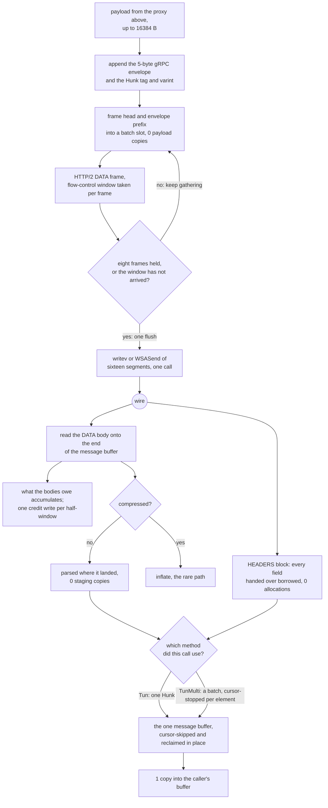

# The gRPC carrier

gRPC is the most expensive carrier in the matrix and it is expensive because of HTTP/2, not because of anything this tree does. What this tree controls is the envelope: a 5-byte gRPC length prefix, a compressed-flag byte, and a protobuf `Hunk` carrying one `bytes Data = 1` field. There is no chunking in the envelope — one `Hunk` is exactly one buffer that came from above, at most `HUNK = 16384` bytes.

Write never touches the payload. The 5-byte gRPC envelope and the `Hunk` tag and varint are assembled in a small prefix buffer, and the caller's payload is handed to HTTP/2 as a separate frozen slice beside it — a frame's head and envelope prefix in a batch slot of their own, its payload still the caller's slice — so the bytes the proxy passed down are the bytes the socket carries, and no payload byte is staged into a message buffer first. Before this shape the payload was copied into a `Hunk`, then into an envelope, then once more per flow-control window; none of those copies survive here.

Those frames do not leave one at a time either. A caller write's frames are gathered and flushed as one vectored call, so a relay's full `64 KiB` read — four hunks, eight DATA frames, sixteen segments — is one `writev` on unix and one `WSASend` on Windows, where a read of four hunks used to cost eight socket calls on unix and twenty there, a frame having been sent part by part wherever the platform had no `writev`. A batch never waits on credit it has not been given: the window is still taken per frame, and when it is not there the gathered frames go out first, because a peer grants for bytes it has seen.

Read has one buffer. A DATA frame's body is read onto the end of the message buffer, the envelope and the `Hunk` are parsed where they landed, and the payload is delivered out of that buffer at the offset the parser found — so a byte is copied twice on the way through: once into user space by the socket read, once into the caller's buffer. What a body owes the peer accumulates instead of leaving: one credit pays for the bodies that landed since the last one, as the two `WINDOW_UPDATE` frames — eighteen constant header bytes differing only by stream id and the increment — in one write, and it is owed once half the advertised window has arrived. That grant only holds because the preface pays the peer the whole connection window at once, since a batched credit cannot be the thing that raises it. The cursor skips the protobuf fields this lane does not read without moving them, and the dead prefix is reclaimed before the next body is appended, which is what keeps one buffer enough. There is no second buffer to stage into and no backlog to join one to.

One listener serves both methods the service defines. `rpc Tun` streams a `Hunk` — one `bytes Data = 1` — and `rpc TunMulti` streams a `MultiHunk`, whose field 1 is `repeated bytes`, so one message carries the batch a writer's `WriteMultiBuffer` holds: Xray's server reads the echo through a `readv` reader that doubles up to eight 8 KiB buffers and puts one element per buffer into a single message (`transport/internet/grpc/encoding/multiconn.go:115-134`). A served call's method is the `:path` it used — the configured path, or the same path with `TunMulti` for the last segment — because the two shapes cannot share a decoder: a `MultiHunk` read as a `Hunk` hands the caller only the last element of every message, which is a silent truncation rather than an error. The mode is the caller's choice, not the listener's, the way Xray's hub registers both handlers from one config (`transport/internet/grpc/hub.go:124`). In multi mode the cursor stops being per-message and becomes per-element: an element's own bytes end exactly where the next element's key begins, so a batch is delivered from the one message buffer in order, element by element, with no staging move — `8` on the batched row is eight 8 KiB elements arriving from two messages, and its `0` is the same `staged` counter the single-mode rows use. What is not here: this lane still writes one element per message, and the batch a `WriteMultiBuffer` holds is not gathered into one message, so the batching win is only on the side that receives it. The dial side is a second gap, and it is the wider one. `grpcSettings.multiMode` is read nowhere in the tree, and the method names are not derived the way the reference derives them from one service string (`transport/internet/grpc/config.go:16`, `:36`, `:48`): an old-school service is escaped whole and its streams are `Tun` and `TunMulti`, an empty service keeps its empty segment (`//Tun`, `//TunMulti`), and a custom path names the service in every segment before the last and the streams in the last one, split on `|` when both are named. This tree writes `/Tun` for the empty service, hands a custom path back verbatim, and derives the multi name by replacing the last segment of the configured path with `TunMulti` — the old-school spelling, and the wrong one for a custom path. The reference picks the client decoder from the config rather than from the path (`transport/internet/grpc/dial.go:60-69`); this tree picks it from the path, so a peer that answers the multi path hands a `MultiHunk` to a `Hunk` reader and the caller sees only the last element of every message — a silent truncation rather than an error. A working derivation and a multi-mode dial are on the local `option1` branch (`b37bbc9`), with `grpc::tests::a_multi_mode_dial_asks_for_the_multi_path_and_reads_the_batch` and `proxy::tests::a_grpc_service_name_is_escaped_the_way_xray_escapes_it` as its gates; it is a port candidate, not a landed diff, and the writer's one-element-per-message gap is still open in it.

## Data path



## Measured

<!-- counts:begin -->
| key | value | checked by |
| --- | --- | --- |
| ops-retired-instructions | UNBLESSED | scripts/count-ops.sh |
| hunk-payload-bytes | 16384 | ferrox-app-grpc::tests::hunks_carry_the_xray_schema_bytes |
| user-space-copies-per-byte-written | 0 | ferrox-app-grpc::tests::the_uplink_hands_the_payload_to_the_writer_by_pointer |
| writes-per-relay-read | 1 | ferrox-app-grpc::tests::a_relay_read_gathers_its_frames_into_one_write |
| segments-per-socket-write | 16 | ferrox-app-grpc::tests::a_relay_read_gathers_its_frames_into_one_write |
| payload-runs-per-socket-write | 8 | ferrox-app-grpc::tests::a_relay_read_gathers_its_frames_into_one_write |
| payload-staging-copies-per-byte-read | 0 | ferrox-app-grpc::tests::a_body_never_lands_in_a_second_buffer |
| message-bytes-moved-per-padded-frame | 0 | ferrox-app-grpc::tests::a_padded_frame_opens_a_message_without_moving |
| credit-bytes | 2097152 | ferrox-app-grpc::tests::a_credit_grants_the_window_it_owes_in_one_write |
| window-update-writes-per-credit | 1 | ferrox-app-grpc::tests::a_credit_grants_the_window_it_owes_in_one_write |
| window-update-frames-per-credit | 2 | ferrox-app-grpc::tests::a_credit_grants_the_window_it_owes_in_one_write |
| padded-frame-credit-octets | 0 | ferrox-app-grpc::tests::a_padded_frame_credits_its_whole_wire_payload |
| connection-window-credit-at-preface | 4128769 | ferrox-app-grpc::tests::the_preface_grants_the_peer_a_whole_window |
| pinned-threads-per-silent-preface | 0 | ferrox-app-proxy::tests::a_silent_peer_cannot_pin_a_grpc_preface |
| pinned-threads-per-silent-request-head | 0 | ferrox-app-proxy::tests::a_silent_peer_cannot_pin_a_grpc_request_head |
| pinned-threads-per-silent-vless-request | 0 | ferrox-app-proxy::tests::a_silent_peer_cannot_pin_a_grpc_vless_request |
| pinned-threads-per-silent-tls-request | 0 | ferrox-app-proxy::tests::a_silent_peer_cannot_pin_a_grpc_tls_vless_request |
| pinned-threads-per-silent-trojan-request | 0 | ferrox-app-proxy::tests::a_silent_peer_cannot_pin_a_grpc_trojan_request |
| pinned-threads-per-silent-vmess-request | 0 | ferrox-app-vmess::tests::a_silent_peer_cannot_pin_a_grpc_vmess_request |
| pinned-threads-per-silent-shadowsocks-request | 0 | ferrox-app-shadowsocks::tests::a_silent_peer_cannot_pin_a_grpc_shadowsocks_request |
| pinned-threads-per-silent-2022-request | 0 | ferrox-app-shadowsocks2022::tests::a_silent_peer_cannot_pin_a_grpc_shadowsocks2022_request |
| message-buffer-reallocations-per-same-sized-frame | 0 | ferrox-app-grpc::tests::the_message_buffer_is_reused_not_reallocated |
| reclaim-moves-per-drained-buffer | 0 | ferrox-app-grpc::tests::the_message_buffer_is_reused_not_reallocated |
| batched-elements-served-per-message | 8 | ferrox-app-grpc::tests::a_batched_downlink_arrives_element_by_element |
| grpc-methods-served-per-listener | 2 | ferrox-app-grpc::tests::one_listener_serves_both_methods |
| header-field-copies-per-head | 0 | ferrox-app-h2::tests::a_plain_field_borrows_the_block |
| table-entry-copies-per-indexed-field | 0 | ferrox-app-h2::tests::an_indexed_field_borrows_the_table |
| decoder-buffer-writes-per-borrowed-field | 0 | ferrox-app-h2::tests::a_borrowed_block_leaves_the_scratch_alone |
| header-field-allocations-per-inserted-field | 2 | ferrox-app-h2::tests::an_indexed_field_borrows_the_table |
| header-block-allocations-per-frame | 1 | ferrox-app-h2::tests::a_header_block_is_opened_once |
<!-- counts:end -->

`payload-staging-copies-per-byte-read` is the reader's own `staged` counter, the shape `xtls-vision` uses: it counts the bytes this lane moves for itself, which are the only copies a byte test cannot see. It is driven from an in-memory server that answers whole frames, over the three shapes a body can arrive in — one message per frame, two messages in one frame, one message split over frames. The `0` on the padded row is that gate's own message opened behind a pad byte: the parser steps over the byte and the frame's length drops the tail, so nothing moves; a second padded test cuts a pad byte into a message the frame before had started and shows the counter at `5`, the move that shape still pays. `reclaim-moves-per-drained-buffer` counts the reclaim *calls* that copy live bytes — the operation `staged` cannot see, because a fully drained buffer leaves an empty run that is zero bytes moved either way. A caller that takes each whole `HUNK` before the next arrives leaves nothing live, so the reclaim is a `clear` and the counter holds at `0` over three `HUNK` frames in `the_message_buffer_is_reused_not_reallocated`, the same test that gates the buffer's capacity as steady. The three credit rows come from one test over an in-memory peer that keeps each write it was given: full `HUNK` bodies are delivered and counted, and the test fails if a credit leaves before `credit-bytes` of bodies have landed, if the grant is more than one write, or if that write is not the peer's two frames with the increment of every body since the last grant — `128` frames of `16393` bytes per credit, on a downlink of full hunks, where the lane used to write one pair per frame. The preface row is read off the first write both halves of a call make: the setting and the `WINDOW_UPDATE` on stream `0` that lifts the connection to the window the setting advertises, which is the grant a batched credit rests on. The eight `pinned-threads` rows are one serve thread each, watched through a channel: a peer that opens and never speaks, one that sends the `24`-octet preface and stops, and six that dial a real gRPC client, answer the head, and never send the opening request — for `vless`, for `trojan`, `vmess`, `shadowsocks` and `shadowsocks-2022` each decoding its own head, and one through a TLS session, where `accept_split` answers the head and only the request's own clock is left to end the flow. The `0` is a give-up at `budgets::handshake()` rather than a race, and each row was audited by taking its own arm away first — the preface read's deadline, the pump's, the reader's, then the session caller's — and reading the test fail at its `15s` bound. The five plaintext rows share one arm, `proxy::under_handshake`, so the control that audits them removes it once and the five fail together; `accept` hands the caller a reader whose poll and clock it has already cleared, and a protocol that then reads its own request through it would wait unbounded. The session row needs no socket arm: the dispatchers behind it already poll the session's socket at `RELAY_POLL`, so the read answers on a grain and it is the deadline that turns the silence into a refusal. The batched row counts the elements one `TunMulti` message hands over before the caller sees a gap: eight 8 KiB elements in two messages, each element delivered from where it lay, so the row's `0` is the same `staged` counter and the eight 8 KiB runs are the assertion that no element was dropped or reordered — the failure `hunk_decode` would give is the last element of each message and nothing else. The methods row is served from a scripted wire: `Tun` with a `Hunk`, `TunMulti` with a batch, and a third path that is neither and is refused. The four header rows are the decoder handing a block's fields over borrowed rather than built: `header-field-copies-per-head` records the address every field arrives at and fails unless it lies inside the block the caller passed, at the offset where that field's own bytes are. `table-entry-copies-per-indexed-field` requires the pair a dynamic entry is and the pair the consumer was handed to be the same two addresses — once for the insert that made the entry, once for the index that names it afterwards. `decoder-buffer-writes-per-borrowed-field` warms the decoder's Huffman buffers, then reads a block of one index and one plain literal, and fails if either buffer's pointer or capacity moves or either ends the block holding bytes. The inserted row is the `2` those two allocations still cost: a name and a value the table keeps after the block is gone. The three write rows are one test over the same in-memory peer, given a full relay read of four `HUNK`s: it counts the writes the batch cost (`1`), the segments the one write carries (`16`, a head slot and a payload run for each of the eight frames) and how many of those runs are the caller's own buffer (`8`, edge to edge, no gap and no byte twice), and it compares the whole batch against a frame-by-frame reference built at the same `max_frame`, so a gather that reordered or restaged a frame fails as different bytes rather than as a count. `a_wide_batch_reaches_a_real_socket_whole` puts the same sixteen segments through a real socket, which is where a platform that split the list or refused its width would show it — as missing bytes, the only thing a loopback test can assert. Neither is a count the socket can gate: `writes-per-relay-read` is driven from the in-memory peer, exactly as `window-update-writes-per-credit` is. `a_gathered_batch_flushes_before_a_window_that_has_not_arrived` is the deadlock witness the batch needs and does not carry a row: a peer grants for bytes it has seen, so frames held in a batch cannot wait behind the window only those frames would raise, and the test watches a real write appear while the writer thread is still parked inside the same `send`, then joins it once the credit arrives. None of those numbers is a duration, and `## Time` says why.

## Ops

```bash
./scripts/count-ops.sh report \
  grpc::tests::the_envelope_and_the_hunk_cost_their_loops_and_nothing_else \
  grpc::tests::the_envelope_and_the_hunk_cost_their_loops_and_nothing_else
```

`UNBLESSED`, as above. The row is a probe, not a fixture test: the two per-message math steps — a gRPC envelope assembled and a `Hunk` parsed — over buffers the compiler cannot fold, so the frame is the loops and the methods and the number is read as the difference between two runs of the same row, never as the cost of a method alone.

## Time

Measured on CI only, where the run is paired against xray-core on the same runner: `benchmark-matrix.yml`, `full` tier, `vless-grpc-down-8` — 8 connections streaming `16384` hunks of `65536` B, 8 GiB down, 5 repeats.

| run | what it was | ferrox, median of 5 | xray-core in the same cell |
| --- | --- | --- | --- |
| 38968303906 | `main`, machine-matched control | 10.09 s (`10.08`–`10.39`) | 9.09 s, throughput ratio `0.903×` WORSE |
| 38967309360 | one credit per half-window instead of per frame | 3.81 s (`3.71`–`6.03`) | 9.73 s, throughput ratio `2.405×` better |

The 8 GiB downlink took 2.7 times less wall clock for 128 times fewer credit writes, and the comparator's own time moved by less than a second between the two cells, so the difference is this carrier's write count and not the runner. The after cell's harness ceilings are `1528`–`2270 MiB/s` against ferrox's `2153`, which is why the ratio is read as a floor.

The same workload on the runner this tree loses on, `windows-latest`:

| run | what it was | ferrox, median | xray-core in the same cell |
| --- | --- | --- | --- |
| 39008558717 | `main`, control for the gathered batch, 3 repeats | 25.9 s (`24.0`–`27.7`), `9955` ms/GiB cpu | 21.3 s (`19.9`–`23.8`), `7633` ms/GiB, throughput ratio `0.838×` WORSE, cpu ratio `0.749×` WORSE |
| 39001299614 | `main`, the nightly control, 3 repeats | 12.9 s (`12.9`–`13.4`), `5568` ms/GiB cpu | 9.69 s (`9.32`–`9.79`), `3654` ms/GiB, throughput ratio `0.735×` WORSE, cpu ratio `0.652×` WORSE |
| 39053349255 | the gathered batch, 5 repeats | 9.10 s (`9.07`–`9.47`), `3385` ms/GiB cpu | 19.8 s (`19.6`–`24.8`), `7580` ms/GiB, throughput ratio `2.263×` better (`2.116`–`2.506`), cpu ratio `2.338×` better (`2.226`–`2.548`) |

The whole of that gap is kernel time: ferrox spends `9473` ms/GiB in the kernel and `482` in user on this runner, against `1519` and `108` for the same code on ubuntu, where the same cell is `2.115×` better than xray-core. Windows has no `writev`, so a frame there was five `send` calls and a GiB was `327_680` of them; `zeronet`, at `8.35 s` and `3240` ms/GiB in the same cell, is the bar this platform sets for the carrier.

The after cell is the third run, and it reads better: against the nightly control's split, ferrox's own median on this platform goes from `5291` to `3188` ms/GiB in the kernel and from `277` to `197` in user, so the buy-back is the kernel half, which is where the five `send` calls per frame were paid. `zeronet` in the same cell is `8.21 s` and `3240` ms/GiB — `1.11×` this carrier's time and `1.04×` its cpu, against the nightly control's `3.0×` and `3.4×` behind that bar. The three cells above are three different machines and the comparator's own time moved with them (`9.69 s` to `19.8 s`), so a ratio is read inside a cell and never across two of them; `kernel calls per GiB` stays `UNPROVEN` on Windows, where there is no `/proc` to read, so the call count here is the page's arithmetic and the ratio is the CI number, not the other way round.

The machine-independent witness is on ubuntu, where the row's checker is `/proc/<pid>/io` `syscw`. Ferrox's writes per GiB go `101_477` (`88_505`–`116_082`) → `51_333` (`48_448`–`59_492`) on x86_64 and `80_107` → `51_041` on aarch64, while xray-core in the same two cells is flat at `219_704` → `218_832` and `219_521` → `219_626`. The tally names `write` and `writev` and not the `recv` half of the route — `syscr` reads `0` for every ferrox run — so what it shows is a halving of a lower bound, and the bound it cannot see is the reason `32×` arithmetic and this number are not the same number. The four runners of the after run all gate better than the reference: `macos-15` `1.849×` (`1.415`–`2.413`) and cpu `1.984×`, `ubuntu-latest` `2.163×` and `1.938×`, `ubuntu-24.04-arm` `3.386×` and `3.446×`, 5 pairs each. Ferrox's own ubuntu throughput in those cells is `2348` → `2433` MiB/s, and its ratio there moves with the comparator's machine, not with this change.

Still open: `tunnel_carries_an_echo_over_loopback` is the flakiest loopback test in the tree — the roadmap records it failing 23 times in 200 runs with nothing else running, where `read_body` sees EOF after a 9-byte frame header, which is a torn write or an RST with data queued rather than a framing error.

## What we removed

- **A credit that forgot the padding.** RFC 7540 6.9 puts the whole DATA payload into the flow-control window, the Pad Length octet and the Padding included, but the credit was what the cut left, so a padded frame gave the peer back `1 + pad` octets fewer than it had sent. A peer that keeps a strict window loses that much a frame, and a long flow loses its window and stalls. The credit is the wire length now, and `a_padded_frame_credits_its_whole_wire_payload` is the witness: it reads the `WINDOW_UPDATE` increments off a padded frame and holds them at the frames' wire length, where the cut's length is what the credit used to carry. What did not move: the bytes on the wire, and the padding's own cut — the payload still arrives trimmed, and the credit is what the frame cost the peer, not what the payload was worth.
- **A grown header block.** The HPACK literal block was written into a buffer that started empty, so a head with a few fields reallocated it a few times before it held them. The block's own length is known before it is written — the never-indexed prefix, the two length prefixes and the two runs of bytes — so the buffer is opened once at that length. The counting allocator is the witness: `a_header_block_is_opened_once` holds the block at one allocation and at its own length, where the grown shape paid four. The bytes on the wire do not move: the same literals are written in the same order, and the xHTTP lane's head rides the same coder.
- **The envelope chain.** Xray's `transport/internet/grpc/encoding/hunkconn.go` copies the hunk into the caller's buffer on every `Read` (`:68-82`), adopts the protobuf's slice only when `cap(h.buf) >= buf.Size` (`:97`) and copies otherwise, and allocates a `&Hunk{...}` per write (`:108-118`). The HTTP/2 side then does its own copy into a 32 KiB `bufWriter` (`grpc@v1.84.0/internal/transport/http_util.go:328-353`), and the read side allocates a fresh buffer per DATA frame (`:545-556`). sing-box's `transport/v2raygrpc/conn.go:37-52` does `copy(b, hunk.Data)` into the caller's buffer and stashes the tail in a cache, through grpc-go, so a `Hunk{Data: b}` is a protobuf marshal per write.
- **The quadratic drain.** Consuming a pending buffer with `Vec::drain` moves every remaining byte for every message, so a burst of N messages in one window costs O(N²) bytes moved. One cursor consumes the message buffer, and the reclaim that keeps it bounded moves only what is still live, once per appended body.
- **The reader's own staging hop.** Until this page's read rows were written the way they read now, the path was socket → frame scratch → message buffer → backlog → caller: the DATA body was `extend`ed into `msg`, `hunk_decode` borrowed it, and the very next statement copied that borrow into a backlog because the caller had not asked for it yet. Two of those three moves are now gone — the body is read straight onto the end of `msg` and the payload is delivered where it lies — which is what `payload-staging-copies-per-byte-read 0` counts. `user-space-copies-per-byte-read 1` was the row before, and no test observed it: `tunnel_carries_an_echo_over_loopback` is a byte test, and a byte test cannot see a copy. It is replaced by the counter, not re-blessed.
- **A second allocation per message.** The message buffer is reused across writes, and the HTTP/2 layer takes it by `split().freeze()` so the refcount, not a copy, is what crosses the boundary. On the read side the same buffer now serves every frame, gated by `message-buffer-reallocations-per-same-sized-frame 0`.
- **The write-side copy that was never there.** `user-space-copies-per-byte-written` read `1` and named `hunks_carry_the_xray_schema_bytes`, a byte test that cannot see a copy — the bytes are identical whether the payload is staged or handed straight to the socket. The carrier already assembles the frame header, the envelope prefix and the caller's payload as three separate slices and passes them to a `writev`, so the true count at this layer is `0`. The row is not re-blessed to a nicer number: it is given the witness it never had — `the_uplink_hands_the_payload_to_the_writer_by_pointer` records the base of every slice that reaches the frame writer and fails unless one of them *is* the caller's buffer, at the payload's full length.
- **The second write per credit.** A credit is two `WINDOW_UPDATE` frames, one for the connection and one for the stream, and each was built and written on its own. Their eighteen header bytes are constant and only the stream id and the increment differ, so both come out of one 26-byte template in a single write — the same two frames, in the same order, one write syscall fewer per DATA frame. What this leaves alone: `xhttp_h2`'s `replenish` credits the same pair as two frames over two writes, and its page owns that row.
- **The credit per frame.** A downlink of full hunks is `65_536` messages per GiB, and every one of them was credited and locked as it landed: `65_536` writes of `26` bytes and `65_536` takes of the frame-write mutex, beside the `131_072` writes that carry the payload — two DATA frames per hunk at the `16_384` this lane advertises. Bodies now add to a counter and one credit pays the counter when it reaches half the advertised window, so a GiB costs `512` credit writes and `512` locks — `128` messages per credit by the arithmetic on the page's own `hunk-payload-bytes` and `credit-bytes` rows, witnessed message by message by `a_credit_grants_the_window_it_owes_in_one_write`. The two windows can only be batched because the preface pays the peer the connection window that setting implies: one `13`-byte `WINDOW_UPDATE` on stream `0` per connection, added where the settings already went, in the same write. What is not flushed: a credit that has not reached `credit-bytes` when the stream ends is never sent, because the peer still holds at least the other half of the window and can fill it without waiting — the bound the same test reads off its own measured increment.
- **The socket call per frame.** The same `131_072` frames per GiB each took the frame-write mutex and made a call of their own: `2` per hunk on unix, where a frame went out as head and body in one `writev`, and `5` per hunk on Windows, where there is no `writev` and the parts were sent one `send` each — head, envelope, payload. Both cost one call per relay read, so a GiB down this lane pays `16_384` calls and `16_384` mutex takes against `131_072` of each at the hunk width on unix: `8×` fewer calls, `20×` on Windows, and every call carries sixteen segments rather than two or five. That is the shape of the loss the `## Time` cell prices: `95%` of this carrier's Windows cpu is kernel time, against `93%` on ubuntu at six times less of it per call, so the platform's per-call cost is exactly what the call count buys back here. What it costs: `8` slots of `25` bytes live on the stack for a caller write — `200` B written once per write, `0.3%` of the bytes that write carries — and a frame that is not the last of its batch reaches the socket when the batch fills, when the credit is short, or when the write ends, which is what the flush-before-park witness above gates. What is not removed: the frames. Two DATA frames per hunk is what `16_384` advertises on the wire, and merging them would mean a larger `MAX_FRAME_SIZE`, which changes the bytes the peer sees rather than the calls this side makes.
- **The pair per header field.** `Decoder::decode` used to answer with a `Vec<(Vec<u8>, Vec<u8>)>`: a name and a value allocated for every field of every block, which the consumer then read from and dropped. gRPC's `headers()` built one to look up four fields — `:status`, `:path`, `:method`, `content-type` — and xHTTP/H2's `open_stream` built one to take `:method` and `:path` out of it and re-emit the rest as head lines. The block now walks itself and hands each field to the visitor as it is read: an index gives up the table's own entry, a plain literal gives up the block's own run, so a field that is only read costs neither an allocation nor a copy. gRPC keeps four `Option<bool>` judged as the fields pass, and xHTTP/H2 keeps the one head buffer it was going to write anyway — sized for the bytes it carries, and its page owns that row. What is not removed: the two allocations an inserted field costs, because the dynamic table outlives the block, and one copy into the decoder's warm buffer for a Huffman-coded string, which is what the `## Measured` capacity gate is written against.
- **The head no peer could be refused by.** This was the only vless carrier whose opening read carried neither a poll quantum nor a wall clock: a peer that connects and says nothing, or sends the `24` octets of preface and stops, or completes the handshake and never sends its first hunk, held a relay-pool thread forever — and behind a TLS session the same stall wore a fourth shape, because `accept_split` answers the head and clears its own clock before handing the reader over, so `serve_session_grpc`'s request decode ran polled at the relay's grain with no clock, which is the pair that retries forever. Arming a quantum alone would have made it worse — `proxy::read_exact` retries a timeout by design, so a `20ms` grain with no deadline is `50` wakes a second forever — which is why the clock lives inside the reader as it does for `ws`: each of the four phases now reads under `budgets::handshake()` and is cleared again where its head ends, so the relay behind it waits blocking exactly as it did. What it costs: `4` `setsockopt` calls per accepted vless-over-gRPC flow, arm and clear at the preface and at the request head, and up to `500` wakes for a peer that never speaks. The session arm costs no `setsockopt` at all: `serve_vless_tls` and `serve_vless_reality` poll the socket under the session at `RELAY_POLL` before the handshake, so the reader only needs the clock to turn a grain into a refusal. What is armed by one function now: `proxy::under_handshake` holds the poll and the clock across one decode and puts both away on the way out, and the five plaintext reads of this carrier — `vless` and the four protocols that decode their own head behind `accept` — run through it, so the arm a caller cannot forget is the arm that does not leak. What is not unified: the http carriers' request head still runs on `budgets::head_arrival()`, because that budget names an HTTP request arriving, while this one is the carrier's opening read — the budget `serve_vless_raw` already bounds its own opening read with. What is not armed here: the `ws`, `xhttp`, `httpupgrade` and `http-header` carriers each hand their caller a reader they have already disarmed, so the same four protocols wait unbounded behind those four — `P13`'s deep-retry add-on holds the list.

What is **not** removed: HTTP/2's own framing. `T_DATA`, `T_HEADERS` and `T_SETTINGS`, HPACK and the flow-control window are the cost of the carrier, and they are the same cost Xray and sing-box pay. The 32 KiB HTTP/2 write buffer and the 4 MiB session window are named here rather than claimed as ours. Nor is the copy into the caller's buffer: a `Read` has to fill the caller's `&mut [u8]`, and that is the `1` the `## Data path` graph ends on. Two moves still survive the staging removal, and both are counted rather than hidden. A caller that leaves a payload in the buffer while the next frame arrives pays one reclaim move of what it has not taken. A pad byte that cuts into a message the frame before had started still moves what follows it down, because those bytes have to become contiguous for the parser; a pad byte that opens a message region costs a cursor step instead, which is the `0` on the padded row. `staged` counts both, which is the only reason the zeros mean anything. One accounting gap is named rather than fixed: a credit is the DATA body less its pad byte and pad tail where RFC 7540 §6.9.1 counts the whole body, so a padded frame leaves that many bytes of window unreturned — conservative, and never taken back.

## Pins

| what | where |
| --- | --- |
| `Hunk` encoding, per-write allocation, 32 KiB bufWriter | `upstream/xray-core/transport/internet/grpc/encoding/` |
| `MultiHunk{repeated bytes}`, `WriteMultiBuffer` batching into one message | `upstream/xray-core/transport/internet/grpc/encoding/multiconn.go` |
| `copy(b, hunk.Data)`, per-write protobuf marshal | `upstream/sing-box` → `transport/v2raygrpc/conn.go` |
| one in-place assembly, `advance` instead of `drain` | `upstream/zeronet/crates/zero-transport/src/grpc.rs` |

## CI scope

What a change here owes, read by `scripts/ci-scope.py`; see [`docs/ci-scope.md`](../ci-scope.md).

<!-- scope:begin -->
- paths: crates/ferrox-app/src/grpc.rs, crates/ferrox-app/src/h2.rs
- symbols: grpc, h2
- scenarios: vless-grpc, vless-tls-grpc, vless-reality-grpc
- oracle: grpc
- go: ./transport/internet/grpc/...
<!-- scope:end -->
