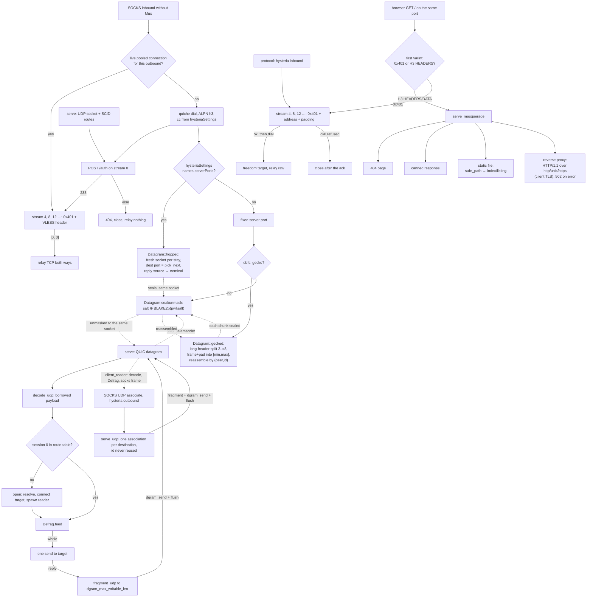

# The Hysteria carrier

Hysteria v2 is a **both-roles, both-shapes** row. As the transport it dials from a SOCKS inbound without Mux and serves a `streamSettings` inbound that names a `tlsSettings.certificates[0]` chain, carrying the inner protocol (VLESS) on each `0x401` stream. As the protocol it serves a `protocol: hysteria` inbound: the stream's request itself names the destination as a varint string, the server acknowledges before it dials, and a refused dial closes after the acknowledgement. Both run over quiche — the default QUIC stack for this rung, pinned at `upstream/quiche` for reading. Every served connection also carries the QUIC datagram lane: the auth response advertises `hysteria-udp: true` the way the reference does whenever a validator is present — and a served connection always has one — so the lane is on rather than negotiated, and no branch of it is dead config. An inbound that names `tlsSettings.obfs: salamander` masks every datagram of that lane: an 8-byte random salt then the QUIC packet XORed against `BLAKE2b-256(password || salt)` tiled at `key[i mod 32]`, applied at the `quic::Datagram` seam so no handshake, frame or stream above it changes. Salamander is the only mask carried, and `gecko` is the one variant that rides on top of it; any other named obfs, or a password below the 4-byte floor the reference accepts, is refused as `Unknown` rather than silently sent in the clear. The masked lane is proven end to end by `hysteria_carries_a_flow_through_salamander_over_loopback` — the same dial-and-echo path as the cleartext gate, over a salamander socket on both ends, which only completes if the salted seal and the in-place unmask agree.

The wire shape is small: every TCP flow is one client-bidirectional QUIC stream opening with the `0x401` varint, and the connection opens with an HTTP/3 `POST` to `/auth` carrying `hysteria-auth`, answered `233`. `ferrox-core::hysteria` owns those bytes and proves them bit-exact (`ferrox-core-hysteria::*` unit tests); `ferrox-app/src/hysteria.rs` owns the sockets: a `Router` keyed by server SCID on the serve side, and on the dial side one authenticated connection per outbound, pooled and reused for every flow it can carry — stream 4, 8, 12 … — the way the pinned client multiplexes (`max_tcp_streams: 64`; this tree caps at quiche's `MAX_STREAMS`). The datagram lane rides the same pooled connection: on the serve side one association per `BE32 session` id, keyed in the route's table, relayed to its connected target socket through `ferrox-core-hysteria`'s codec (`decode_udp` borrows the payload out of the arrived datagram; `a_decoded_datagram_leaves_its_payload_where_it_landed` is the pointer-identity witness), reassembled by `Defrag`, and reaped after `UDP_IDLE` (60 s, the reference's `udp_idle_timeout`) or the connection's close — a UDP socket has no shutdown to wake a blocked read, so the reply-path reader threads end on the `UDP_POLL` (1 s, the reference's cleanup tick) timeout watching the stop flag the reap sets. The dial side answers that lane in its own small shape: `serve_udp` relays a socks5 UDP association over a connection of its own — the pool is a TCP instrument, and a stale connection carries a datagram into a silent blackhole with no reply deadline to catch it — one destination at a time, each stamped with a session id the connection never reuses, the writer holding the connection lock once per datagram and a companion reader driving it with `drive_once` — so the client's UDP flows are this carrier's row, not a cross-cutting gap: `hysteria_udp_lane_carries_a_datagram` witnesses the lane off the front and `hysteria_carries_a_udp_association_over_the_carrier` through the full socks dispatch. A pooled connection is reused within half the server's 300 s idle timeout, dropped when it stops taking application data (closed, draining or carrying a close), goes stale or runs out of streams, and a dial with no live pool entry pays a fresh handshake: `hysteria_shares_one_connection_between_two_flows` witnesses one handshake carrying two echoes on the `HANDSHAKES` counter, and `hysteria_redials_when_a_pooled_connection_closes` the fresh handshake after `close_pooled`.

A wrong password is refused with `404` then `CONNECTION_CLOSE` and relays nothing: `hysteria_refuses_a_wrong_password_without_relaying` is the gate. Settings parse with guarded fallbacks — unknown congestion spellings pace as `bbr`, and only `version: 2` or absent names this carrier, anything else is `Unknown`: `hysteria_settings_parse_with_guarded_fallbacks` is the gate. The full path, dial plus auth plus one VLESS echo, is `hysteria_carries_vless_echo_over_loopback`, and the UDP lane's full path — advertisement, association open, fragment, defrag, target echo, reply frames — is `hysteria_carries_udp_echo_over_loopback`, both serialised on the shared QUIC mutex and retried like the other loopback socket tests, because a socket test that passes twice and fails the third is testing the scheduler. The protocol shape's gate is the pinned one: `xray-rust-hysteria` in `upstream/pins.toml` runs the pinned client's wrong-password and failed-destination verdicts against `ferrox-app` in `scripts/run-upstream-suite.sh`, which is also where the server's SETTINGS-before-auth order is proven — the pinned client's H3 stack posts its auth only once the server's SETTINGS arrive.

A browser that stumbles on this port with a plain `GET /` is answered rather than refused: the masquerade site serves an ordinary HTTP/3 request on the *same* connection hysteria rides. The classifier is a stream's first varint — `0x401` names a hysteria flow and relays as before, while an HTTP/3 `HEADERS`/`DATA` frame (`read_tcp_prefix` returning `None` beside those types) is a browser and goes to `serve_masquerade`; on stream 0 the same split keys on request shape — a `POST` to `/auth` is the handshake and anything else is the cover — proven apart by `the_flow_frame_tells_hysteria_from_a_browser_request` and `a_browser_get_parses_to_method_path_and_authority`. Four cover answers match the reference's `masq` — the default `404` page, a canned `response` line, a static `file` directory and a `proxy` to an origin — every one built by `ferrox-core::hysteria`'s `encode_h3_response` (a `HEADERS` frame then a `DATA` frame) so the bytes are pinned without a socket. A right-shape, wrong-password hysteria attempt still refuses with `404` and closes exactly as a plain server would (`hysteria_closes_a_wrong_hysteria_password_even_with_masquerade`), so the cover never walks past authentication, and a browser `GET` beside a live flow is served while that flow still relays (`hysteria_still_carries_proxy_flows_beside_a_masquerade_get`).

A dial whose `hysteriaSettings` names `serverPorts`/`mport` (a comma spec or an array of ports and `start-end` ranges) and `hopInterval`/`hopIntervalMax` **hops its server port**: the destination moves among the expanded set every random stay, and the socket moves with it — a fresh local bind per move, so a filter or NAT sees a new flow rather than one long-lived one, the way the reference's `HoppingSocket` does. It lives at the same `quic::Datagram` seam as salamander, so only the destination port and the socket change and no handshake, frame or stream above is touched; a salamander seal still rides each hopped datagram. The plan is expanded, deduplicated and sorted once per dial in `ferrox-core::hysteria` (`Hop::ports`, `hop-port-set-expanded` 4 witnessed by `the_plan_expands_overlapping_ranges_into_one_sorted_set`), and the two decisions — never land back on the port just left (`pick_next`) and draw the next stay inside its window (`stay_ms`) — are pure functions of the port set, the port to avoid and one folded-in roll, so they are proven without a clock or an rng. The wire keeps one view of the peer: only the server's own address is rewritten, a datagram to any other target passes through, and a reply from any hopped port is turned back to the nominal port the connection was named for (`is_hop_port`) so QUIC above keeps accepting it — `hopped-reply-source-normalized` 1 witnesses that rewrite off a loopback listener, and `hopped-datagrams-delivered` 200 that a zero-millisecond schedule spreads a burst over more than one port with none lost. The old socket lingers ten seconds for its in-flight replies, and the plan joins the pool key (`hop-plan-pool-keys` 2: `a_hop_plan_is_its_own_pool_key`) so a hopped dial never rides a plain connection to the same address, nor the reverse.

An inbound that names `tlsSettings.obfs: gecko` fragments **and** masks: gecko is a fragment-plus-pad layer composed on top of salamander, so it shares the salamander key and the same `quic::Datagram` seam. A QUIC long-header packet (first byte `& 0x80`) is split into 2..=8 chunks, each wrapped in a 5-byte frame (`0x80`, a message id, `chunk<<4 | total`, a big-endian pad length) plus random padding drawn so the salamander-masked datagram — `salt(8) + frame(5) + pad + chunk` — lands inside a `[min, max]` window (defaults 512..1200, cap 2048), then sealed exactly as a plain salamander datagram; a short-header packet is masked whole and passes through. The receiver reassembles by `(peer, message id)`. The frame codec — `encode_gecko_frame`, `decode_gecko_frame`, `gecko_chunk_range`, `gecko_pad_len` — is pure `ferrox-core::hysteria` and proven bit-exact: the exact emitted bytes (`gecko-frame-bytes-encoded` 10, `a_gecko_frame_is_the_exact_bytes_ the_reference_emits`), a decode that borrows its payload out of the input with no refill (`gecko-frame-decode-copies` 0, pointer-identity), a forged or truncated frame refused with the buffer held, and a 1234-byte packet that fragments and reassembles byte-identical (`gecko-packet-reassembled-bytes`). The window parses from the sing-box `min_packet_size`/`max_packet_size`, their camel spellings, or the reference's `packetSize` range as an object or a two-element array (`gecko-window-forms-parsed` 3), and an unusable window is refused rather than carried as a plain salamander that would silently drop the fragmentation. A dial that both hops the port and geckos the framing is refused at `connect`, since neither alone carries the other's bytes. The whole split-and-reassemble round trip over a real loopback socket is `gecko-loopback-reassembled-bytes` 900 (`a_gecko_dial_reassembles_its_split_long_header`), which also witnesses that a long-header packet leaves the socket as more than one padded datagram.

## Data path



## Measured

<!-- counts:begin -->
| key | value | checked by |
| --- | --- | --- |
| ops-retired-instructions | UNBLESSED | scripts/count-ops.sh |
| tcp-flows-per-handshake | 2 | ferrox-app-proxy::tests::hysteria_shares_one_connection_between_two_flows |
| closed-connections-reused | 0 | ferrox-app-proxy::tests::hysteria_redials_when_a_pooled_connection_closes |
| request-parse-reallocations | 0 | ferrox-app-hysteria::tests::a_parsed_request_leaves_its_payload_where_it_landed |
| wrong-password-bytes-relayed | 0 | ferrox-app-proxy::tests::hysteria_refuses_a_wrong_password_without_relaying |
| non-v2-configs-carried | 0 | ferrox-app-proxy::tests::hysteria_settings_parse_with_guarded_fallbacks |
| datagram-lane-client-round-trips | 1 | ferrox-app-proxy::tests::hysteria_carries_a_udp_association_over_the_carrier |
| udp-datagram-decode-copies | 0 | ferrox-core-hysteria::tests::a_decoded_datagram_leaves_its_payload_where_it_landed |
| udp-fragments-witnessed | 200 | ferrox-core-hysteria::tests::every_length_survives_fragment_then_defrag_intact |
| udp-datagram-reassembly-allocations-per-whole-packet | 0 | ferrox-core-hysteria::tests::an_unfragmented_datagram_is_handed_over_without_a_buffer |
| obfuscated-datagram-heap-copies | 0 | ferrox-core-hysteria::tests::a_sealed_datagram_never_touches_the_heap |
| pinned-hysteria-client-verdicts | 1 | scripts/run-upstream-suite.sh |
| masquerade-answers-browser-on-same-port | 1 | ferrox-app-proxy::tests::hysteria_serves_a_canned_masquerade_response |
| masquerade-answer-allocations-per-response | 1 | ferrox-core-hysteria::tests::an_h3_answer_allocates_only_its_field_block |
| masquerade-file-bytes-served | 1 | ferrox-app-proxy::tests::hysteria_serves_a_file_from_the_masquerade_directory |
| masquerade-proxied-round-trips | 1 | ferrox-app-proxy::tests::hysteria_proxies_a_masquerade_request_to_an_origin |
| masquerade-escapes-served | 0 | ferrox-app-proxy::tests::hysteria_refuses_a_masquerade_path_that_escalates_the_directory |
| hop-port-set-expanded | 4 | ferrox-core-hysteria::tests::the_plan_expands_overlapping_ranges_into_one_sorted_set |
| hop-config-forms-parsed | 2 | ferrox-app-config::tests::a_hysteria_carrier_reads_a_port_hopping_plan |
| hop-plan-pool-keys | 2 | ferrox-app-hysteria::tests::a_hop_plan_is_its_own_pool_key |
| hopped-datagrams-delivered | 200 | ferrox-app-quic::tests::a_hopped_dial_spreads_its_datagrams_over_more_than_one_server_port |
| hopped-reply-source-normalized | 1 | ferrox-app-quic::tests::a_reply_from_a_hopped_port_reads_back_as_the_nominal_server |
| gecko-frame-bytes-encoded | 10 | ferrox-core-hysteria::tests::a_gecko_frame_is_the_exact_bytes_the_reference_emits |
| gecko-frame-decode-copies | 0 | ferrox-core-hysteria::tests::a_gecko_frame_decodes_its_payload_without_a_copy |
| gecko-packet-reassembled-bytes | 1234 | ferrox-core-hysteria::tests::a_fragmented_long_header_packet_reassembles_bit_identical |
| gecko-window-forms-parsed | 3 | ferrox-app-config::tests::a_hysteria_carrier_reads_a_gecko_window |
| gecko-loopback-reassembled-bytes | 900 | ferrox-app-quic::tests::a_gecko_dial_reassembles_its_split_long_header |
| masquerade-https-origin-served-bytes | 6 | ferrox-app-proxy::tests::hysteria_proxies_a_masquerade_request_to_an_https_origin |
| masquerade-https-untrusted-refusals | 1 | ferrox-app-proxy::tests::hysteria_refuses_a_masquerade_https_origin_whose_chain_is_untrusted |
| masquerade-unix-origin-served-bytes | 6 | ferrox-app-proxy::tests::hysteria_proxies_a_masquerade_request_to_a_unix_origin |
<!-- counts:end -->

## Ops

```bash
./scripts/count-ops.sh report proxy::tests::hysteria_carries_vless_echo_over_loopback \
  'hysteria::serve_loop' 'hysteria::drive_once' 'hysteria::serve_stream' \
  'hysteria::read_request' 'hysteria::auth_exchange' 'hysteria::open_pooled'
```

`UNBLESSED`, as above. `scripts/expected-ops.txt` still blesses exactly one symbol in the whole tree, `der_to_pem 2653`, which is a PEM formatting helper rather than a carrier. That is why the whole ops row in this table is open. All six symbols are rows in `scripts/method-ops.txt`, so `ops.yml` publishes their inclusive cost on every run — the functions whose first store to a receive or send buffer used to be a memset, and the pool path a shared flow rides. The datagram relay is under these rows' inclusive cost (`serve_loop` calls `drive`, which calls `relay_datagrams`); it has no `ops.yml` row of its own yet.

## Time

**Not measured yet.** Every duration in this repository comes from a named runner, and a number produced off a machine behind a VPN measures the tunnel. No CI artefact has been read.

## What we removed

- **The upstream UDP session machinery, rewritten smaller.** Both pinned implementations keep a UDP session manager with a per-direction message channel beside the streams (`conn.go:udpSessionManager`, `protocol/hysteria2` inbound/outbound UDP paths). This tree carries the lane as one `UdpFlow` per association — a connected target socket, the `Defrag` reassembly, and the idle reap — the parse, fragmenter and reassembly living entirely in `ferrox-core::hysteria`, proven by `every_length_survives_fragment_then_defrag_intact` (the 200-row sweep is `udp-fragments-witnessed`) and end to end by `hysteria_carries_udp_echo_over_loopback`, and on the dial side smaller still: one `Association` and one shared `Lane` per socks front — no manager, no channels, the reader a single thread riding `drive_once` — proven by `hysteria_udp_lane_carries_a_datagram` and `hysteria_carries_a_udp_association_over_the_carrier`. The reference's `MaxDatagramFrameSize: 1200` is not reimposed; fragmentation sizes to the peer's live `dgram_max_writable_len` instead.
- **The decoder's per-datagram payload copy.** The relay hands `decode_udp`'s borrowed payload straight to the target socket's one `send`; the pointer-identity test pins the base inside the arrived datagram, the buffer unmoved, the capacity ungrown (`udp-datagram-decode-copies` 0). What the lane still pays, named: quiche's `dgram_recv_buf` returns the datagram as an owned `Vec` — a copy inside quiche that borrowing the buffer would retire but moving it would not; the reply path's one `send` to the target and one `dgram_send` of the re-encoded head are the relay's own; and the reassembly holds its slots behind one owned address per flow, re-filled with `clone_into` rather than a fresh allocation.
- **An address copied and a payload staged to hand a whole datagram on.** `Defrag::feed` answered every whole packet with a `(String, Vec<u8>)` it built itself — `message.address.to_owned()` and `message.payload.to_vec()` — even when `frags == 1` meant no reassembly at all, so the common datagram paid two allocations and two copies before the relay put the bytes back into its own buffer. The answer is now borrowed: `feed` hands the message's own `&str` and `&[u8]` for a whole packet and takes a buffer to assemble into only for the fragmented case, where the pieces are not contiguous. `an_unfragmented_datagram_is_handed_over_without_a_buffer` pins both bases against the message's (`udp-datagram-reassembly-allocations-per-whole-packet` 0) and holds the window over 4096 feeds — 0 allocations, 0 bytes, 0 zeroed; staging the payload back into the answer turns the pointer assert red. What the lane still pays, named: quiche's `dgram_recv_buf` still returns the datagram as an owned `Vec` (one copy per arrival, inside quiche), the fragmented path still keeps one `Vec` per slot until assembly, and the client-side relay still copies the payload once into the socks5 reply frame because the header and the payload leave as one `send_to`.

- **A second delimiter walk in the origin-response parse.** `parse_origin_response` opened with `windows(4).position`, the four-byte weigh at every offset, and now reaches `foxy::head_end` — the tree's one eight-byte-at-a-time scan — so an origin's head is found the way this lane's own CONNECT answer finds it. The offsets and the `None` are unchanged, gated by `the_swar_terminator_scan_is_the_windows_four_scan` on [`carrier-foxy`](carrier-foxy.md); what the lane still pays is the rest of that parse, one `split` per header line.
- **A `String` for the code, and a joined field list ahead of the answer.** `encode_h3_response` began with `status.to_string()`, then built a `Vec` of pairs one longer than the caller's headers to put `:status` in front of, then handed that list to `qpack_literal_many` — an allocation each for the string, the list and the block, and a fourth when `Vec::with_capacity(32 + 16 * headers.len())` undersized the block a three-name head actually writes — 16 384 allocations and 1 191 936 bytes over 4096 answers, measured by running that body against the window below. The digits now land in a stack array, `hpack::qpack_open` and `hpack::qpack_field` write each line straight into the block, and `hpack::qpack_field_len` sizes that block to the bytes it will hold. `an_h3_answer_allocates_only_its_field_block` pins 4096 allocations and 274 432 bytes over 4096 answers — one block of exactly the size the fields need (`masquerade-answer-allocations-per-response` 1), the caller's own buffer pinned at one `as_ptr` and `capacity` across all 4096 so the answer provably never moves or grows it, and `an_h3_response_is_headers_then_data` that the same `:status` and the same field values come back off the wire. What the answer still pays, named: the block itself — one buffer per response, retireable only by writing the frame into the caller's `out` and patching its varint length afterwards.
- **Salamander's pre-allocated key buffer and separate output.** Both references build `password || salt` into a fresh slice, hash it, then write a new masked buffer. This tree streams the two parts into one `BLAKE2b` update so the concatenation is never materialised, and the wire form `seal_into` writes salt-then-mask straight into the caller's datagram frame — `a_sealed_datagram_never_touches_the_heap` pins that frame's base and capacity across a fresh salt (`obfuscated-datagram-heap-copies` 0), and `the_stack_seal_form_matches_the_vec_oracle_form` proves the in-place form emits the same bytes as the `Vec` form the oracle vectors pin. What the lane still pays, named: the inbound unmask reads the salted datagram into a scratch a salt wider than the caller's buffer and copies the plaintext back — one copy on the receive of an obfuscated datagram, retirable only by widening every shared `MAX_DATAGRAM` buffer; the salt itself costs one `getrandom` per datagram, which is the construction, not overhead.
- **The masquerade site's web-server machinery, rewritten minimal.** The reference answers `masq` with a real `net/http` stack — a `Server`, virtual hosts, `http.FileServer` with its full `os` walk, and an `httputil` reverse proxy pooling origin connections. This tree hand-rolls the same four cover answers off its own H3 codec: `serve_file` sanitises the `:path` (percent- decode, reject any `..`/escape) against one root and answers with a content-type read off the extension; `serve_proxy` speaks a hand-written HTTP/1.1 request/response over the existing transport seam, drops the hop-by-hop headers, de-frames a chunked origin body in core (`a_chunked_origin_body_defragments_to_its_bytes`) and buffers it under the datagram cap. No server object, no pooling, no new dependency — `masquerade-file-bytes-served`, `masquerade-proxied-round-trips` and `masquerade-escapes-served` 0 pin the file, proxy and traversal paths, and `masquerade-answers-browser-on-same-port` pins the canned answer reaching a browser on the port hysteria dials. An `https` origin wraps that same hand-written exchange in `ferrox_core::tls::connect` — the client TLS the relayed lane already speaks — so the cover adds no second TLS stack and no dependency; `masq_url_insecure` is honoured by one accept-as-presented verifier reachable only from this path, and `masquerade-https-origin-served-bytes` 6 and `masquerade-https-untrusted-refusals` 1 pin that a named-insecure chain serves and a verified dial against an untrusted chain refuses rather than silently trusts. All three schemes now resolve to one `crate::conn::Target`, so the cover dials `http`, `https` and `unix` origins through the same seam the relayed lane rides, and `ORIGIN_TIMEOUT` now bounds every leg of the exchange: the connect gets the bound the read already had, so an origin a firewall pins answers the bad-gateway line in five seconds instead of parking the stream handler for the kernel's own retransmission (a socket path answers its own connect at once, so its budget is the read's), and the request write gets one too, so an origin that accepts but never reads cannot hold the cover open either. `masquerade-unix-origin-served-bytes` 6 dials a real socket path and gets the answer byte-identical to the TCP origin's, which is what witnesses the unix scheme on the seam rather than beside it.
- **The hopping socket's async machinery, rewritten to a synchronous schedule.** The reference's port hop is an async `HoppingSocket` wrapping a quinn `AsyncUdpSocket`, with a spawn/replace dance per hop and a `GenRng` threaded through. This tree keeps the same three facts — never the port just left, a stay drawn inside its window, the old socket read until its linger expires — as two pure core functions and one `Mutex<HopState>` behind the existing blocking `Datagram`, so hop, obfs and the relay share the one seam rather than a parallel socket type. No new task, no rng type, no second socket: `pick_next`/`stay_ms`/`Hop::ports` are proven without a socket at all.
- **Gecko's background expiry thread.** The reference reassembles fragments in a map swept by a dedicated `gcLoop` timer goroutine that ticks to expire stale messages. This tree keeps the same three facts — an 8 s TTL, a per-source cap and a global cap — but drops the thread: each `accept` runs one `retain(|_, m| m.until > now)` over the table it already holds behind its `Mutex`, so an expired message is swept lazily on the next frame rather than by a ticker that wakes with nothing to do. No task, no timer, one owner for the map: `gecko-loopback-reassembled-bytes` witnesses a split long-header round-tripping byte-identical over a real socket, and `gecko-packet-reassembled-bytes` the same reassembly purely in core.
- **A custom brutal sender.** `brutal` and `force-brutal` pace as quiche `bbr` (`Congestion::quiche_name`), stated in the settings test. That is a narrower congestion loop, not a second implementation of one.
- **Rate-capped pacing.** `up_mbps`/`down_mbps` are never read; flows pace by quiche `bbr` uncapped, which is wire-compatible with a capped peer and differs only in throughput, so the keys stay accepted-and-ignored.
- **A per-chunk relay clone.** The relay direction held its `Flow` behind one clone for the whole direction rather than cloning the backlog `Vec` per 16 KiB chunk.
- **The relay legs' zero fill.** Both `relay` buffers were per-flow `vec![0u8; 16384]` callocs; they now read into the same uninitialised `RelayBuf` the proxy's raw loops use. Each leg still reads the whole 16 KiB and forwards `&buf.as_mut()[..n]`, so read granularity, per-chunk copies and syscalls are unchanged — what retires is the two memsets per flow, witnessed by the CI RSS matrix, not by a count row.
- **The per-flow handshake.** Every dial used to pay a full QUIC handshake and a `POST /auth` for one stream. The dialer now pools one authenticated connection per outbound — keyed on host, address, port, congestion, auth and roots — and hands each flow the next stream id off it, the pinned client's own shape. `tcp-flows-per-handshake` is 2, not 1: the `HANDSHAKES` counter shows one handshake carrying two echoes (`hysteria_shares_one_connection_between_two_flows`), and a closed pooled connection pays a fresh one (`hysteria_redials_when_a_pooled_connection_closes`, `closed-connections-reused` 0).
- **A flow handed a connection that had stopped carrying data.** The pool asked only `is_closed()`, so a connection quiche had already stopped taking application data on — draining, or closed locally and not yet drained — was handed the next flow's stream; its `[0, 0]` reply had nothing to arrive on, and the dial sat out `HANDSHAKE_TIMEOUT` before redialling. `candidates` and `open_pooled` now ask `usable` — not closed, not draining, no local or peer error — so the redial gate reaches its fresh-handshake assertion without the wait. A connection that drains between the hand-out and the reply is caught only after the failed open: `usable` is asked at the hand-out and at the eviction, not by the wait itself, so that dial still pays the budget before it redials.
- **Nine zeroing passes on the flow paths.** `drive_once`'s receive room (1350 bytes), `serve_loop`'s packet buffer and the router's output buffer (1350 each), `serve_stream`'s head room (64), `drain_settings`' room (128), `recv_reply`'s two-byte reply, and the 4096-byte rooms in `read_headers_block`, `auth_exchange` and `read_request` all opened zeroed and were overwritten in full by the first read. All take `quic::Unfilled` now. Witnessed in machine code like the quic carrier's own removal: the aarch64 dev-profile asm of `ferrox-app` goes from 9 `_bzero`/`_memset` calls across `ferrox_app::hysteria` frames to 0 — whole-file zeroing calls 91 → 82 — and the bytes did not move, because the loopback, hand-rolled client/server and pinned-client suites read the same stream.
- **The request path's copies.** `serve_stream` used to slice the prefix off (`head[prefix..].to_vec()`); `read_request` used to rebuild the backlog with `flow.backlog[flow.at..].to_vec()`; `read_headers_block` used to `to_vec` the header block; `auth_exchange` used to `to_vec` the auth body before verifying it. The prefix now stays in the buffer with a cursor stepped over it, and each parse reads what already arrived: `a_parsed_request_leaves_its_payload_where_it_landed` pins the backlog's base pointer and capacity across the parse (`request-parse-reallocations` 0), and the other three sit under the same loopback and pinned-client gates that read the auth bytes.
- **`Router::idle`'s two passes and the per-packet SETTINGS drain.** `idle` collected dead route keys into a `Vec` and locked every surviving route twice; it is one `retain` pass with one lock per route. And the server used to pay `stream_recv` on stream 2 for every packet; a `settings_done` latch set on the stream's FIN retires the call, found with the same one route lookup that feeds the auth state. The datagram reap enters through the same `retain`, touching each flow once.
- **Two threads, one socket, each remembering its own wait.** `drive_once` is shared by the TCP pump and the UDP reader of one association, and both hold the same `Arc<Datagram>` — and `SO_RCVTIMEO` sits on the file description, not on the handle, so the two arm one clock. The reader's budget is `UDP_POLL` (1 s), the pump's is `STREAM_POLL` (5 ms), and each used to keep its own note of what it had armed: whichever armed last won the socket, and the other skipped its arm on every turn after, so a pump whose note said "5 ms applied" slept out the reader's second per datagram — two hundred times the poll it asked for — or a reader spun at the pump's rate. The note is one cell inside `quic::Datagram`, shared by every handle of the socket and read before any skip, so a holder can only skip an arm the description really carries; `drive_once` lost its `applied` parameter and its four callers lost the locals with it. `a_wait_undone_by_another_handle_is_armed_again_before_the_read` is the witness, and it is the quic carrier's rather than one written per carrier, because the bug is in the socket seam both ride: it asks 400 ms through the first handle after a second has armed 4 ms, and returns at 4.5 ms on the per-handle shape. No count moves here and none is claimed — this is a wait that was being missed, not a syscall that was being saved; the re-arms the fix makes necessary are named on the quic page.

What is **not** removed, and is named rather than claimed: the pool is one process-wide map per outbound key with no eviction policy beyond pruning closed, stale and stream-exhausted entries on the next dial, so an outbound burst holds one connection each for `REUSE_WINDOW` (150 s, half the idle timeout); the client's UDP lane rotates associations on one connection rather than retiring the connection per destination, so a retired flow's late datagrams land on the floor by the never-reuse rule; the masquerade site's `proxy` cover dials `http`, `unix` and `https` origins — the second on either host family, since the unix scheme is served by the transport seam rather than a `#[cfg(unix)]` side of its own, and the last through the same client TLS the relayed lane already speaks, verified against the platform roots or trusted as presented when the config names `masq_url_insecure` — and every origin request pays a fresh connection closed after its buffered response, so a hot cover page re-dials instead of pooling; 0-RTT, migration and key updates are quiche's; the server keeps one UDP socket per inbound with a per-connection route map and a linear scan over routes per Initial.

## CI scope

What a change here owes, read by `scripts/ci-scope.py`; see [`docs/ci-scope.md`](../ci-scope.md).

<!-- scope:begin -->
- paths: crates/ferrox-core/src/hysteria.rs, crates/ferrox-app/src/hysteria.rs
- symbols: hysteria
- scenarios: vless-hysteria
- oracle: xray-rust-hysteria=rejects_wrong_auth
- go: ./transport/internet/hysteria/...
<!-- scope:end -->
