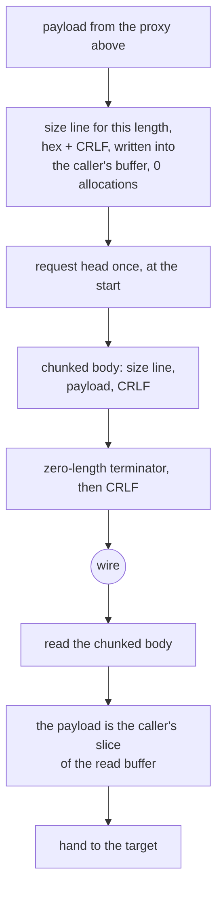
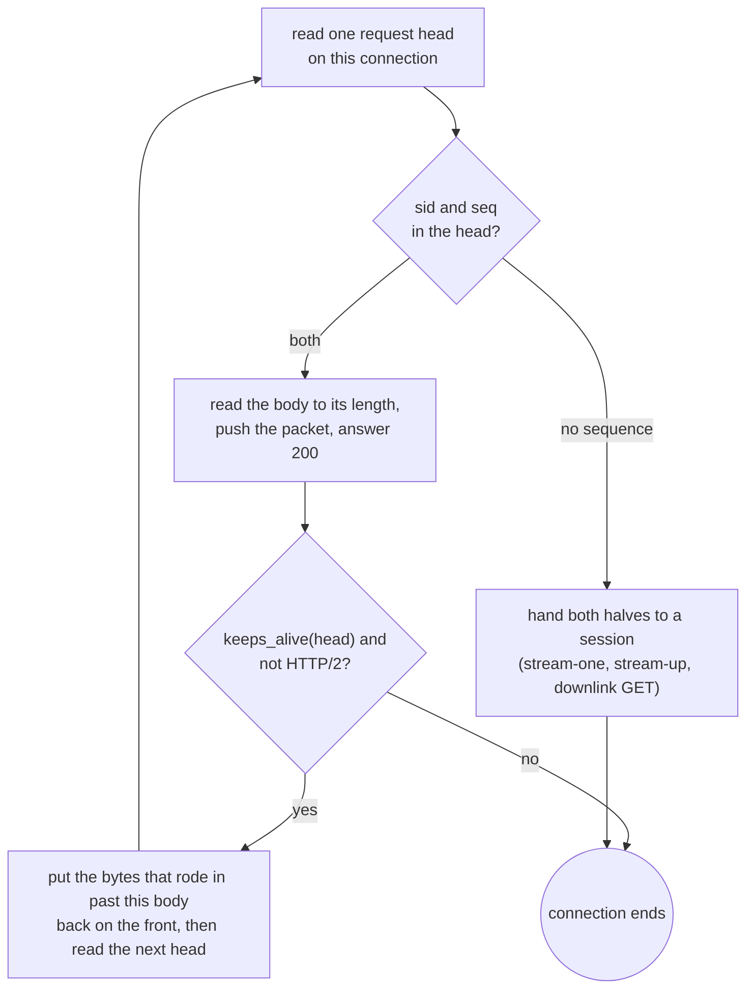

# The xHTTP carrier

The modes the hub serves are `stream-one`, `stream-up` and `packet-up`, on the padding and placement rules the reference ships: `x_padding` in the `Referer` by default, or in the configured header, cookie or query parameter once `xPaddingObfsMode` is on, with the session id and sequence number in a path segment, header, cookie or query parameter as configured. `multi` is not, and neither is the `xmux` connection pool under it.

The framing is the chunked encoding and nothing else: a hex length, CRLF, the payload, CRLF, and a zero-length terminator. There is no envelope, no type byte and no session header beyond the request head.

The settings a server honours come from `extra` when the config carries one: the reference builds its `Config` from that block and lets it replace every knob except host, path and mode, because that is how a share link carries obfuscation. A parser that reads only the outer block answers its own padding check with a `400`; "What we removed" names the tests that pin the precedence and the status code that falls out of it.

The size lines are the part worth naming. A `Size` line for a given length is a pure function of the length, so `size_lines_match_format_without_allocating` builds them into the caller's buffer and allocates nothing. The reader's half of that framing — turning a size line back into the `usize` it encodes — runs in one fused pass, and `chunk_size_fused_matches_two_pass_on_every_probe` keeps it bit-identical to the two-pass form it replaced.

## Data path



## Refusal teardown

An H2 connection we refuse — oversized frame, header block past `HEAD_CAP` — writes its GOAWAY and then closes. Closing with the peer's bytes still sitting unread in our receive queue makes the stack abort instead of shut down, and the RST can swallow the GOAWAY a few microseconds before it: `winsock` delivers `ConnectionReset` with nothing read. So a refused connection now stays open for `budgets::GOAWAY_GRACE` (100 ms, the window a peer already blocked in `recv` takes the refusal in) before it is killed. The grace is a window, not a guarantee: a peer slower than 100 ms one-way still loses the refusal to our close, and this slice does not fix that — making the close orderly needs a read deadline the plaintext carrier does not arm.

## Mode gates

The reference reads `mode` twice, with two different jobs. The dialer resolves an empty or `auto` mode into the shape it will *send* (`dialer.go:332`: `packet-up`, or `stream-one` and `stream-up` under REALITY). The hub never resolves it: each shape gate is written `Mode != "" && Mode != "auto" && Mode != <shape>` (`hub.go:154`, `:199`, `:241`), so a config that does not state a mode serves every shape, and only a config that states one narrows the hub.

This carrier resolved `auto` once, at parse, and then compared the *resolved* value on the hub too. A config written as `{"path": "/share"}` — every share link without an explicit mode, and the matrix cell — therefore became a packet-up-only hub that refused the only head our own dialer can write: `xhttp::connect` sends a session-less chunked `POST`, and a session id is a packet-up/stream-up shape, so the hub answered its own client `HTTP/1.1 400 Bad Request`. Nothing on the wire ever moved, at any connection count, and the run looked like a stall rather than a refusal because `dial_vless_rung` reports a `connect` that returns `None` as `unreachable at socket-connected (inferred)` and the ladder then climbs `xhttp -> grpc -> httpupgrade`; the bench cell wrote no `result.json` at all. That is the whole of why `vless-xhttp-down-8` is red on every engine but ours.

`XhttpSettings` now carries `mode_source` — `Stated` or `Auto` — and the session-less gate arms only on `Stated` — which also lets a *stated* `stream-up` hub serve a session-less `POST`, as `hub.go:154` does. `an_unstated_mode_serves_the_dialers_own_head` is the 400 that becomes a 200, and `the_dialer_and_its_own_hub_complete_on_loopback` completes the round trip through the real socket pair; both fail on the previous gate. `a_stated_mode_still_refuses_the_session_less_post` and `an_unstated_mode_still_serves_the_shape_it_resolved_to` pin what did not move: a hub that was told still refuses, and the packet shape auto resolves to is still served.

The hub's two *session-shaped* gates weigh the shape a *stated* mode names and only when the mode is stated, so an auto hub serves a `stream-up` `POST` where a stated `packet-up` hub refuses it, as `hub.go:154` does. What kept that widening prose was the park it hands out: the POST's socket is now bound into the session as its upload (`set_upload`), the relay's forward leg ends the request body at the app half-close (`upload_done`), and the test that used to certify the refusal is now the flip — `an_unstated_mode_serves_the_shape_once_a_carrier_owns_the_upload` drives the shape over two real sockets, answers `HTTP/1.1 200` where the old gate wrote `400`, and fails on that previous behaviour. Not served, and named rather than rounded off: a `stream-up` POST whose downlink never joins parks its handler on `wait_ended` until the session ends, the residual Session teardown carries below. No syscall, copy or byte on the wire moves here — a refusal becomes a served request — so this is prose rather than a row in the table below, and the gate that proves the mode dial end to end is CI's `vless-xhttp-down-8`, which never runs locally.

## The dial it sends

Until this slice the hub served all three modes and the dialer spoke one — a session-less chunked `POST`, the shape xray's `auto` resolution ends at only when REALITY is not there to speak for it (`dialer.go:332`). A served reference node's own config asks for `packet-up`, so there was no client here that could dial it. The dialer now carries the modes the hub serves:

- The mode resolves where the reference resolves it. An empty or `auto` mode is resolved at parse into the concrete shape the dial will send — `auto_mode` mirrors `dialer.go:332`, and `mode_source` keeps the *stated*/*auto* split the hub's own gates read — so a config that states a mode states it on both halves, and nothing on the hub is compared against a resolved value any more (`a_stated_mode_still_refuses_the_session_less_post`, `an_unstated_mode_still_serves_the_shape_it_resolved_to` pin the two halves of that).
- Both session shapes mint a session id the reference would: UUID v4, or one drawn from a configured `sessionIDTable`/`sessionIDLength` (`config.go:511`), and the POST path carries the session and sequence as segments of the configured placement split at the round-tripped `?` of `addToPath`.
- `packet-up` posts one `POST {path}/{session}/{seq}` per packet, cut at `sc_max_each_post` (`scMaxEachPostBytes`), the packet riding the `Content-Length` body, or encoded base64url once and split at `uplinkChunkSize` across `X-Data-{i}` headers or `x_data_{i}` cookies by `uplinkDataPlacement` — the placement the hub joins and decodes. The paced wait from the second post on is a range now (`scMinPostsIntervalMs`, drawn the way `dialer.go:520` draws it), and the `200` answer is drained before the next packet shares the connection (`a_packet_up_dial_posts_every_slice_under_one_session`). The head keeps the connection alive across the posts, where the reference's transport holds `DisableKeepAlives` (`dialer.go:272`) and reconnects per packet — a dialed divergence, carried knowingly: the posts share one connection the hub's reuse loop above serves, and a client that says `close` takes its connection with it (`a_request_that_says_close_takes_the_connection_with_it`).
- `stream-up` is one chunked `POST {path}/{session}` upload with its sidecar `GET {path}/{session}` downlink open beside it (`a_stream_up_dial_uploads_before_its_downlink` holds the order, and `dialer.go:411` opens the GET on the same session), and the app half-close finally ends the request body: the relay's forward leg calls `upload_done`, `Body::Stream` writes the chunked terminator, and `Body::Packets` returns without one because a packet-up session has no end frame to write — its close is the session's. That was the bottom row of the mode puzzle that made an unstated mode a refused tunnel instead: the body now ends when the relay's bytes end, and the wire-level flip test in Mode gates is the gate that pins it — it fails on the previous shape, which answered `400` and never parked at all. Not rewired, and named rather than rounded off: a pooled connection whose answer came back `keep-alive` is not re-entered by our dialer after its upload ends — every POST closes its own connection, as the reference's default does; and neither mode re-dials an ended session, which is the row that makes a mid-tunnel dial failure a failed tunnel rather than a fresh one.

What the dial does to counts: the reader and the sink dial write for `packet-up` and `stream-up` come from `connect_dual`, which opens the head like `connect` always did — one `format!`-sized head per shape — and *then* the session shape's POST: so the dial's known number rises, and that number is `dial-head`-**`allocations`**-per-thread's row to keep an eye on, not this slice to count. What it does not do is write an operating assumption the reference never made: no route assumption and no actual reconnection — an unreachable neighbour session that drops its sidecar GET and never dents the write path of the POST still lowers to its flush-with-end carrier, as the reference's dial's own Connect does, as long as the `GET` and `POST` are on connections the socket family permits back-to-back.

What is *not* sent yet, and named rather than rounded off:

- `xmux`, the multi-connection pool the reference grows a stream-up session out of, and `serverMaxHeaderBytes`, which bounds the head a reference hub reads. Neither changes a byte the modes above put on the wire.
- The keep-alive padding the reference hub injects down an open stream-up response: once `scStreamUpServerSecs` is above zero, `hub.go:219` writes a random `xPaddingBytes`-sized run of `X` down the response every that many seconds until the request context ends. Our `sse_ok` answers `200` without the filler — a reference dialer that pads against such a stream waits on content that does not arrive on this side, so until that lands a served stream-up session is a quiet answer instead of a padded one.

## Connection reuse

A packet-up uplink is a sequence of `POST {sid}/{seq}` requests, and the reference hub is an `http.Server` that never closes the connection under it: `plain_ok` answers `Content-Length: 0` with `Connection: keep-alive`, and Go's transport puts the socket back in its idle pool and writes the *next* packet on it (`hub.go:561` only arms a 4 s timeout for the next head). Our hub answered the first POST, promised keep-alive in that very response, and then tore the connection down, because `accept_core` could only return a session or nothing.

That mismatch is not merely wasteful — it is the shape of a lost uplink. A client that trusts `Connection: keep-alive` reuses the socket without rechecking it; the server's close arrives after the request bytes are already written, and a `POST` with a body is not an idempotent request, so the transport reports the failure instead of retrying it. The bulk flow in `rust_socks_client_reaches_echo_server_through_local_xray_vless_xhttp_selected_cases` (`h1-none-packet-up`) is exactly that: 64 KiB posted in packets on one session, and the panic is the client giving up on a packet whose connection we had already dropped. The gate for this slice is that CI cell; it never runs locally.

`accept_core` now returns `Served` — `Session` (a session took the halves), `Again` (the connection is still the caller's, plus the bytes that rode in with this request and belong to the next), or `Closed`. `accept_split_with_settings` loops on it, so one connection carries the whole uplink: the body is read *before* the placement match so the socket stays byte-synchronous, `read_body` reports how much of the sniffed tail it consumed, and the rest is pushed back through `ChainReader::set_carry` for the next head. A `Connection: close` or an HTTP/1.0 request ends the loop, as does any refusal — refusals still answer `Connection: close`, so nothing about them moves.

What is *not* reusable, and named rather than rounded off:

- **A chunked uplink body.** It leaves no length behind that the next head can be found after, so an H1 `packet-up` POST sent with `Transfer-Encoding: chunked` still ends the connection (`resumable = false`). xray's packet-up client writes `Content-Length`, so the cell above does not depend on it.
- **`stream-up`.** Its POST parks the handler in `wait_ended` for the life of the session, so it owns the connection by definition; the carrier-side owner that ends it is the relay's forward leg (`upload_done`), which is what the Mode gates flip rides on.
- **HTTP/2.** `Served::Again` is gated on `h2.is_none()`: an h2 stream ends by `end_stream`, and its connection is owned by `xhttp_h2`, not by this loop.
- **The 4 s window.** The reference gives a peer that keeps a connection alive but says nothing a bounded wait before dropping it; ours blocks in `read_exact_head` on the socket's own timeout, so an idle kept-alive connection holds its thread. `budgets::HEAD_DEADLINE` is only consulted on a timeout error, so it does not bound a blocking read — arming it per request is the open row below.

The cost is stated too: every kept-alive request copies its head once (`read_exact_head` is the kept loop now, so no stack probe stands behind it) and its carried tail twice — once at the loop's `head.split_off(at)` and once more on the length path (`prefix[pre..].to_vec()`) — and re-runs the padding and placement parse. That is the price of not reconnecting; against a TLS handshake per packet it is nothing, but it is a copy this slice adds rather than removes, so it is here rather than in "What we removed".



## Session teardown

A session outlives the request that made it. The downlink `GET` parks its reader on `Session::cv` waiting for the next sequence, and the `stream-up` `POST` parks its handler there waiting for the downlink. Nothing else ever notified that condvar: `close_session` ran only from a `SessionReader`'s `Drop`, so a client that opened one half and died left the other half's thread parked for the life of the process, holding its session and up to `sc_max_buffered` buffered packets in the global map. The H2 connection is the owner of what its streams opened, so `kill()` now ends every session bound to it; and a packet refused at the buffer cap ends its own session, because the reader pops a strict sequence and a lost packet is a session that cannot be resumed. `xhttp_h2::tests::a_dead_carrier_ends_the_session_it_parked` and `xhttp::tests::a_refused_packet_ends_the_session_it_overflowed` name the two leaks — both fail without the binding — and `xhttp::tests::a_carrier_death_lifts_both_parks` pins the wake itself. This is a lifecycle repair, not a count change: no syscall, copy or byte on the wire moves, which is why it is prose here rather than a row in the table below.

Two shapes are left parked by this slice and are named rather than rounded off. An H1 `stream-up` `POST` whose downlink never joins: its socket is bound as the session's upload now (`set_upload`), but the leg that drives that socket comes with the downlink, so the POST's handler stays parked on `wait_ended` until the session ends — the same lift `end_session` gives a dead peer, and `xhttp::tests::a_carrier_death_lifts_both_parks` holds the wake itself. And an H2 *session* spans streams, so binding a session to one stream would end a live session when a single `POST` completes; a lone stream reset therefore leaves its reader parked until the connection itself ends. A client that reconnects under the same session id joins the one global session rather than a fresh one, which is already two readers popping one sequence — that is the `sessionIDTable` row below, and the binding does not change it.

A session that refuses still has to end the stream it owns. `serve_session_xhttp_with` has four exits before its relay: an undecodable head, a uuid, command or freedom the hub will not serve, a dial that failed, and a reply the carrier would not take. Each returned without touching its `XhttpWriter`, and on H2 the stream outlived the thread that served it — a client that had already read its `200` then parked on the next read for the life of the connection, because a stream is not a connection and nothing closed. A wrong uuid was therefore indistinguishable from a stall. The four exits now call `cwriter.finish()`, the same call a served session's sink close makes when its relay ends, so the path that answers is untouched; `end_stream` ends a headed stream with an empty `DATA` carrying `F_END` and resets one that never got its head, and the H1 arm gains only the chunked terminator its `Transfer-Encoding: chunked` head already promised. `xhttp_h2::tests::a_refused_session_ends_the_stream_it_parked` dials a uuid the served id does not carry and reads the frame that ends its downlink: it fails by timeout without the call. Not removed: a refusal still answers no reason — the peer learns only that its stream ended — and an H1 `stream-up` POST whose downlink never joined parks its own thread, the residual named at the top of this section.

## Padded DATA credit

Flow control counts the whole DATA payload, the Pad Length octet and the Padding included (RFC 7540 §6.9), and the reference takes `f.Length` — the wire length — at both levels before it refunds the pad immediately and the payload as the body reads it. The H2 dispatch cut the padding in place and then credited the *cut* length, so every padded frame under-credited by `1 + pad` octets: the peer's view of our receive window shrank a little each frame, and a stream-long pad, which the cut turns into an empty chunk, credited nothing at all. The credit is now the frame's wire length, taken before the cut, on both the queued path and the path that drops DATA for a stream that is not there. `xhttp_h2::tests::a_padded_data_credit_counts_the_whole_wire_payload` reads the two `WINDOW_UPDATE` increments off a connection with no socket and fails at `1 + payload + pad` without the change. Only the four-byte increment changes — no copy, allocation or syscall — so `writes-per-credit` and `window-update-frames-per-credit` below do not move, which is why this is prose rather than a row. Not fixed here: the gRPC lane (`grpc.rs`, crediting `len - first - pad`) and the Foxy lane (`foxy.rs`, crediting the unpadded payload the frame parser hands over) carry the same shortfall and are roadmap rows.

## Kept head

Both H1 handshakes — the `POST` a server reads and the `200` a dialer reads — used to `peek` for `\r\n\r\n`, prove the head, then re-read exactly those octets so whatever rode in behind the delimiter stayed on the socket: a head of `H` crossed user space twice and a dribbled head cost two read-family calls per round. `proxy::read_http_head_kept` reads once into the buffer it hands back and returns where the head ends, so the head crosses once, a round costs one call, and the bytes behind it start out in `Reader::prefix` at that cursor instead of being read again. `xhttp::tests::a_chunk_that_rode_in_with_the_head_costs_no_syscall` drives the walk from an in-memory buffer: the size line, the payload and the terminator come out of the head's own allocation — `reads()` stays `0`, base and capacity unchanged. A wrong cursor delivers the head as body; a re-read trips the counter. The dial arm took it too: a record stream has no `peek`, so `read_exact_head` is the same `kept_head_rounds`, and `connect_split` hands `Reader` the buffer that read filled with the Cursor past the `200` (`xhttp::tests::the_record_head_hands_over_the_buffer_it_filled`). What is *not* removed: the accept loop still `split_off`s its tail, because `accept_core` parses the head and hands the tail on, and a borrow of a buffer cannot outlive the move of that buffer; only the dial arm carries `head-tail-allocations 0`. `proxy::read_http_head` still answers the `http` front and the Shadowsocks rung, named on the WebSocket page.

## Measured

<!-- counts:begin -->
| key | value | checked by |
| --- | --- | --- |
| ops-retired-instructions | UNBLESSED | scripts/count-ops.sh |
| framing-size-lines-without-an-allocation | 0 | ferrox-app-xhttp::tests::size_lines_match_format_without_allocating |
| framing-read-syscalls-per-chunk | 1 | ferrox-app-xhttp::tests::a_chunk_costs_two_reads_not_three |
| read-syscalls-per-chunk | 2 | ferrox-app-xhttp::tests::a_chunk_costs_two_reads_not_three |
| write-slices-per-window | 1 | ferrox-app-xhttp::tests::one_window_is_one_chunked_frame |
| user-space-copies-per-byte-written | 1 | ferrox-app-xhttp::tests::exchange_carries_an_echo_over_loopback |
| requests-served-per-connection | 2 | ferrox-app-xhttp::tests::one_connection_carries_the_packet_up_uplink |
| requests-served-before-a-close | 1 | ferrox-app-xhttp::tests::a_request_that_says_close_takes_the_connection_with_it |
| writes-per-credit | 1 | ferrox-app-xhttp_h2::tests::a_credit_grants_both_windows_in_one_write |
| window-update-frames-per-credit | 2 | ferrox-app-xhttp_h2::tests::a_credit_grants_both_windows_in_one_write |
| head-buffer-reallocations-per-request-head | 0 | ferrox-app-xhttp_h2::tests::the_synthesized_head_is_sized_for_its_bytes |
| head-tail-read-syscalls | 0 | ferrox-app-xhttp::tests::a_chunk_that_rode_in_with_the_head_costs_no_syscall |
| head-tail-allocations | 0 | ferrox-app-xhttp::tests::the_record_head_hands_over_the_buffer_it_filled |
| received-data-frames-copied | 0 | ferrox-app-xhttp_h2::tests::a_received_frame_is_queued_as_the_buffer_the_loop_read_it_into |
| received-header-blocks-copied | 0 | ferrox-app-xhttp_h2::tests::a_received_frame_is_queued_as_the_buffer_the_loop_read_it_into |
| zero-filled-bytes-per-received-frame | 0 | ferrox-app-xhttp_h2::tests::a_received_frames_body_is_not_zero_filled |
| dial-head-allocations-per-thread | 1 | ferrox-app-xhttp::tests::the_dial_head_is_staged_once_per_thread |
<!-- counts:end -->

## Ops

```bash
./scripts/count-ops.sh report \
  xhttp::tests::chunk_size_fused_matches_two_pass_on_every_probe 'xhttp::chunk_size'
./scripts/count-ops.sh report \
  xhttp_h2::tests::a_credit_grants_both_windows_in_one_write 'xhttp_h2::replenish'
```

`UNBLESSED`, as above. The reported row points at the fused parser so a future slice can bless the one-pass count without moving the target again. The second row points at the credit: `a_credit_grants_both_windows_in_one_write` calls `replenish` on a connection with no peer, no socket and no thread, so the frame it charges is the method and nothing else — which is what the open list asks of a row before it earns a number. CI read it and it reported `Ir=inlined-not-a-frame`: in the release profile the harness profiles, the credit dissolves into the two callers that reach it, so the row is an honest blank, not a figure, and it stays in the open list until a probe keeps a frame for it.

## Time

CI `vless-xhttp-down-8` (standard tier, 3 repeats, linux x86_64, gate passed — an autohub config, `path: /share` and no mode, so the served and dialled shapes meet the same resolution): **3.31× xray-core's throughput** (medians 4141 vs 1251 MiB/s), **3.37× leaner CPU** (657 vs 2218 ms/GiB), **3.87× leaner peak RSS** (10.1 vs 39.2 MiB) and **47.7× fewer kernel calls per GiB** — on 43 threads against xray's 16, and ahead of zeronet too (1.54× throughput, 1.60× CPU).

What that cell does *not* witness is named, because it is not a small thing: its config is `network: xhttp` with `path: /share` and no mode, the dialer writes the H1 `stream-one` head for that shape, and the hub reaches `xhttp_h2` only behind a peer's 24-byte HTTP/2 preface (`proxy.rs:1513`), so the request never spends a credit. The cell is this page's no-regression gate and the ratio is our standing against the reference; `writes-per-credit 1` is gated by the in-memory writer above, which is the only checker that can count writes.

- **A chunk per 16 KiB of a window the relay already framed.** The sink cut every send at 16 KiB, so a promoted 64 KiB relay window left as four chunked frames — four size lines, four `write_slices` calls, and on Windows four `WSASend`s for bytes one call could carry. `CHUNK` is the relay window now, so the same window is one chunk, one size line and one call: `one_window_is_one_chunked_frame` counts the calls and reassembles their bytes, one call carrying the seven-byte line `10000\r\n`, the payload and the closing CRLF. This does change the bytes on the wire — fewer, larger chunk boundaries — and says so: the payload and its order are untouched, and the size line grew a fifth hex digit, which `size_lines_match_format_without_allocating` checks against `format!("{n:X}\r\n")` at 65 535, 65 536 and one whole chunk. A chunked reader takes an arbitrary size by definition, so the interop proof is the upstream suites in CI. What did not move: the h2 lane keeps its own DATA frames (`send` hands an h2 stream its payload whole and never sees `CHUNK`), and a peer whose relay reads land short of a window still pays one chunk per read.
- **A framing read syscall per chunk, and the second one was two bytes.** The reader spent three reads per chunk: one to fetch the size line, one for the body, and one `read_exact` for the two-byte CRLF that closes the chunk. The CRLF read now fills a 128-byte window instead, and the bytes past the CRLF are the *next* size line, which `read_line_into` then finds without asking the socket again — so the framing reads amortise to one per chunk and the count is `2 * chunks + 1`, measured: **33 reads for 16 chunks against 49** for the old shape over the same loopback socket, with the payload byte-identical.

Two things this needed to get right, both of which the worst case caught rather than the average:

- The window must be looped until two bytes are buffered, and the loop has to take those bytes from *wherever they are*: a first version took one read and refused on `n < 2`, and a second refused whenever the prefix held only the ` CR`, so a peer that segments the CRLF across two packets still died. `a_trickling_stream_still_drains_whole` drives a one-byte-per-read stream and `a_crlf_split_across_reads_still_drains` delivers `…ping<CR>` in one segment and `<LF>…` in the next; the first cannot see the second, because a trickle leaves the prefix empty at that point.
- The exhausted prefix has to be **cleared** before the window lands in it. The first version appended to the drained prefix and took the CRLF from stale bytes, which broke four existing xHTTP tests immediately.

The count is gated by `a_chunk_costs_two_reads_not_three`, which drives an in-memory stream that always answers the whole buffer — so the count is exact and deterministic. A real socket may segment, so `a_real_socket_drains_the_same_bytes` asserts only the bytes and bounds the count loosely; a scheduler-dependent number is not a gate.

## What we removed

- **Two allocations and a copy of the head per dial.** The dial's head was a `format!` over a template that carried the path, the host and a padding run of its own `String`, so a dial paid two allocations and copied the whole head into the second one. The head is the dialling thread's own room now, opened once to the head's longest shape and refilled in place by every later dial on it, and the padding run is written into that room. The counting allocator is the witness: `the_dial_head_is_staged_once_per_thread` drives twelve dials and holds the thread at one allocation, where the old shape paid twenty-four. The bytes on the wire do not move: the head is the same POST, the same `Referer` and the same padding run, and the test pins both ends of it.
- **A second target copy and a referer string per packet-up POST.** `packet_head` cloned the configured path, cloned it again through `target_of`, and formatted the `Referer` line into its own `String` only for the head's `format!` to copy it. The head now appends the query to the path it already owns and writes the pad inside the head's own `format!`, so a packet-up POST pays one target and one head instead of three strings. `a_packet_up_dial_posts_every_slice_under_one_session` still pins the head's bytes; no counter observes these allocations yet, so this stays prose rather than a row.
- **A zero pass over every received frame.** The `h2` lane's frame loop allocated its body with `vec![0u8; len]`, so a frame paid a zero pass over its whole length before the read that fills it in full — a copy of the whole transfer's bytes, written and thrown away. The body is the read's own target now, and the counting allocator's `zeroed` counter is the witness: `a_received_frames_body_is_not_zero_filled` fails if a frame body is zeroed again. What did not move: the frame's own buffer. The body is still the caller's allocation and the queue still holds that same pointer, which `a_received_frame_is_queued_as_the_buffer_the_loop_read_it_into` holds, so the frame is queued as itself and not as a copy of it.
- **A TCP connection per uplink packet.** The hub used to serve one request per connection and drop the socket, so a `packet-up` uplink paid a connect, a TLS handshake and a fresh slow start for every `scMaxEachPostBytes` of payload. The reuse is counted in memory, where the number is exact: `one_connection_carries_the_packet_up_uplink` asks one `accept_split_with_settings` call to serve two pipelined POSTs and gets **2 answers and both packets in the session**, where the single-shot shape served 1; `a_request_that_says_close_takes_the_connection_with_it` holds the other half — **1 answer**, the pipelined tail left unread. What that buys on throughput, CPU and RSS is CI's `h1-none-packet-up` interop cell and `vless-xhttp-down-8`, read after the run rather than predicted here. A loopback socket is not the checker for either number: it sees the bytes, not how many connections carried them.

- **A pass over the size line.** `chunk_size` used to scan for the first terminator once and then parse the digits it had kept as a second pass; both branches re-read the same two-to-seven bytes. The rewrite walks the line once, and the nibble, terminator and invalid tests collapse into one 256-byte LUT that is hot in the I-cache after the first chunk. `size * 16 + digit` becomes `(size << 4) | nibble` — same arithmetic, same wrap. Bit-identity is gated by `chunk_size_fused_matches_two_pass_on_every_probe`, which sweeps every length 0..=20 with a probe byte at every position against the old two-pass form kept as the oracle. Nothing on the wire moves, and a bad line is still `None`.
- **An allocation per size line.** A hex length plus CRLF is at most five bytes and is a function of the length alone, so it is written in place. Neither Xray nor sing-box ships an xHTTP carrier in the pinned trees, so there is no comparator here to beat — which is exactly why this page says what it removed and does not claim a ratio.
- **A rescan per adjust step.** `generate_tokenish` re-summed the whole padding's Huffman code lengths from byte zero on each of its up-to-150 adjust steps, so a K-byte pad cost 150·K table reads per served request. The loop now carries the sum: seeded by one pass over the initial string, then moved only by the pushed or popped char's own length, so `cur` is the same integer at every step and every branch is the same branch. `tokenish_carry_matches_the_recompute_on_every_probe` sweeps targets 0..=64 plus three larger sizes against the old recompute form kept as the oracle, over four raw-content shapes per target. What is **not** removed: the seed pass — the initial string's length still has to be computed once — and the randomness of the raw, which is the point of the padding.
- **A credit that took two locks and two writes.** `xhttp_h2::replenish` grants the peer back the bytes a stream body just consumed, once per inbound `DATA` frame and once per read of a body, so a bulk tunnel paid it per chunk in each direction. It did so by calling `frame()` twice, and each `frame()` takes the connection writer while each frame reaches `write_slices` as a head and a body: **2 lock acquisitions and 2 writes per credit** (one `writev` per frame on unix), or **4 `write_all` calls** over a TLS stream, where each part is sealed as its own record. The two frames differ only by the stream id, so the pair is now one `const` 26-byte template with three slots patched and one `write_slices(&[&out])` under one lock — **1 write, and 1 syscall on unix**. `a_credit_grants_both_windows_in_one_write` is the checker: an in-memory writer counts the `write_slices` calls and keeps the bytes, and the test asserts one call, 26 bytes, and both frames decoding as length 4, `WINDOW_UPDATE`, no flags, id 0 then the stream, with the same increment in both. A loopback socket cannot witness it — it sees the bytes, not how many writes carried them. What did not move: the same 26 bytes go out in the same order, connection frame first as before, and the credit still touches only the *inbound* windows, which is what `h2_bulk_echo_never_outruns_the_granted_connection_window` pins against the merged pair.
- **A base64 decoder of its own, and a pass per character.** The packet-up hub's placement arm joins `X-Data-{i}` headers or `x_data_{i}` cookies into one string and decodes it; that decode was `b64_url_decode` — a `match` per character pushed into a `bits` `Vec` with no capacity, then a second pass over `bits` pushing three bytes per group into a second `Vec` with no capacity either. Two buffers each grown by a reallocation per doubling, two passes, and one extra buffer the size of the input, for a length the head already stated. It now calls `ferrox_core::transport::url_decode`, the same one-pass group loop `early_decode` runs: six bits per table lookup fill a 24-bit window whose three low bytes are the three bytes they stand for, and one `Vec::with_capacity` reserves the tail before the first push. The checker is a differential sweep: `the_shared_loop_decodes_every_prefix_the_serial_ladder_decoded` keeps the old body in the test module as the oracle and walks every prefix of every encoded length to 200 bytes, asserting byte-for-byte equality wherever the prefix is a base64 length. The arm itself had no gate before this, so `a_packet_split_across_data_parts_reaches_the_session_whole` now drives the hub with the parts cut at 41 and 97 characters — mid-group, the way the reference client cuts one encoded stream at a random `uplinkChunkSize` (`upstream/xray-core/transport/internet/splithttp/config.go:66-94`), so only the joined tail carries the remainder — over both placements, and reads the packet back off the session. What did not move: the group math, the joined single string, and every read, syscall and copy count on the request path — the decode was one pass over the head's value in the old shape too, it just made two buffers of it. One divergence is a convergence: five characters are not a base64 length, and the ladder dropped the last one and handed a short packet up as if it were whole, where `base64.RawURLEncoding` (`hub.go:249-285`) and `URL_SAFE_NO_PAD` (`upstream/zeronet/crates/zero-transport/src/xhttp_request.rs:917`) both refuse it. `url_decode` refuses, on a URL-only table that also rejects `+`, `/`, `=` and whitespace for the same reason. `a_trailing_digit_in_the_data_parts_is_refused` pins the `400` and, on the same head with four digits instead of five, the `200` that says the refusal came from the decode rather than from the request's shape. `early_decode` keeps its dual-alphabet table and its trim for the `Sec-WebSocket-Protocol` peer that sends either alphabet padded; only the loop is shared.
- **An allocation per header part in the placement join.** The same arm reads `X-Data-{i}` headers or `x_data_{i}` cookies by building each name with `format!("{key}-{i}")`, so every part — and the first absent index that only ends the run — handed the allocator a fresh `String`. The suffix is the only part that moves, so one reused buffer `write!`s the name and clears it between parts, costing one allocation per request for both placements instead of one per part plus a free one for the miss. `a_packet_split_across_data_parts_reaches_the_session_whole` drives the arm on both placements with the parts cut mid-group, so the join and the decode it feeds are unchanged bytes. What did not move: the join itself and the single `url_decode` over it stay — a base64 group can straddle a part boundary, so the parts have to be concatenated before the one-pass decode.
- **A header list per request head.** `open_stream` decoded a `HEADERS` block into a `Vec<(Vec<u8>, Vec<u8>)>` — two allocations for every field — then scanned that list twice to find `:method` and `:path` and a third time inside `synth_head` to write the rest as head lines. The block is now visited once: each field arrives borrowed from the decoder, the two pseudo-headers are copied into their own buffers as they pass, and every other field is written into the head lines as it passes. `synth_head` then asks for the bytes the head carries, so `head-buffer-reallocations-per-request-head` is gated on `capacity == len` for both stream shapes rather than on a byte comparison; the shape it replaces asked for 256 and grew when a head was longer than that. What did not move: the three captures are still one allocation each, and every head byte is still copied once into the request line, because the answer this carrier writes is an HTTP/1 head the block does not already contain.
- **A third copy of the config walk.** `xhttp.rs` carried its own byte-identical `header_value` copy and a third head reader; the roadmap has a slice for folding both into `proxy.rs`, and it is open. Until that lands, this carrier duplicates them, which is a code-size debt rather than a data-path cost, and it is named here rather than quietly counted as a win.
- **A settings parse that read one block only.** Every knob was taken from the outer `xhttpSettings`, so a config whose obfuscation lives in `extra` — which is how a share link carries it, and what the oracle's `extra=true` cases send — silently fell back to the defaults: `xPaddingObfsMode` false, padding range 100-1000, `Referer` placement. The hub then applied the *default* padding check to a request built to the configured one, and every such request was refused with `HTTP/1.1 400 Bad Request` before any byte of the tunnel moved; that is the `xhttp_requests_match_the_oracle` line in the interop baseline. `extra` now replaces the block the rest of the parse reads, keeping host, path and mode on the outer object as the reference does, and accepting either the object form or the JSON-string form a link query holds. The object form costs one key lookup and no allocation; a shape that is neither object, `null` nor a string of an object is refused rather than ignored. `the_extra_block_replaces_every_knob_but_path_and_mode` pins the precedence and the replace-not-merge rule (`scMaxEachPostBytes` set outside and omitted inside ends up at the default, not at the outer value); `xhttp_refusals_carry_their_statuses` pins what the hub does with the result — the configured header padding is accepted, the default `Referer` padding is now refused, so the knobs demonstrably reach the accept path and not just the parser.
- **A copy of every received h2 frame body.** The h2 receive loop read each frame into its `vec![0u8; len]` and then copied what it parked: `payload.to_vec()` queued a DATA chunk (a second allocation and a second copy of every inbound byte, on top of the read that filled the frame), `block.to_vec()` copied each HEADERS block before the pad trim, and a padded DATA frame paid the extra allocation after that. `pump_frame` owns the frame now (padding cut in place by `copy_within`, the truncated buffer itself queued, the unterminated block stored owned in the assembly), so a received DATA frame, its padded variant and a received header block each cost zero further copies. `a_received_frame_is_queued_as_the_buffer_the_loop_read_it_into` gates both rows by pointer identity — the queued chunk's base stays the frame buffer's base and its capacity stays the frame's, which bytes-only assertions cannot see — and the test fails on the copied shape (checked before landing by reintroducing the `push_back(body.clone())` it replaces). What did not move: the zeroing of the frame buffer on receipt, the `WINDOW_UPDATE` pair consumed bytes still grant, and the memmove the padded cut needs; the h2 wire is untouched.

## Open rows

- A payload the placement arm refuses answers `400` (or `413`) and returns *after* `bound_session` has already entered the sid, and nothing in the tree reaps that map: `end_session` and `SessionReader::drop` are its only removers, and a refused POST reaches neither. So one POST of undecodable base64 under a fresh sid is one `Arc<Session>` kept for the life of the process. The smaller shape is the refusal ending the session it opened, as `a_refused_packet_ends_the_session_it_overflowed` already requires of the overflow; it is not done here because it is the teardown row, not the decode.

- The placement arm still builds `joined` before it decodes: a `String` grown by `push_str` with no capacity, one copy per part, then the decoder's own copy of the payload. The smaller shape decodes the parts in order with a window carried across the boundary, which is one allocation and one copy per POST cheaper. The parts arrive at a size the client picks (`uplinkChunkSize`, now parsed — `GetNormalizedUplinkChunkSize` floors it at 64 and falls back through header and cookie defaults at `config.go:181`), so a carried boundary is what the arm has to model either way.

- A kept-alive connection with no request on it is held open by a blocking `read_exact_head`, so the reuse this page now documents also buys a thread per idle connection. The reference bounds that wait at 4 s (`hub.go:561`); `budgets::HEAD_DEADLINE` is 20 s and is only consulted on a timeout error, so it does not bound a blocking read. The smaller shape is one deadline armed per loop turn rather than per connection. The thread-per-idle-connection this leaves is the per-concurrency tax, answered by the planned readiness seam in [`docs/concurrency.md`](../concurrency.md), not by a deadline.

- This page, `carrier-foxy` (`foxy.rs:516`) and `carrier-grpc` now each carry their own 26-byte `WINDOW_UPDATE` pair. The three differ only in which frame goes first, so one home in `h2` and one writer is the smaller shape; it is open because it crosses three method pages and three cells, and a slice that moves a template is not a slice that measures one lane.

- The stream-up padding filler above (`scStreamUpServerSecs`, `hub.go:219`) is not carried: a served stream-up response is a quiet answer instead of a padded one, which a padding-hungry reference client reads as a hung downlink.

- Three knobs in the reference's `Config` are still not parsed here: `xmux` (the multi-connection pool a stream-up session is dialled out of) and the two caps `serverMaxHeaderBytes` and `scStreamUpServerSecs`. None of them changes a byte the dial puts on the wire, so they are rows for the slice that carries the shapes they govern, not gaps the mode dial leaves behind it.
- The pinned conformance row `rust_socks_client_reaches_target_through_remote_xhttp_profile` panics unless `XRAY_REMOTE_XHTTP_CONFIG` names an owner-only file. The mode assertion in the pinned tree must not be weakened to make it pass; that is stated in the roadmap and repeated here so the row is not quietly rounded off.

## Pins

| what | where |
| --- | --- |
| the carrier Xray-core and sing-box do not ship | — |
| the carrier ZeroNet does ship | `upstream/zeronet/crates/zero-transport/src/xhttp.rs` |
| `extra` replacing every knob but host, path and mode, in object and string form | `upstream/zeronet/crates/zero-config/src/xhttp.rs:446` |
| the padding value, its placements and the tokenish length bound | `upstream/zeronet/crates/zero-transport/src/xhttp_request.rs:619` |
| the hub whose `http.Server` keeps the HTTP/1.1 connection alive, with 4 s for the next head | `upstream/xray-core/transport/internet/splithttp/hub.go:561` |
| the client that encodes the packet once and splits that string across the parts | `upstream/xray-core/transport/internet/splithttp/config.go:66-94` |
| the hub that joins the parts and decodes them as one `RawURLEncoding` stream | `upstream/xray-core/transport/internet/splithttp/hub.go:249-285` |

The `extra` precedence is cited from ZeroNet's port, not from the Xray pin: the `Config` message at `upstream/xray-core/transport/internet/splithttp/config.proto` carries all of these knobs as top-level fields and has no `extra` at all, so the block is newer than the commit `upstream/pins.toml` names. The rule is the same one the reference's own `SplitHTTPConfig.Build` applies.

## CI scope

What a change here owes, read by `scripts/ci-scope.py`; see [`docs/ci-scope.md`](../ci-scope.md).

<!-- scope:begin -->
- paths: crates/ferrox-app/src/xhttp.rs, crates/ferrox-app/src/xhttp_h2.rs
- symbols: xhttp, status_of
- scenarios: vless-xhttp, vless-reality-xhttp
- go: ./transport/internet/splithttp/..., ./transport/internet/xdrive/...
<!-- scope:end -->
