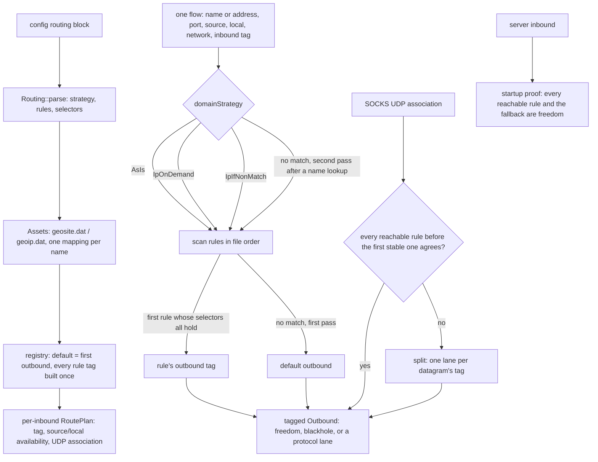

# Routing rules and the geosite/geoip assets

A rule is a set of selectors that must all hold, and one outbound tag the first match decides. A rule may instead name a `balancerTag`: the balancer draws a candidate from the outbound tags its selector prefixes match, ordered by tag as the reference handler manager sorts them, with `random` when no strategy is given and an atomic counter for `roundRobin`. `leastPing` and `leastLoad` need the health observatory this tree does not carry, so they pick nothing and the `fallbackTag`, then the default outbound, answers exactly as the reference does without observations. A duplicate balancer tag, an unknown strategy, a selector that is not a list, and a rule naming a balancer no entry defines are startup refusals named by the offending field. When a rule names both an outbound tag and a balancer, the outbound wins, as the reference's selector does. The default is the first configured outbound — the reference's `defaultHandler`, tag or no tag — so a config that adds `routing` moves unmatched flows to that entry rather than to the protocol priority this tree used before. Every tag a rule names is built once, at startup; a tag no outbound carries, an outbound this tree cannot dial, and a missing asset file or code are startup refusals named by the thing that is missing, never inert rules.

The asset containers are xray's protobuf `GeoSiteList` and `GeoIPList`, decoded here with the same field walk the rest of the tree uses for xray's wire form. On Unix a container is read into an anonymous mapping rather than a heap buffer and unmapped when the parse ends, so a real `geoip.dat` is resident during startup, not for the life of the process; elsewhere it is a heap buffer. `geosite:CODE@attr@attr` keeps only the domains that carry **all** listed attributes; codes are compared case-insensitively and attributes are lowercased as the reference does. For addresses, a leading `!` on a rule toggles that rule's own reverse flag, twice toggles it back, and the positive and negative subsets OR together. A family that the negative set never names is not matched by its reverse — the reference's `max4`/`max6` sentinel — so a v4-only `!geoip:test` does not match a v6 address.

Domain forms: `geosite:` / `ext:` / `ext-domain:` / `ext-site:`, `domain:` (suffix), `full:`, `regexp:`, `keyword:`, `dotless:`, and a plain value, which is a substring as in the reference. `ip:` / `source` / `localIP` take CIDRs, `geoip:`, `ext:` or `ext-ip:`. Ports accept a number or a comma/range string; `env:` is refused by name. `network` is `tcp` or `udp`; `unix` is refused by name. `localOS` is compared case-insensitively with `darwin` for macOS.

## Data path

## What a flow carries

A flow has a network, a destination (a name stays a name; only a lane that carries no destination resolves it), a port, and — where the transport can answer them — the client's source address and the local address the inbound accepted on. An absent field matches no rule, which is what keeps a selector from turning into an unconditional match. A rule with no effective selector is refused at parse time, so no rule can match every flow by accident.

`AsIs` never looks a name up. `IpOnDemand` resolves on the first IP matcher the scan reaches, and the address test is last in a rule: a rule that already failed a source or local selector resolves nothing. `IpIfNonMatch` runs the match once, and only if nothing matched, the destination is a name, and a rule whose other selectors held still names an address set does it resolve and revisit just those rules. A literal destination and a table with no address rule both short-circuit the lookup: tests drive each path and count the resolver calls. A domain matcher hashes a name once from its last byte to its first, and each parent suffix falls out of that pass into an open-addressed probe that compares the string on a hit; the name itself is the last suffix probed, and an empty table is never probed. No label is allocated, and no byte of the name is hashed twice by one matcher.

## Lanes the transport cannot route

A server inbound in this tree dials direct whatever the rules say. Rather than ignore the table per flow, startup walks the rules that can reach the inbound (its tag, its network, the current OS) and requires each to target a freedom outbound; it stops at a rule that matches every flow on that tag, and otherwise requires the fallback to be freedom. Anything else refuses the config with the tag named.

A `tun` flow has no source or local address the rules could read. If any rule that could reach the tun tag names `source`, `sourcePort`, `localIP` or `localPort`, the config is refused naming that selector instead of letting the rule silently never match.

A SOCKS UDP association whose reachable rules agree on one tag rides that tag's lane. When a per-destination selector (a domain, an address, a port) could send datagrams of the same association to different tags, the association is split: the outer relay asks the rules for each datagram's destination and forwards the frame to a lane, one per chosen tag, spawned on first use and reaped when its loop ends. A datagram whose destination picks a blackhole is dropped without opening a lane; a lane's replies travel back through the outer relay to the client. A rule that matches every datagram on the association still fixes a single lane, when all such rules agree with the fallback.

## Measured

<!-- counts:begin -->
| key | value | checked by |
| --- | --- | --- |
| ops-retired-instructions | UNBLESSED | scripts/count-ops.sh |
| flow-decision-allocations | 0 | ferrox-app-router::tests::a_flow_without_a_domain_matcher_allocates_nothing |
| host-lowercase-buffers-lowercase | 0 | ferrox-app-router::tests::a_lowercase_host_matches_without_a_buffer |
| host-lowercase-buffers-mixed-case | 1 | ferrox-app-router::tests::a_mixed_case_host_takes_one_lowercase_buffer |
| host-lowercase-buffers-mixed-case-two-rules | 1 | ferrox-app-router::tests::a_mixed_case_host_is_lowercased_once_for_the_table |
| host-lowercase-buffers-before-a-domain-rule | 0 | ferrox-app-router::tests::a_mixed_case_host_matched_before_a_domain_rule_is_not_lowered |
| geosite-shared-entry-copies | 0 | ferrox-app-router::tests::a_code_named_by_two_rules_shares_its_entries |
| geosite-unwanted-code-allocations | 0 | ferrox-app-router::tests::an_unwanted_geosite_code_is_not_decoded |
| geoip-unwanted-code-allocations | 0 | ferrox-app-router::tests::an_unwanted_geoip_code_is_not_decoded |
| geosite-unrequested-attribute-allocations | 0 | ferrox-app-router::tests::attributes_are_not_decoded_unless_requested |
| domain-table-reads-ip-if-non-match-candidate | 1 | ferrox-app-router::tests::a_candidate_is_not_re_evaluated_under_ip_if_non_match |
| literal-route-allocations | 0 | ferrox-app-proxy::tests::a_route_decision_on_a_literal_address_allocates_nothing |
| dns-lookups-per-rule-matched-name | 0 | ferrox-app-router::tests::ip_if_non_match_resolves_only_after_no_rule_matched |
| dns-lookups-per-unmatched-name | 1 | ferrox-app-router::tests::ip_if_non_match_resolves_only_after_no_rule_matched |
| dns-lookups-ip-if-non-match-no-ip-rule | 0 | ferrox-app-router::tests::ip_if_non_match_does_not_resolve_without_an_ip_rule |
| dns-lookups-ip-on-demand-source-failed | 0 | ferrox-app-router::tests::ip_on_demand_does_not_resolve_when_a_later_selector_fails |
<!-- counts:end -->

`flow-decision-allocations 0` is a rule table with no domain matcher: the scan reads ports and networks and allocates nothing. `host-lowercase-buffers-lowercase 0` is a domain match on the host as it arrived: the suffix and substring tables are stored lowercased, and a name that is already lowercase is borrowed rather than copied, which is the shape almost every client sends. `host-lowercase-buffers-mixed-case 1` is the same match on an uppercase name, where one buffer is the price of the comparison; the test asserts both counts, so a copy on the common path or a second copy on the mixed path fails them. That buffer belongs to the decision, not to a rule: `host-lowercase-buffers-mixed-case-two-rules 1` scans two domain rules and still pays one, where a per-rule copy would pay two. `geosite-shared-entry-copies 0` is pointer identity between the two rules' entries: a code named twice stores the same `Arc<str>` twice, not two decoded strings. `geosite-unwanted-code-allocations 0` and `geoip-unwanted-code-allocations 0` are the startup half: a container holding one large code and one named code parses in exactly the allocations of the named code alone, because the decoder reads an entry's code before its payload and skips every code the config did not name. `geosite-unrequested-attribute-allocations 0` is the same skip inside a named entry: a domain's attributes are decoded only when a rule asks for one with `@`, and an attribute key that is decoded is borrowed from the file rather than copied. `domain-table-reads-ip-if-non-match-candidate 1` is the second `IpIfNonMatch` pass: a rule whose other selectors already held before resolution is remembered, so the pass after resolution reads its address set and not its domain table again. `host-lowercase-buffers-before-a-domain-rule 0` is a rule that matches on its port before any table is consulted: the buffer is deferred until a table needs it, not bought at the top of the decision. `literal-route-allocations 0` is the same claim for a routed flow on an address: the plan borrows the chosen outbound and the decision touches no heap. `dns-lookups-per-rule-matched-name 0` and `dns-lookups-per-unmatched-name 1` are the two halves of `IpIfNonMatch` — a name a rule already matched is never resolved, and a name no rule matched is resolved exactly once before the second pass. `dns-lookups-ip-if-non-match-no-ip-rule 0` is the case the first half does not cover: no rule names an address set, so no address can turn the decision and the resolver is never called. `dns-lookups-ip-on-demand-source-failed 0` is the address test ordered last: a rule whose source selector already failed resolves nothing under `IPOnDemand`.

What was not removed: a geosite code is expanded into the rule's sets at startup, so a rule naming a large code pays that memory for the life of the process (the entries themselves are shared between rules that name the same code, but each rule keeps its own probe table); the container is still walked once per named code, and the named entry is read once, with a code that trails its payload deferred to the end of that entry; keywords build one Aho-Corasick automaton per rule that names them; the rule scan is linear in the number of rules, as the reference's first-match pass is; and a table past 256 rules re-tests the non-address selectors of the candidates in the second `IpIfNonMatch` pass, because their bits do not fit the stack mask. The registry keeps one outbound instance per named tag and clones the default for its own tag, so a lane's shared state is not duplicated.

## Time

No duration is claimed here. Benchmarks are CI-only in this tree, and the pinned routing references have no per-flow durations that a local run could compare without the tunnel this machine sits behind. The operation-count gate (`scripts/count-ops.sh`) needs valgrind, which does not exist for macOS/aarch64, so on this host the figure is `UNBLESSED` and the gate is the `ops.yml` artefact in CI. The allocation and lookup counts above are the parts a test here can see exactly.

## Pins

| what | where |
| --- | --- |
| rule shape, first match, default handler, `IpOnDemand`/`IpIfNonMatch` | `upstream/xray-core/app/router/{config.proto,config.go,condition.go,router.go}`, `upstream/xray-core/infra/conf/router.go` |
| geosite/geoip containers, attributes, reverse semantics, invalid-entry skipping | `upstream/xray-core/common/geodata/{geodat.proto,rule_parser.go,geodat_loader.go,ip_matcher.go,domain_matcher.go,ip_registry.go}` |
| asset location and file checks | `upstream/xray-core/common/platform/{platform.go,others.go,filesystem/file.go}` |
| balancers, selector prefixes, strategy shapes, fallback | `upstream/xray-core/app/router/{config.proto,config.go,balancing.go,strategy_random.go,strategy_leastping.go,strategy_leastload.go}`, `upstream/xray-core/infra/conf/router.go` |
| same-language reference | `upstream/zeronet/crates/zero-router/src/{router.rs,matcher.rs,assets.rs}` |

## CI scope

What a change here owes, read by `scripts/ci-scope.py`; see [`docs/ci-scope.md`](../ci-scope.md).

<!-- scope:begin -->
- paths: crates/ferrox-app/src/router.rs
- symbols: router, Reader, skip, Outbound, RouteShared, RoutePlan, Association, inbound_tag, build_outbound, route_shared, prove_server_route, serve_root, serve_socks, serve_connect, serve_socks_udp, serve_dokodemo, serve_tun_inbound, accept_loop, dial_socks_outbound
- scenarios: vless-raw, vmess-raw, trojan-raw, shadowsocks-raw
<!-- scope:end -->

No routing conformance seam exists: the pinned xray-core `app/router` tests are in-process Go and never inject `ferrox-app`; `testing/scenarios` has no routing family; sing-box, xray-core-rust and zeronet expose no suite that runs this binary's router. The scenarios named above are the server cells whose configs carry `type: field` rules and must still start and serve.
