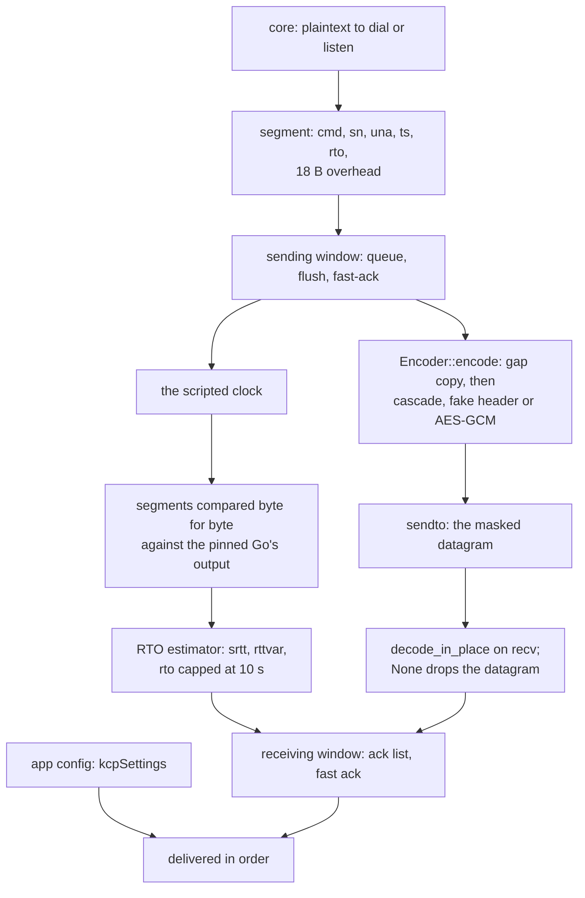

# KCP / mKCP

The core rung is real, bit-identical and proved against the pinned Go, and the carrier is now wired: VLESS, VMess, Trojan and Shadowsocks all serve and dial over plaintext KCP, and all four carry TLS over it both roles, the session above the connection as it is upstream; REALITY is served only, and the legacy mKCP header stack — the `mkcp-legacy` finalmask families, both roles, oracle-proven like the framer beneath them. Mux stays raw-carrier-only tree-wide, and VMess UDP refuses KCP as it refuses xdrive; every other carrier carries it.

The proof is `kcp::oracle::the_scripted_core_matches_the_pinned_go`: a scripted clock drives the sending window's queue/flush/fast-ack behaviour, the ack list, and the RTO estimator — including the cap probe and peer-RTO adoption — and the segments it produces are compared against `scripts/kcp-oracle/expected.txt`, which was recorded from `xray-core/transport/internet/kcp` at the pin in `upstream/pins.toml`. That is the strongest claim in this tree: not "looks right", but byte-for-byte equal to the implementation it replaces, over a script that deliberately probes the estimator's edges.

Nothing on this rung is now named-without-being-honoured. `kcpSettings` is parsed into `kcp::Config` (`mtu`, `tti`, capacities, multiplier, window, both spellings), and every `streamSettings.finalmask.udp` entry of type `mkcp-legacy` contributes one mask to the chain. An entry naming any other finalmask type is refused by name rather than dialled unmasked — a config asking for a mask this tree does not carry either runs the whole chain it asked for or does not dial.

## Data path



## Masks

The stack this replaces is `upstream/xray-core/transport/internet/finalmask/mkcp/`: three families and a manager that chains them. `original` is the legacy mKCP header — an FNV-1a hash of the payload, its length, and a lag-4 XOR cascade over the whole frame. `header` fakes one of six packet shapes: `dns`, `dtls`, `srtp`, `utp`, `wechat`, `wireguard`. `aes128gcm` keys itself with SHA-256 of the password truncated to sixteen bytes and frames `nonce ‖ ciphertext ‖ tag`. The spelling is the reference's:

```json
"streamSettings": { "network": "kcp", "finalmask": { "udp": [
  { "type": "mkcp-legacy", "settings": { "header": "srtp" } },
  { "type": "mkcp-legacy", "settings": { "header": "dns", "value": "example.com" } },
  { "type": "mkcp-legacy", "settings": { "value": "password" } }
] } }
```

The reference reverses the list as it composes it, so the **last** entry wraps most and is the outermost mask on the wire; `Mask::from_spec` takes that wire order and `decode_in_place` strips outermost first with the manager's own slice arithmetic. Empty `header` and empty `value` is `original`; empty `header` with a `value` is `aes128gcm`; `dns` without a `value` packs the reference's default `www.baidu.com`. A frame that is shorter than the chain prefix, fails the `original` hash, or fails the GCM tag decodes to nothing and is dropped there: the socket thread and the accept loop never parse it, never deliver it, and never build a session for it — `a_raw_dial_never_establishes_a_masked_session` and `the_wrong_password_echoes_nothing` are those gates. What actually goes on the wire is proven through a plain UDP relay sitting between the two roles: `the_wire_under_a_masked_session_carries_the_mask` records the first _datagram_, opens it under the same chain and finds the conversation id in it, and counts the overhead — `srtp` outside `aes128gcm` adds exactly 32 bytes — then the session still echoes through the relay.

Two inputs the reference accepts are refused at build time rather than half-implemented: a DNS name containing an escaped dot (`\.`, which `packDomainName` supports), and anything under `finalmask` that is not `mkcp-legacy` — that second family list is in Open rows. The cross-language gate covers the stack in `expected.txt`: 86 mask lines — `original` seals at 21 lengths including the ragged ones, every fake header's counter walk including the dtls length wrap, the dns template's packing, fixed-nonce AES seals and opens, and five composed chains with their opens, tampers and wrong-order refusals — replayed through the shipped `Encoder` and `decode_in_place`.

## Measured

<!-- counts:begin -->
| key | value | checked by |
| --- | --- | --- |
| ops-retired-instructions | UNBLESSED | scripts/count-ops.sh |
| maximum-transmission-unit-bytes | 1350 | ferrox-core-kcp::tests::the_upstream_defaults_are_these |
| command-only-segment-bytes | 16 | ferrox-core-kcp::tests::the_command_only_layout_is_sixteen_bytes |
| oracle-runs-against-the-pinned-go | 1 | ferrox-core-kcp::oracle::the_scripted_core_matches_the_pinned_go |
| rto-cap-seconds | 10 | ferrox-core-kcp::tests::rto_is_capped_at_ten_seconds_and_widened |
| app-rows-serving-over-kcp | 4 | ferrox-app-proxy::tests::kcp_carries_vless_echo_over_loopback |
| send-payload-buffers-per-window | 1 | ferrox-core-kcp::window::tests::the_arena_serves_every_segment_without_growing |
| send-payload-reallocations-per-window | 0 | ferrox-core-kcp::window::tests::the_arena_serves_every_segment_without_growing |
| send-payload-staging-copies-per-segment | 0 | ferrox-core-kcp::window::tests::the_writer_gets_the_arena_range_and_not_a_copy_of_it |
| receive-payload-reallocations-per-window | 0 | ferrox-core-kcp::connection::tests::the_receive_pool_serves_every_segment_without_growing |
| receive-parse-allocations-per-segment | 0 | ferrox-core-kcp::segment::tests::a_data_segment_is_parsed_into_the_lent_buffer |
| ack-number-list-reallocations-per-flush | 0 | ferrox-core-kcp::window::tests::the_ack_list_reuses_its_scratch_across_flushes |
| ack-numbers-reallocations-per-cycle | 0 | ferrox-core-kcp::segment::tests::a_received_ack_reuses_its_number_list |
| segment-header-staging-copies-per-segment | 0 | ferrox-core-kcp::segment::tests::a_borrowed_payload_serialises_identically_to_an_owned_one |

| segment-list-vectors-per-datagram | 1 | ferrox-core-kcp::connection::tests::a_datagram_leaves_the_callers_segment_buffer_ready_for_the_next |

| reader-wakeups-per-datagram | 1 | ferrox-core-kcp::connection::tests::a_datagram_wakes_the_reader_once_however_many_segments_it_carries |
| mask-families-implemented | 8 | ferrox-core-kcp::listener::tests::every_mask_family_echoes_over_loopback |
| mask-chain-wire-overhead-bytes | 32 | ferrox-core-kcp::listener::tests::the_wire_under_a_masked_session_carries_the_mask |
| mask-read-side-payload-copies-per-datagram | 0 | ferrox-core-kcp::mask::tests::the_original_frame_round_trips_and_the_checks_fire |
| mask-encode-buffer-allocations-per-frame | 0 | ferrox-core-kcp::mask::tests::the_scratch_holds_its_capacity_across_frames |
| datagram-room-zero-filled-bytes | 0 | ferrox-core-kcp::listener::tests::the_datagram_room_is_not_zeroed |
| oracle-mask-lines-against-the-pinned-go | 86 | ferrox-core-kcp::oracle::the_scripted_core_matches_the_pinned_go |
<!-- counts:end -->

## Ops

```bash
./scripts/count-ops.sh report \
  kcp::tests::a_data_segment_round_trips 'ferrox_core::kcp::Segment::serialize'
```

`UNBLESSED`, as above. The oracle is a differential test, not an instruction count, and the two are not substitutes: `expected.txt` is an output oracle, `expected-ops.txt` is a cost oracle.

## Time

**Not measured yet.** `ferrox-core/examples/kcp_bench.rs` exists and is not wired to a workflow that runs it on a named runner, so no throughput figure is quoted. A KCP number measured over a VPN is a measurement of the VPN.

## What we removed

- **The two 64 KiB zeroings per connection.** The receive rooms were opened with `vec![0u8; 65536]`, so a connection zeroed 128 KiB of memory that the receives wrote over byte by byte — and the fill pre-faulted fifteen pages a datagram of a few hundred bytes would never have touched. Each room is the receive's own room now, opened to its length and handed to `recv_from` as it is, and the counting allocator's `zeroed` counter is the witness: `the_datagram_room_is_not_zeroed` fails if a room is zeroed again. What did not move: the room's length, the datagrams that come out of it, and the shape of the receive — only the fill in front of it is gone. Read against the pinned Go implementation, which is the reference here because it is the one this rung replaces:

- **A `Vec<Segment>` allocated and freed per received datagram.** `Connection::input` took `Vec<Segment>` by value, so the socket thread's `parse_segments` had to build a fresh one — `Vec::new()` then a `push` per segment — and it was dropped the moment the datagram was consumed. At the default MTU that is one `malloc`/`free` pair per 1 332 received bytes. `input` now takes `&mut Vec<Segment>` and `drain`s it, which hands every `Segment` over by value while leaving the caller's capacity intact: the same vector serves every datagram the socket ever receives. `a_datagram_leaves_the_callers_segment_buffer_ready_for_the_next` is the gate, and it is the same capacity-identity idiom as `frames_reuse_the_callers_buffers`. Go's `kcp-go` has no equivalent object to drop here — it decodes into a slice header and a fixed `seg` array — so this is a place where the Go reference is structurally cheaper and this tree now matches it.
- **A `Vec<Vec<u8>>` allocated and freed per `read`.** `read_multi_buffer` drained the receiving window into a fresh outer `Vec` only for `read` to move it straight into a `VecDeque`, one entry per segment, and then walk two layers of indirection to reach the payload. The outer `Vec` is gone: `drain_window` pushes straight into `left_over`, which keeps its capacity, so a read that finds the window non-empty allocates nothing.

**The lazy version of this was measured as a regression and is not here.** Pulling one segment at a time out of the window instead of draining it is cheaper still and passes every test in this file — but it lets `next_number` lag by whatever one `read` did not consume, and `process_segment` refuses anything `window_size` ahead of `next_number`. At the default `receiving_in_flight_size()` of 776 segments, a sender legitimately in flight would start having segments dropped that the eager drain accepts. That is a flow-control change wearing a performance costume, and `drain_window` carries a comment saying so.
- **Two mutex acquisitions where one decides the same thing.** `wait_for_data_input` took the read deadline, tested it, then took it again to compute the wait. `Option<Instant>` is `Copy` and nothing else changes it between the two acquisitions under the same lock, so the two reads agreed by accident; the rewrite reads it once, and it also closes a window in which a concurrent `set_read_deadline` could land between the two. Same for `wait_for_data_output`.
- **A park with no deadline.** `Notifier::wait_since` took `Option<Duration>` and its `None` arm was a bare `condvar.wait` — an unbounded park. No caller reached it: the updater passes its retransmit interval, and each data wait already turns "no deadline set" into a 16 s cap before it asks. So the arm was three lines of dead code *and* the only shape of this wait that could hang a lane. `timeout: Duration` deletes the branch, and the checker is the type — a caller that names no deadline does not compile — while the arm that ships keeps being observed by `a_segment_beyond_the_receiving_window_is_dropped`, which reads the timeout as its verdict. What is *not* removed: the 16 s fall-back, which is a cap of this tree's own choosing rather than anything the reference has.
- **`n - 1` wakeups per multi-segment datagram.** `Connection::input` signalled the reader inside the loop, once per data segment that made data available, so a datagram carrying *n* segments paid *n* lock-and-broadcast pairs to wake the same reader for the same reason. The loop now records whether any segment did and signals once, after it, which is `reader-wakeups-per-datagram 1`.

That row is gated by a real counter rather than by reading the code: `a_datagram_wakes_the_reader_once_however_many_segments_it_carries` snapshots `Notifier::gen` — the generation counter `read` takes and `wait_since` compares, so its delta *is* the number of wakeups — and requires the delta to be exactly 1 for datagrams of 1, 2, 3 and 8 segments, and 0 for a segment outside the receiving window. Safe because the counter is a change-detection token compared only against its own past value: a reader parked on it needs to see it change, not to see it change once per segment. It is *not* relaxed to an atomic — `signal` bumps it under the mutex and `wait_since` compares it under the same mutex, which is what closes the lost-wakeup window between `gen()` in `read` and the `wait`.

- **A fresh 8 KiB buffer per outbound segment.** Xray's `transport/internet/kcp/connection.go:406` does `b := buf.New(); b.ReadFrom(io.LimitReader(reader, int64(c.mss)))` — a pooled 8 KiB buffer for at most 1332 bytes of payload, per segment — and then `sending.go:260` wraps it in a heap-allocated `DataSegment`. That buffer is only released when the segment is acked or the window is cleared.
- **A retry closure and timer per segment write.** `output.go:49` wraps every segment write in `retry.Timed(5, 100)`, which is a closure and a timer per packet, on top of the two copies the write path already makes: `LimitReader` into a buffer, then `seg.Serialize` into the writer's reused buffer.
- **A fresh 8 KiB buffer per *received* segment.** `segment.go:102` allocates a pooled 8 KiB buffer to hold at most 1332 bytes, and `Clear()`s it first, so a retransmission never reuses the payload buffer.
- **A `bytes.Buffer` growth per record on the TLS side**, for contrast: REALITY's `readFromUntil` is called twice per record and each `Grow`s a `bytes.Buffer`. One provider that is the stream avoids the question.
- **A copy of every masked frame received.** `headerManagerConn.ReadFrom` (`transport/internet/finalmask/finalmask.go:321`) returns `copy(p, buf)` — after every entry has stripped in place, the manager memmoves the plaintext back to the front of the caller's buffer. `decode_in_place` strips with the same slice arithmetic and returns the tail. The witness is pointer identity: `the_original_frame_round_trips_and_the_checks_fire` requires the decoded base to *be* the caller's buffer plus six bytes at nine lengths, and `a_forged_original_leaves_the_buffer_untouched_on_reject` requires a refused frame to stay exactly as it arrived — a byte test passes with the memmove and without it, so it cannot see this removal.
- **A 4 096-byte pool round-trip per masked frame sent.** `headerManagerConn.WriteTo` (`finalmask.go:326`) does `buf.New()` and `Resize(0, UDPSize)` for every datagram. The `Encoder` holds one scratch for the life of the connection, and the gate is its capacity — `the_scratch_holds_its_capacity_across_frames` settles it over 32 frames of five ragged lengths and fails the moment it grows again.
- **The gap sum recomputed per datagram.** The reference loops `c.sizes` to total `sum` at the top of both `ReadFrom` and `WriteTo`; the prefix table is built once in `Encoder::new` and the strip indexes it.
- **The pad-and-truncate dance around the cascade.** The reference rounds the buffer up to a multiple of four before `xorfwd`/`xorbkd` and drops the pad after — the pad can only ever touch bytes that get dropped again. The cascade is a prefix-XOR over the four mod-4 residue classes, so the u128 form takes the ragged tail directly: two log-doubled shift-xor steps per block with the carry entering word 0, which the scan then spreads. `the_fast_cascade_is_the_naive_one_at_every_length` sweeps it against the naive scan at every length 0..=209, and the oracle seals 21 lengths including the ragged ones.

The oracle is the gate for all of it: the wire format is fixed by the pinned Go, so anything that removed an operation had to do it without moving a byte, and `expected.txt` is checked in with `-text` in `.gitattributes` because `core.autocrlf` once converted it to CRLF on the Windows runner and failed this one test on that runner only.

## What is not removed

- **A fresh 8 KiB buffer per received segment** is gone too: the payload buffer is reused across a segment's lifetime and the ACK path reuses one staging buffer, which is what the `app-rows-serving-over-kcp` row above is measuring the consequence of — four proxy rows now reach a target over KCP that had no KCP carrier at all.
- **UDP over KCP is refused**, and Mux too. VMess UDP rides raw, ws, xhttp, http header, httpUpgrade and gRPC both roles, but KCP and xdrive serve VMess command 1 only, so a config asking for VMess UDP over KCP is refused by name; VLESS, Trojan and Shadowsocks UDP still ride only the raw carrier. `crates/ferrox-core/src/transport.rs` parses the `kcp`/`mkcp` spelling and the app serves the TCP session above it.

## Open rows

`ferrox-core/examples/kcp_bench.rs` is not wired to a workflow that runs it on a named runner, so no throughput figure is quoted. The oracle proves the wire format; nothing in CI yet proves the loss behaviour under a real packet layer. The same no-figure rule covers the mask: the 86 lines prove bytes, not speed. The other `finalmask` families — salamander, noise, sudoku, xdns, xicmp, realm, udphop, the custom header, fragment, xmc — are not in this slice and route to a `prompts.md` add-on.

- **`security: tls` over KCP on the other two protocols.** Upstream wraps the session for every protocol; here VMess serves a `tls` row over KCP in plaintext and refuses the dial, and Shadowsocks has no TLS arm at all and dials the plaintext. The VLESS and Trojan pairs are the witnesses that the session belongs above the connection — `a_vless_kcp_session_with_tls_echoes_over_loopback` holds the listener, `a_trojan_kcp_inbound_that_declares_tls_answers_the_session` and `a_trojan_kcp_dial_under_tls_wraps_the_header_in_the_session` hold the Trojan pair from both ends, `a_fingerprint_shapes_the_hello_a_kcp_session_dials` the hello a `fingerprint` writes above the session, and `vless_tls_outbound_parses_diallable_carriers` / `trojan_tls_outbound_parses_diallable_carriers` the parse — tracked by #444. REALITY over KCP is served and not dialled: it is refused at parse rather than sent plain.

- **A `malloc` and a `free` for every 1 332 bytes sent.** `Connection::write` took `b[offset..offset + n].to_vec()` and `SendingWindow` held `VecDeque<DataSegment>`, so each MSS-sized chunk owned a heap buffer for as long as it was unacknowledged. At the default `mtu - 18` = 1 332 that is about **9 400 allocation pairs a second per direction** at 100 Mbps. The window now keeps one `arena: Vec<u8>` and each cache entry holds a half-open range into it, so a segment is two integers rather than an allocation, and the payload is never staged on its way out. That is `send-payload-buffers-per-window 1` and `send-payload-reallocations-per-window 0`, gated by arena **capacity** — a per-segment `Vec` cannot hold its capacity steady, so the witness is the quantity itself.

Read against the pinned references: Xray's `transport/internet/kcp/connection.go:406` takes `b = buf.New()` per chunk, and `common/buf/buffer.go:41` shows that is a `pool.Get()` — so it is a pool round-trip, not a `malloc`, but it is also an 8 KiB `make([]byte, Size)` whenever the pool is cold, for a 1 332-byte payload. ZeroNet does not carry KCP at all; `zero-protocol`'s lanes are TCP-based and its `run_carrier_writer` coalesces under `WRITE_COALESCE_LIMIT` (`mux.rs:431`), which is the batching idea this tree already applies to VMess via `FRAMES_PER_WRITE`. So the references were ahead on pooling and behind on sizing; this is now ahead on both.

**The gate found two leaks in this.** The first version's `trim()` returned early when its dead-prefix marker was zero, which is also the state of a window acknowledged down to empty between bursts, so the "reclaim everything" case was unreachable and the arena grew to 681 984 bytes for 8 live segments of 1 332. The empty-cache check comes first now. The second was the marker itself: nothing advanced it while the cache stayed non-empty, which is the shape a relay actually runs — the next eight segments arrive before the last eight are acknowledged — so the arena kept every byte the flow had ever sent, 691 200 bytes for those same 8 live segments after 64 rounds. The prefix is now read from the oldest live range, which is the same rule whether or not the cache reaches empty, and the marker is gone. `the_arena_serves_every_segment_without_growing` runs both cycles — drained and live-tailed — and fails on capacity the moment `trim` stops reclaiming.

Two more shapes of the same risk are gated rather than argued: `trimming_never_moves_a_live_payload` pushes 32 segments, acknowledges a different prefix at seven different offsets and requires every emitted payload to still be its own — a wrong range adjustment would send one segment's bytes inside another's header. `the_arena_does_not_confuse_wrapped_segment_numbers` does the same across the `u32::MAX` wrap. And `a_borrowed_payload_serialises_identically_to_an_owned_one` sweeps 84 cases of the borrowed writer against the owned one, because the pinned-Go oracle and every segment test write it from an owned buffer while the sender writes it from the arena — the oracle now flushes through the shipping path, so the pinned bytes are pinned against the code that actually goes on the wire.
- **The second copy of every sent byte.** The emit path staged each segment again in the output sink before the write — arena → buffer → socket — so a 1 332-byte payload was copied twice on its way out. The arena now keeps an 18-byte header gap in front of each payload, `flush` drops the fresh header into that gap and hands the writer the arena range itself, and the sink is skipped entirely. That is `send-payload-staging-copies-per-segment 0`, gated by pointer identity in `the_writer_gets_the_arena_range_and_not_a_copy_of_it`: the slice's base must *be* the arena plus the segment's start, because every byte test passes with the copy either way. The ack and cmd paths still write through one reused staging buffer — they are 16- and 17-byte segments, and the arena gap only pays for itself at payload sizes.
- **A `Vec<u32>` per emitted ack.** `AckList::flush` built a fresh `AckSegment` — and so a fresh `numbers` list — every time one flush overflowed its limit and at the top of every flush, where `candidates` beside it was already reused across the run. The list now owns one scratch `AckSegment` reused for every ack in a flush and every flush after it; `begin` resets the header fields and clears `numbers` (keeping its capacity), which is byte-identical to a rebuilt segment because nothing on the wire reads a `Vec`'s capacity and every write path re-stamps `conv`, `window`, `next` and `option` before serialising. That is `ack-number-list-reallocations-per-flush 0`, gated by pointer identity in `the_ack_list_reuses_its_scratch_across_flushes` — the emitted ack's bytes are the same either way, so the witness is that the list's base pointer and capacity survive nine flushes of 200 numbers over a limit of 128.
- **A `Vec<u32>` per received ACK.** This page once refused it as "more code for less," and the refusal was right about the two ways it named: borrowing the caller's buffer puts a lifetime on a public segment type, and routing the list through the payload pool's cross-thread lender trades a `malloc` for a `Mutex` — a wash. A received ACK's number list is neither. `parse_segments` fills it and `Connection::input` consumes the segment on the same socket thread moments later, so one thread both takes and returns it and a thread-local pool needs no lock and no owner across threads. `AckSegment::parse` now pulls a cleared `Vec<u32>` from that pool and fills it with `extend` — the same decode, into a reused buffer instead of a fresh `collect` each time — and `Connection::input` moves the spent list back. That is `ack-numbers-reallocations-per-cycle 0`, gated by pointer identity in `a_received_ack_reuses_its_number_list`: the parsed list's base and capacity survive a full take/reclaim cycle, so no `malloc`/`free` pair entered it. What it gives back is bounded retained memory — up to 64 cleared lists parked per thread (the wire bounds a list to 255 numbers), handed to the allocator when a burst outgrows the park. No pass got worse: a `malloc` and a `free` leave, a thread-local dereference, a pop and a push take their place.
- **The 18-byte header staging array, per segment.** `serialize` built the header in a `[u8; 18]` on the stack and copied it into the output buffer, then copied the payload after it: two memcpys per segment where one `reserve` and a run of stores is one pass. That is `segment-header-staging-copies-per-segment 0`. The ack and cmd serialisers kept the same stack-array shape after the data serialiser had moved off it; they now write their fields straight into the output buffer too, so the file holds one form for one operation. At 16 and 17 bytes the win is a near-zero `SROA`'d stack copy, not a measured figure — the reason to move them is that the file cannot keep two contradictory shapes and a row that claims zero staging, and `an_ack_segment_round_trips_at_every_count` and `a_cmd_only_segment_round_trips_at_every_command_byte` pin the bytes that came out the same.
- **Three per-segment stores.** `SendingWorker::flush` set `conv`, `sending_next` and `option` on every segment inside the flush loop. All three are the same for every segment in a given flush, so they are computed once and captured.

What is **not** removed, and is named rather than claimed:

- **One `sendto` per 1 332-byte segment.** The writer is called once per segment as `SendingWindow::flush` hands over each arena range, so KCP sends as many datagrams as it has segments, and that is by far the largest syscall count on this rung. Batching segments into one datagram would cut it substantially — and it would change the bytes on the wire, because a peer sees fewer, larger datagrams. That is a wire change, not an optimisation, so it is named here rather than done.
- **A `Vec<u8>` per received data segment — the same 9 400/s the send path had.** `DataSegment::parse` did `buf.get(..)?.to_vec()`, so receiving allocated and freed once per segment. The buffers now come from a pool owned by `ReceivingWorker`: the socket thread lends one per segment through `Connection::take_payload`, parsing fills it, and `read` returns it when drained. That is `receive-payload-reallocations-per-window 0`, gated by spare **capacity** steady over 64 rounds of eight 1 332-byte segments, and `receive-parse-allocations-per-segment 0`, gated by the parsed payload's base address *being* the lent buffer's at five lengths — a byte test passes with the copy either way, so pointer identity is the witness. Against the pins this is the same sizing win as the send arena: Xray's pool hands out 8 KiB for a 1 332-byte payload, while these buffers settle at the payloads they carry times the deepest the window ever held.

Two orderings matter and both are pinned. The accept loop reads the conversation from the first four bytes *before* it has a session to lend from, so an unparsable datagram from a new source still creates no session — creating one would spawn its update thread for garbage. And lending goes through the connection the segments are fed to, never a thread-local, because the reader that returns the buffers is a different thread from the socket that fills them.
- **One copy of every masked frame sent.** The `Encoder` copies the payload into the gap it reserved in the scratch — `finalmask.go:341` does the same — because the mask prefix has to grow the frame and the bytes it covers must sit after it. The removal landed on the read side, where the reference's final `copy(p, buf)` had nothing to do with the wire format.
- **The FNV-1a dependent chain in `original`.** A multiply and an xor per byte where the next input is the previous output: there is no vectorising a dependency, and the frame is hashed byte-serial on the seal and again on the check. The cascade got the SIMD; the hash stays a loop.
- **A draw per datagram under the dns header.** The reference rolls the transaction id afresh per datagram (`dice.RollUint16()`) and the other header fills are counter walks, not draws; holding the random back would make a visibly static session on the wire, so one getrandom per datagram stays and `the_dns_transaction_id_moves_every_datagram` is its gate.
- **Per-session fake-header counters on the server.** The reference wraps the listening socket once, so an `srtp` number or a `wechat` sn walks over every session's traffic at once; ours belongs to the session's `Encoder`. A loaded hub's counter position is not something a second implementation can be bit-identical to anyway, and no reader parses these fields on the wire, so the divergence is named: the oracle's single-chain bytes match, the interleaving with other sessions' traffic does not.

## Pins

| what | where |
| --- | --- |
| the reference this rung is proved against | `upstream/xray-core/transport/internet/kcp/` |
| the mask stack this replaces | `upstream/xray-core/transport/internet/finalmask/mkcp/` and `finalmask/finalmask.go` |
| the Go recorder that produced `expected.txt` | `scripts/kcp-oracle/main.go` |
| the pin and the suite seam | `upstream/pins.toml`, `[sources.xray-core]` |

## CI scope

What a change here owes, read by `scripts/ci-scope.py`; see [`docs/ci-scope.md`](../ci-scope.md).

<!-- scope:begin -->
- paths: crates/ferrox-core/src/kcp/*
- symbols: kcp
- scenarios: vless-kcp
- go: ./transport/internet/kcp/...
<!-- scope:end -->
