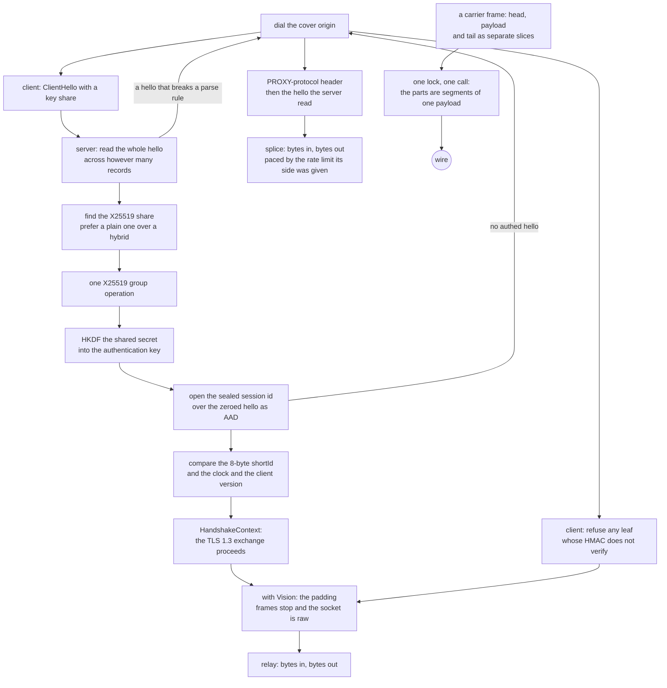

# REALITY and TLS

One TLS stack, one interface. `TlsProvider` is implemented by rustls and the provider *is* `Read + Write`, so nothing above this rung can depend on the stack underneath — no feature to select, no build without TLS, and no second provider to keep in step. `active_backends()` names it, and it names one.

REALITY dials raw TCP and every carried carrier, and serves the same set. The client seals the session id into a stock rustls hello in two passes over one scripted provider — the probe for the AAD, the flight with the seal — and refuses any leaf whose HMAC does not verify, so a cover origin never carries a proxy byte. A carried REALITY outbound rides the `ws`, `httpupgrade`, `grpc`, `xhttp` and `http-header` framings over the very seal the raw dial pays, so the hello is the one rung that does not care what sits above it; the UDP-carrier set (`quic`, `kcp`, `hysteria`) stays refused for want of a client leg. The rest is the handshake's cost.

What the handshake does: read the ClientHello, find the X25519 key share, do one group operation, derive the shared secret, HKDF it into an authentication key, and check that the certificate the peer presented is the certificate this session's key can account for — plus an eight-byte `shortId` compared against what the client sent. The certificate is minted per authentication key, so two sessions never present the same bytes.

## Data path



## Measured

<!-- counts:begin -->
| key | value | checked by |
| --- | --- | --- |
| ops-retired-instructions | UNBLESSED | scripts/count-ops.sh |
| tls-providers | 1 | ferrox-core::active_backends |
| client-outbound-rows-dialled | 6 | ferrox-app-proxy::tests::vless_outbound_with_reality_dials_raw_and_every_carrier |
| client-carriers-roundtrip-verified | 1 | ferrox-app-proxy::tests::reality_ws_dial_reaches_echo_through_the_relay |
| x25519-shares-recognised | 3 | ferrox-core-reality::tests::the_x25519_share_is_found_in_every_group_that_carries_one |
| short-id-bytes | 8 | ferrox-core-reality::tests::a_short_id_is_zero_padded_to_eight_bytes |
| cover-origin-dials-per-authenticated-hello | 0 | ferrox-core-reality::tests::an_authenticated_hello_costs_the_cover_origin_nothing |
| cover-origin-bytes-per-spliced-hello | 1 | ferrox-core-reality::tests::an_unauthenticated_hello_is_spliced_into_the_cover_origin_byte_for_byte |
| cover-origin-dials-per-unparseable-hello | 1 | ferrox-core-reality::tests::a_hello_that_cannot_be_parsed_still_reaches_the_cover_origin |
| cover-origin-dials-per-silent-peer | 0 | ferrox-core-reality::tests::a_peer_that_sends_nothing_costs_the_cover_origin_nothing |
| peer-reply-bytes-per-spliced-request | 1 | ferrox-app-proxy::tests::the_cover_origin_splice_carries_the_reply_back_to_the_peer |
| proxy-protocol-header-bytes | 28 | ferrox-core-reality::tests::the_binary_proxy_header_is_a_fixed_rectangular_twenty_eight_bytes |
| hello-buffers-per-single-record-read | 1 | ferrox-core-reality::tests::reading_a_single_record_hello_allocates_one_buffer |
| tls13-session-tickets-per-authenticated-handshake | 0 | ferrox-core-reality::tests::an_authenticated_session_sends_no_tickets_after_the_handshake |
| certificateverify-signature-scheme | ED25519 | ferrox-core-reality::tests::the_reality_certificate_verify_answers_ed25519_the_peer_never_offered |
| disarmed-limiter-records-per-read | 2 | ferrox-core-reality::tests::a_disarmed_limiter_stops_bounding_reads |
| addrs-resolved-per-xver0-handshake | 0 | ferrox-app-proxy::tests::reality_edges_skip_lookups_without_xver |
| client-hello-passes-per-handshake | 2 | ferrox-core-reality::tests::client_hellos_differ_only_in_the_session_id |
| sealed-session-id-bytes | 32 | ferrox-core-reality::tests::client_seal_matches_the_test_oracle_byte_for_byte |
| unauthenticated-servers-accepted | 0 | ferrox-core-reality::tests::a_client_with_a_wrong_key_is_refused_before_any_proxy_byte |
| server-shared-session-poll-millis | 1 | ferrox-app-proxy::tests::a_server_relay_bounds_the_shared_session_to_one_tick |
| late-hello-grains-survived | 12 | ferrox-app-proxy::tests::a_plain_tls_lane_retries_a_hello_that_arrives_past_the_grain |
| unsafe-fingerprint-header-bytes-added | 0 | ferrox-core-vless::tests::an_unsafe_fingerprint_adds_no_header_byte |
| plaintext-to-public-header-bytes-added | 0 | ferrox-core-vless::tests::pattng_plaintext_to_public_needs_opt_in_and_adds_no_byte |
| certificate-refusals-folded-into-other | 0 | ferrox-core-tls::rustls_backend::tests::mismatched_certificate_name_fails |
| trust-anchors-parsed-per-dial-after-the-first | 0 | ferrox-core-tls::rustls_backend::tests::the_parts_a_config_is_built_from_are_built_once |
| trust-anchor-bytes-copied-per-dial | 0 | ferrox-app-foxy::loopback::every_dial_of_one_trust_names_the_same_anchors |
| handshakes-skipped-by-an-earlier-dials-ticket | 0 | ferrox-core-tls::rustls_backend::tests::a_second_dial_with_the_same_config_still_fetches_the_chain |
| untrusted-dials-counted-as-retryable | 0 | ferrox-app-proxy::tests::a_refused_chain_is_a_refusal_not_a_drop |
| session-writes-per-frame | 1 | ferrox-app-proxy::tests::a_frame_reaches_the_tls_session_in_one_call |
| session-sends-per-64KiB-window | 1 | ferrox-app-proxy::tests::a_window_leaves_the_session_in_one_send |
| session-sends-per-frame-wider-than-the-batch | 2 | ferrox-app-proxy::tests::a_frame_wider_than_the_batch_leaves_in_batches |
| transport-reads-per-flush | 0 | ferrox-core-tls::rustls_backend::tests::a_flush_does_not_read_the_transport |
| transport-reads-per-write | 0 | ferrox-core-tls::rustls_backend::tests::a_write_does_not_read_the_transport |
| transport-reads-per-answer-write | 0 | ferrox-core-tls::rustls_backend::tests::a_server_answer_write_does_not_read_the_transport |
| relay-write-waits-for-a-parked-read | 0 | ferrox-app-proxy::tests::a_relay_write_goes_out_while_the_reader_is_parked |
| session-write-waits-for-a-parked-read | 0 | ferrox-app-proxy::tests::a_session_write_goes_out_while_its_read_is_parked |
| session-read-waits-for-a-parked-write | 0 | ferrox-app-proxy::tests::a_session_read_runs_while_its_write_is_parked |
| relay-reads-on-an-unarmed-handle | 0 | ferrox-app-proxy::tests::the_socket_half_reads_on_the_armed_handle |
| tls-arm-cells | 4 | scripts/run-benchmark-matrix.sh |
| census-waits-per-relay-read | 0 | ferrox-app-proxy::tests::a_release_build_registers_no_census_wait |
| user-space-copies-per-framed-write | 0 | ferrox-app-proxy::tests::a_frame_reaches_the_tls_session_in_one_call |
| seal-into-instructions | UNBLESSED | scripts/count-ops.sh |
<!-- counts:end -->

`certificate-refusals-folded-into-other 0` is the shape of a refused chain in the error type: the reason lives inside `BadCertificate`, so a caller matches the kind and still reads which certificate problem it is. `untrusted-dials-counted-as-retryable 0` is what that buys on the dial plane — `tls_failure` can only report a refusal when the backend still names one, and before this a refused chain reached it as `Other`, so it classified as a peer that hung up and counted into the retryable dial total.

`session-writes-per-frame 1` and `user-space-copies-per-framed-write 0` are the frame seam: what `FrameWrite::write_slices` hands the session when a carrier frames a write onto a `TLS` stream. Their checker is `a_frame_reaches_the_tls_session_in_one_call`, a session that records the calls it receives instead of sealing records, driven through the real `h2::write_frame` and the three-segment `write_slices` a gathered batch hands over. It counts one call per frame with two segments and then three, and it fails if the payload segment is not the caller's own buffer — the pointer-identity shape, because a test that compared bytes would pass just as happily on a frame staged into one scratch buffer. The same test asserts the recorded bytes are exactly the two frames concatenated, so the stream the peer decrypts is named as unchanged rather than claimed. `relay-write-waits-for-a-parked-read 0` is the relay's own half: `relay_stream` holds one lock per side and used it for the read and the write alike, so a read parked in the kernel held the lock the other direction's write wanted and the download's bytes waited for the upload's poll grain. A socket's read and its write never touch each other, so a socket's side is two handles of that socket now and no lock stands between them. `a_relay_write_goes_out_while_the_reader_is_parked` is the witness: it drives an in-memory reader that parks until it is released beside an in-memory writer, and it fails when the writer's bytes only leave after the reader's read has ended, which is what the one-lock half did. `session-write-waits-for-a-parked-read 0` is the session's own half, and it was the open row: a session's read and its write are one object behind one lock, and the read parked in the transport — waiting out the `SESSION_POLL` arm, one millisecond — while holding that lock, so the other direction's write waited out the peer's silence once per buffer. `a_session_write_goes_out_while_its_read_is_parked` is its witness: a session's read parked in its transport beside a write, and the write's bytes go out before that read ends. `relay-reads-on-an-unarmed-handle 0` is the other edge of that split: the caller arms the read wait on the handle it hands over, so that handle keeps the read and the duplicate takes the write — on Windows a duplicated socket is an independent handle that inherits no timeout, and a read served there has no bound and so never notices its sibling ending, while on unix both handles share one arm and the swap adds no syscall. `the_socket_half_reads_on_the_armed_handle` is its witness: it gives `Half::socket` an in-memory handle that records which of the two served each call, and fails if the read is not the armed one. The matrix has a `TLS` arm now: `vless-tls-raw-down-8`, `vless-tls-raw-up-1` and the duplex pair `vless-tls-raw-duplex-8`/`vless-tls-raw-duplex-16` carry a VLESS session over a `TLS` one, so the rate this rung moves is measured against the reference in the same cell as every other arm. The arm's fixture is a self-signed certificate and its key minted at run time into `target/matrix-tls/` by `ferrox-bench make-tls` (checked by `make_tls::tests::the_minted_pair_names_the_carrier`), because a private key in the tree is a leak surface and `scripts/check-fixture-safety.sh` fails one; the path the engines are given is absolute, because they do not read it the same way — `xray-core` resolves a relative certificate path against its own executable directory rather than the directory it was spawned in, so a relative path finds the file for one engine and not for another — and on Windows it is the path Windows spells, because a Git-Bash path is not one a native engine can open. The client is told to trust it three ways at once, because the three references read three different spellings: this tree reads `caCertFile`, the pinned `xray-core` reads `pinnedPeerCertSha256` (the certificate's own SHA-256, read off the file so the two cannot drift), and the third reads a `certificates` entry marked `usage: "verify"`. The arm's first measurement over `vless-tls-raw-down-8` on `ubuntu-latest` gave ferrox **1079 / 1247 / 1205 MiB/s** and the pinned `xray-core` **713 / 760 / 748 MiB/s**, on the same cell; the same cell without TLS (`vless-raw-down-8`) gave ferrox **6458 / 6804 / 6735 MiB/s**, so the session still costs the lane most of what the plain path costs. That measurement also found the arm's own defect — the reference engine could not start, because it resolves a relative certificate path against its own executable directory — and the stall a flush caused, which is what `transport-reads-per-flush` counts. The upload cell (`vless-tls-raw-up-1`) is the row's open work: the same run gave ferrox **117 / 117 / 118 MiB/s** against the reference's **440 / 454 / 445** and the third's **774 / 928 / 809**, while the same cell without TLS (`vless-raw-up-1`) gave ferrox **5407 / 5250 / 5462** — so a session costs the upload forty-six times what it costs the download, and the direction that writes into a session is the slow one. The reason is the lock the two directions of one session share: the idle reader parks in the transport, waiting out the `SESSION_POLL` arm — one millisecond — while holding the lock the busy writer wants, so the upload moves one relay buffer per grain. Both ends of the session pay it, because this arm's engine is the client that writes and the server that reads, and the download does not, because there the busy leg is the reader. The way out was the one this page already names: a session that handed its transport to the relay would carry no lock across the wait, and the raw `TCP` client's relay does exactly that now. The arm's cells say what it was worth: `vless-tls-raw-up-1` gave ferrox **735 / 709 / 690 / 744 / 747 MiB/s** against the reference's **452 / 451 / 453 / 453 / 455** and the third's **800 / 797 / 766 / 902 / 951**, where it had given **117 / 117 / 118** — from 0.26× the reference to 1.6× it — and `vless-tls-raw-down-8` gave ferrox **1627 / 1656 / 1693 / 1646 / 1539** against the reference's **878 / 893 / 899 / 869 / 866**, where it had given **1079 / 1247 / 1205**. Both raw ends do that now, so a download's busy writer and an upload's busy reader each hold nothing across the wait. The price is one staging pass — the bytes the relay read are copied into the session's deframer, where `complete_io` read the socket into it directly — and the witnesses are the client lane's `a_session_write_goes_out_while_its_read_is_parked`, `a_driven_session_carries_a_bulk_echo` and `vless_over_tls_carries_a_bulk_download`, plus the served lane's `a_served_tls_session_carries_a_bulk_download`: a megabyte from a real target to a real client session through `serve_vless_tls`. The arm's cells after the served drive, on `ubuntu-latest`: `vless-tls-raw-down-8` gave ferrox **1541 / 1470 / 1567 / 1539 / 1538 MiB/s** against the reference's **699 / 719 / 711 / 715 / 717** and `zeronet`'s **1240 / 1225 / 1238 / 1295 / 1254**, 1.24× zeronet where the client-only build gave 1.05×, and `vless-tls-raw-up-1` gave ferrox **1243 / 1222 / 1308 / 1204 / 1275** against the reference's **457 / 473 / 469 / 466 / 468** and `zeronet`'s **935 / 931 / 752 / 858 / 890**, 1.40× zeronet where the client-only build gave 0.92× and behind it. The session's write no longer carries it: a write seals its records into the caller's buffer under the session's lock, and the ciphertext leaves for the transport after that lock drops, so a peer that stopped draining one direction parks that send instead of the same session's decryption — `session-read-waits-for-a-parked-write 0`, gated by `a_session_read_runs_while_its_write_is_parked`. What is still open is the sessions that read their own transport — the carriers and the `REALITY` lane — where a read orders behind an in-flight send, because such a session can answer a peer's key update on the same wire. The duplex cells are the measurement that was missing: before them the only duplex cell relayed two socket handles, the one path with no shared lock. `ops-retired-instructions` stays `UNBLESSED`: no instruction count is quoted for this rung, and the call count above is the measurement. `session-sends-per-64KiB-window 1` and `session-sends-per-frame-wider-than-the-batch 2` are the wire side of that seam. A 64 KiB relay window is four records, and `FrameWrite for TlsHalf` sealed one window and sent it before sealing the next, so a window cost four transport writes and a carrier's head plus its window cost five. The records are sealed window by window into `Sealed::bytes` and the batch leaves with one send; the batch is cut at `RELAY_BUFFER + SESSION_WINDOW`, so a frame wider than one relay window — an `h2` peer that advertises a wide frame size — leaves as one send per batch and never sizes the staging buffer. `a_window_leaves_the_session_in_one_send` drives a bare 64 KiB window and then that window behind a nine-byte frame head over a transport that records each send's length: four and five seals, one send of 65 536 bytes and one of 65 545, the bytes in order; `a_frame_wider_than_the_batch_leaves_in_batches` drives `SESSION_BATCH + SESSION_WINDOW` and reads back two sends of 81 920 and 16 384. What did not move: the record boundaries, the bytes the peer decrypts, and the lock — a seal still takes the session's lock and a send still happens after it drops. What this does not reach: a plaintext carrier, where `FrameWrite for Connection` was already one `writev`, and `vless-tls-ws-down-8` is the one matrix cell that frames a carrier onto a session.

## Ops

```bash
./scripts/count-ops.sh report \
  reality::tests::an_authenticated_hello_is_accepted 'ferrox_core::tls::reality::authenticate'
```

`UNBLESSED`, as above, and `scripts/method-ops.txt` names no REALITY symbol, so `ops.yml` will not report one until it does. `seal-into-instructions` is the encrypt-to-buffer step's own count and is `UNBLESSED` for the same reason: `scripts/method-ops.txt` names no TLS `seal_into`, so no frame is measured and no number is quoted.

## Time

**Not measured yet.** `der_to_pem 2653` is the single instruction count this repository has ever blessed, and it is measured by `ops.yml` on `ubuntu-latest` because valgrind does not exist on the other runners. No handshake duration is quoted from a machine without a named runner.

The frame seam has no duration either, and it is not a runner problem: the matrix's `TLS` arm is raw, and one scenario frames a carrier onto a session — `vless-tls-ws-down-8` — where no scenario gives `grpc` or `xhttp` a `tlsSettings`, so every other framing cell reaches the wire in the clear and never frames onto a `TLS` session. A throughput row here would measure something else. The seam is gated by the write and send counts above and by the rows that do carry a frame over a session: the workspace's `TLS` carrier loops, `vless-tls-ws-down-8` in `benchmark-matrix.yml`, and CI's `conformance` and upstream suites. Giving `grpc` and `xhttp` the same arm is the open row that would change that, and it is not this page's to settle.

## What we removed

- **The record a flush pushed came with a read the peer had not sent.** A session's flush went through rustls's `complete_io`, which reads as well as writes, so every flush waited for a record the peer was not going to send and then paid the socket's read grain for finding out. The relay's write held the session's lock through that wait, so a lane that wrote waited on the peer's silence before the next byte could go out. The flush now hands the transport only the ciphertext that is queued, which is what rustls's own `Stream::flush` does. `a_flush_does_not_read_the_transport` is the witness: it writes a payload over a loopback session whose peer answers nothing, and it counts the reads that reach the transport, which is exact because every read is one this tree asked for. Before the change the flush read the transport twice; now it reads it not at all. What did not move: the bytes on the wire, the records themselves, and the handshake, which still reads because it has to.
- **The read every write paid for.** The flush's read was the first of five: `write`, `write_parts`, `write_all_slices` and the server's counterparts queued a record and then called `complete_io`, which reads as well as it writes, so a framed write cost a socket read — up to the session's read quantum, `SESSION_POLL` one millisecond — under the relay's shared lock, waiting for a record the peer had not sent. All of them now share `send_pending`, which pushes the queued ciphertext and waits for nothing, and the idle answer stays the write's: a socket that reported `EAGAIN` is not a failed write. `transport-reads-per-write 0` is the client's half, gated by `a_write_does_not_read_the_transport` — a connected client writes one record against a peer that never answers, and the transport's read count must not move — and `transport-reads-per-answer-write 0` is the server's half, gated by `a_server_answer_write_does_not_read_the_transport` over the same counting transport, with a peer that drains the answer and sends none back. What did not move: the bytes on the wire, the records themselves, and the read side and the handshake, which still run `complete_io`, because a read has to read and a handshake has to wait for an answer.
- **A session's read held the lock its writer wanted.** A `TLS` session's read and its write are one object behind one lock, and the read parked in the transport — waiting out the `SESSION_POLL` arm, one millisecond — while holding it, so a relay's busy direction waited out the peer's silence once per buffer: the arm's upload cell gave ferrox **117 / 117 / 118 MiB/s** against the reference's **440 / 454 / 445**. Both raw `TCP` relays — the client that dials and the server that serves — now read the transport themselves: the ciphertext comes off the socket with no session lock held, and only the decryption is under it, so the wait costs the writer nothing. The relay reads the transport in thirty-two-kilobyte bites, and the session takes the ciphertext in the pieces its own deframer has room for, so the session's lock is taken as often as it was and holds nothing across the wait. The price is one staging pass: the bytes the relay read are copied into the session's deframer, where `complete_io` read the socket into it directly, and that pass is what buys the wait. `session-write-waits-for-a-parked-read 0` is the row, gated by `a_session_write_goes_out_while_its_read_is_parked`; `a_driven_session_carries_a_bulk_echo` is the other half, a payload that crosses several records coming back byte for byte through the relay's own read; `vless_over_tls_carries_a_bulk_download` is the client lane's own, a megabyte through the real dial, which is where a session that kept feeding itself after the caller's window was full filled its own buffer and closed the lane; and `a_served_tls_session_carries_a_bulk_download` is the served lane's, a megabyte from a real target to a real client session through `serve_vless_tls`. What did **not** move: the bytes on the wire, the records themselves, and the sessions that still read their own transport — the carriers and the `REALITY` lane — which carry the wait as before. The two cells after both ends read `1.24×` and `1.40×` `zeronet`, where the client-only build read `1.05×` and `0.92×`.
- **A session's write held the lock its reader wanted.** `DrivenHalf::write`, `TlsHalf::write` and every `SessionSink` took the session's lock and called `session.write`, and the transport write inside it parked there with no write timeout armed on a `TLS` socket, so a peer that stopped draining one direction stopped the other direction's decryption too: `session.open` waited for a socket write it had nothing to do with. A write now seals under the lock into the caller's buffer and the ciphertext leaves after that lock drops, on a transport handle of its own. `session-read-waits-for-a-parked-write 0` is the row, gated by `a_session_read_runs_while_its_write_is_parked`, which parks a write in the transport and asks a four-byte read to answer while it is parked. The price is one staging pass per record — the ciphertext comes out of rustls's queue into the caller's buffer before the socket sees it — and that pass is what buys the wait. What did **not** move: the bytes on the wire, the records themselves, and the carrier and `REALITY` halves, whose read still orders behind a send in flight because their session can answer a peer's key update on the wire.
- **The census every relay read paid for.** The census that names a wait for a stall hunt is a map behind a global lock, and every relay read registered its wait in it: the lock twice, a clock read, a contended atomic and a linear scan under the lock, for a map nobody reads. A release build's relay registers nothing — the registration returns before the map, the lock, the clock and the scan — and a debug build, where a stall hunt looks, still has all of them. `a_release_build_registers_no_census_wait` is the witness: it drives one relay read and holds the census's own counter still in a release build, and the ops job builds its binary in release, so that row is the shipped shape's. What did not move: the bytes on the wire, and the census a debug build keeps.
- **A relay half that made the writer wait for the reader's parked read.** `relay_stream` held one lock per side and used it for the read and the write alike, so a read parked in the kernel held the lock the other direction's write wanted: the download's bytes waited for the upload's poll grain before they reached the peer, and the flow moved one buffer per grain. A socket's two directions never touch each other, so a socket's side is two handles of that socket (`Half::socket`) and no lock stands between them; a session's read and its write are one object, so that one keeps its lock. The two shared halves a client dial arms are those sessions, and their read is now bounded to the shared grain (`SESSION_POLL`, one millisecond) that this tree already names for exactly this — the client dial armed the idle grain before, and the server arm was already at the shared one. What was **not** removed: the shared session's lock itself, and the wait it holds: a session's read is the session's own read, so it holds that lock across the wait, and the wait is a millisecond rather than the twenty the idle grain would have been. The price is a poll: a shared session's idle read now wakes a thousand times a second where the idle grain woke it fifty. A session that handed its transport to the relay instead of reading it itself would carry no lock at all, and the wait would be the readiness seam this tree has planned; that is the open row, and no byte on the wire moves either way.
- **A second TLS stack to keep in step.** Xray carries REALITY as a fork of `crypto/tls` at a pinned pseudo-version, and reaches into `tls.Conn` with `reflect` plus `unsafe.Pointer` at `proxy.go:688-728` to steal the live `input *bytes.Reader` and `rawInput *bytes.Buffer` so Vision can flush what was over-read. sing-box clones a `utls.Config` per handshake and builds the ClientHello **twice** — once, then again after filtering out ML-KEM (`common/tls/reality_client.go:144-160`) — and then reads an unexported `peerCertificates` field through reflection and `unsafe.Add` to verify (`:284-306`). One provider that *is* the stream means Vision never needs to reach into anything, which is why [the Vision page](xtls-vision.md) can end the framing by handing the socket over instead of by copying bytes out of someone else's buffer.
- **A per-dial rebuild of what only the config names.** Every client dial parsed its trust anchor DERs into a `RootCertStore`, cloned and re-sorted the crypto provider for the `cipherSuites` order, and — where the outbound pins — built a `WebPkiServerVerifier` over that store before assembling a `ClientConfig` around them. None of that depends on which host is being dialed or which ALPN is offered next, so the second outbound to the same remote spent it again; the three inputs now name one shared build, found by pointer identity by `the_parts_a_config_is_built_from_are_built_once`. Sharing the parts then made sharing the whole config worth having: rustls offers a stored ticket only under a pointer-equal verifier, so a config rebuilt per dial threw away the ticket the last dial saved, and the cache now holds one `ClientConfig` per trust inputs and `ALPN` for the life of the process. A second dial of one edge therefore resumes instead of re-verifying its chain — `the_second_dial_to_one_edge_resumes` dials one listener twice and reads `HandshakeKind::Full` then `HandshakeKind::Resumed`. `handshakes-skipped-by-an-earlier-dials-ticket 0` is the other half of the same gate: two *different* listeners must not answer as one edge, so a ticket one left is unknown to the next and both are handed a chain.
- **A platform trust store read and copied per dial.** `system_roots()` asked the OS keychain or a CA bundle for every certificate it trusts, mapped each one into a fresh `Vec`, and returned that list by value; a hysteria cover-origin `https` request reached it again on every request, and a foxy flow deep-copied the list into the `FoxyDial` and again into the `TlsConfig` built from it. The store is now read once for the process and carried behind `Anchors` (an `Arc<[Vec<u8>]>`), so a dial costs a reference count, the config cache compares two anchor lists by pointer before it compares their bytes, and `every_dial_of_one_trust_names_the_same_anchors` fails if a dial ever copies again. What was **not** removed: the anchor bytes are still held per-certificate as `Vec<u8>`, because quiche is handed a staged PEM bundle built by walking them; the hysteria `Server` and `QuicServer` pool keys still `Hash` the anchors by content, because a config built from a CA file and the same config read back must pool together, so pointer-hashing them would break that key; and `alpn` is still a `Vec<Vec<u8>>` cloned per dial, which is one short list, not a store.
- **Reflection and `unsafe` in the handshake.** The gates are `an_authenticated_hello_is_accepted`, `every_unauthenticated_hello_is_refused` and `the_certificate_differs_per_auth_key`.
- **A hybrid key share when a plain one is present.** One group operation per authenticated hello, not two; `a_plain_share_is_preferred_over_a_hybrid_one` is the gate.
- **One cover-origin dial per accepted socket.** Both references dial the real site *before* reading a byte, so a port scanner costs one outbound connection each. The dial here is lazy: an authenticated hello costs the cover origin nothing, and a refused one costs exactly the hello the server read, which is `an_authenticated_hello_costs_the_cover_origin_nothing` and `a_peer_that_sends_nothing_costs_the_cover_origin_nothing`.
- **A refusal that closed the socket instead of answering it.** A hello that broke a record or parse rule — not a handshake record, an oversized length, an EOF partway through the body, a `ClientHello` that will not parse — was dropped, while all three references splice whatever they could not authenticate. The close is the detectable break and the hang: a real browser that happened to send an unusual hello got a reset where its own site would have answered. The bytes spent before the break now travel with the splice, and only a peer that sent nothing at all is still closed; `a_hello_that_cannot_be_parsed_still_reaches_the_cover_origin` is red both ways — dialled nothing, or sent bytes the server never read.
- **Two session tickets after every handshake.** rustls sends two by default and both references send none, so the REALITY identity pins the count at zero while plain TLS keeps two; `an_authenticated_session_sends_no_tickets_after_the_handshake` reads the wire flight (ServerHello, dummy cipher change, one encrypted flight) and asserts the constructed count on both identities. Tickets are emitted only once the client's Finished arrives, which no test peer can send without forking the sealed transcript, so the count is pinned where it is set.
- **Scheme negotiation in `CertificateVerify`.** No `uTLS` fingerprint offers `Ed25519`, so a stock negotiation answers `NoSharedCipher` and the handshake dies after authenticating. All three references comment the negotiation out and hard-set `Ed25519`; the `REALITY` identity here does the same through one signing-key wrapper, and only that identity — plain `TLS` rows keep negotiating. `the_reality_certificate_verify_answers_ed25519_the_peer_never_offered` is the gate.
- **A relay that holds a full echo until close.** The shared copy loop wrote each chunk with `write_all` and never flushed, which is nothing on a raw socket and a stall on a `TLS` session: the framed echo sat in the send buffer until a later read drove the stack, and a request/response exchange has no later read. When either direction ends the loop now closes the other side too, or the far end never learns the exchange is over and waits out its own deadline instead. `a_relay_write_is_sent_without_waiting_for_close` and `a_finished_relay_closes_the_other_side` drive a flush-gated writer with no sockets at all, and the `reality_vision` conformance row is the witness.
- **A splice that outlived its own exchange.** Once both directions were live, a cover origin that stays open and silent pinned the far pump forever: `copy_paced` stopped only on bytes or an error, and its poll timeout only continued. A finished leg now raises a flag the sibling notices on its next twenty-millisecond grain, the same end-the-other-side discipline `copy_stream` already keeps; `the_cover_origin_splice_ends_when_the_peer_finishes` holds a keep-alive-silent origin against a finished peer and is red without the flag.
- **A splice that pumped the upload twice.** `relay_fallback` crossed its copy directions, so both `copy_paced` pumps read the client and wrote the cover origin: the origin's reply never reached the peer, and two racing readers of one client half could deliver the hello to the origin out of order. The directions are crossed now, and the spliced target carries the same twenty-millisecond poll every other relay point sets, because an untimed read on a silent origin holds the mutex its upload writes on. `the_cover_origin_splice_carries_the_reply_back_to_the_peer` drives both legs over loopback and fails red on either direction.
- **A server relay that read its shared session at the idle grain.** Two pumps hold one session through one half-lock: one reads it to forward the request, the other writes the answer into it. A read that parks for a whole twenty-millisecond grain holds that lock for the grain, so the answer waits out every silence. Every other session-shared rung already bounds this: the client sets a one-millisecond poll at dial time, and carried sessions hand the pumps halves that sleep unlocked between polls — only the server raw arm never lowered its grain. `relay_vless` bounds the shared fd to one tick while the flow moves and arms the relay's twenty once a burst has gone quiet, so an idle session wakes fifty times a second instead of a thousand; a write returns it to one tick before the next park. `a_server_relay_moves_an_idle_shared_session_to_the_relay_grain` reads the fd's timeout back after the tunnel grant and after a byte moves: one tick, twenty when the grace is spent, one again — the idle transition red before the policy.
- **A REALITY client that stopped sending to wait for the answer.** `dial_vless_reality` wrote its request, blocked in `read_vless_response` on the session, and only then started the relay — against a server that holds its `[0, 0]` until it has payload to send (`HeaderFirst::hold` waits for it outright, xray flushes a buffered response on the first downstream write) neither end ever moved, and the oracle's two REALITY client rows died at their fifteen-second echo with `up=0 down=0 stage=RequestSent`. Every other carrier rung pumps the upload while the answer is overdue, and REALITY is a carrier: the write half now goes to the same `Pump` and the session comes back through its one lock when that owner joins, so the relay pays no shared lock and Vision still gets the concrete session for its direct switch. The pump is parked for the hundred-millisecond grace and released by the answer itself, so a server that answers at once costs one pool task and no wire byte. `vless_reality_client_pumps_the_upload_before_reading_the_response` holds a REALITY server that answers only after four payload bytes: red at five seconds without the pump, green at a sixth of one with it.
- **A split hello reassembled twice.** The reader grows one buffer and stops at the declared handshake length, then hands rustls the same bytes through a replay prefix, so the record framing is read once rather than re-parsed by a second implementation. A timeout keeps waiting for a hello that arrived in two segments instead of refusing a handshake that was working. A hello that arrives in one record is never copied aside: it authenticates out of the record stream with the session id restored afterwards, so the read is one buffer and only a split hello gathers a second.

- **A session that dies when Vision goes direct.** The outer TLS stack reads past the last framed record into its own buffer, so the raw bytes after it are stuck inside the session just as the read side switches to the raw socket, and the next outer read decrypts raw bytes with the outer keys. `xray-rust` keeps a record-bounded reader in front of its stack for exactly this (`penetrating_tls.rs`); this tree does the same with one `RecordLimiter` that caps every socket read at the current record's end, so the unwrap is lossless and no `unsafe` reaches into anyone's buffers. `record_bounded_reads_never_swallow_the_bytes_after_a_record` pins the chunking and `vision_direct_switch_carries_inner_tls_over_loopback` carries eight inner-`TLS` rounds through the switch on loopback. The plain-`TLS` accept wraps the same limiter open: it only tracks until the `Link` throws the switch at the first 1.3 `ServerHello`, so lanes that never unwrap pay one branch per read and no extra syscall, and foxy never sees it at all.
- **A handshake that refuses a slow peer.** Every socket here polls on a twenty-millisecond grain, and the `REALITY` handshake took one attempt: under a thirty-two-flow burst a slow flight read landed past the grain and the flow died as `socks connect rejected`, five to eleven of thirty-two depending on the runner's mood. The handshake is now retried to the same thirty-second deadline the plain-`TLS` path already used, and the burst row is the witness.
- **A plain-`TLS` raw arm that still shook once.** The retry-to-deadline discipline reached the carrier arms through `accept_tls_session` and the `REALITY` arms through the burst fix, but the `Carrier::Raw` arm of `serve_vless_tls` — matrix row 2 — kept a single `handshake()` on the twenty-millisecond-grained socket: a `ClientHello` that arrived one grain late was refused, not retried, and the lane died before its own deadline. The retry loop was that discipline twice over — `shake_reality` was it with a `REALITY`-only name, and `accept_tls_session` carried an inline copy — so both folds now call one `shake_tls`, and the raw arm calls it too. `a_plain_tls_lane_retries_a_hello_that_arrives_past_the_grain` holds the hello twelve grains and refuses the lane at one: restoring the one-shot shake turns it red on the spot.
- **A service name compared unescaped.** The server built `/interop grpc/Tun` while every reference escapes the configured name Go's way, so the client asked for `/interop%20grpc/Tun` and the `grpc_reality` row died in warmup. `grpc_path` escapes one segment now, and `a_grpc_service_name_is_escaped_the_way_xray_escapes_it` pins it.

- **Five single-byte header iterations read as one five-byte load.** Both framers parse a header byte per loop trip with no observable in between, so a whole header present in the buffer parses at once and a split one falls back to the byte loop; `open_seeded_splits_match_whole_feeds` sweeps 32 seeded chunkings against whole feeds, short reads, mid-header splits and empty frames included.
- **A session that never goes direct stops bounding and tracking reads.** `disarm_record_alignment` is the else-branch of the Vision check on both roles, so non-Vision bulk pays one straight socket read; Vision flows keep the limiter and `engage` re-arms defensively. `a_disarmed_limiter_stops_bounding_reads` delivers two records in one read and every relay test still moves the same bytes.
- **A handshake without a PROXY header costs no address lookup.** The only reader of the edges is the `xver > 0` branch, so lookups happen only there; `reality_edges_skip_lookups_without_xver` pins default against real.
- **One client config builds both hello passes**, so the probe and the flight cannot drift apart; the determinism test still shows only the session id moving.
- **A refused chain that lost its name.** Every certificate problem used to be folded into `Other("bad certificate: …")` to carry the reason, so no caller could match one: `tls_failure`'s `BadCertificate` arm was unreachable, and a server whose chain this device does not trust classified as a peer that hung up — a dial worth retrying, and a message that says io. `BadCertificate(String)` keeps the kind *and* the reason, which is what `mismatched_certificate_name_fails` matches by variant and what the Foxy lane needs to stop asking an edge no second handshake makes trusted ([the Foxy lane](carrier-foxy.md)).

- **A record per part of a frame.** A carrier frame reaches a session as separate slices — a `ws` frame as head and payload (`ws.rs:410`), an `h2` `DATA` frame the same, head, envelope and payload as three of them, an `xhttp` chunk as size line, body and `CRLF` (`xhttp.rs:342`) — and `FrameWrite for TlsHalf` walked that list with one `write_all` per part. Each of those writes took the session lock, ran the handshake drive, handed rustls one buffer and called `complete_io`, so a frame cost two or three locks, two or three sealed records and two or three flushes, with a 9-byte frame head sealing a record of its own before the payload followed. The impl now locks once and hands the whole parts list to `RecordAlignment::write_all_slices`, which is the `coalesce` this tree already pays for Vision: the segments go out in one `write_vectored` (`rustls_backend.rs:342`, gated by `the_framer_path_coalesces_without_a_heap_buffer` at one call and zero allocations), so the fragmenter sees one payload and emits one record, and one lock covering the whole list means no other writer lands between a frame's parts. Two to one on lock, record and flush for a `ws` or `h2` `DATA` frame; three to one for an envelope-carrying frame and for an `xhttp` chunk. What did not move: the bytes the peer decrypts, which the witness compares against the two frames concatenated, and the plaintext path — `FrameWrite for Connection` still means one `writev`. What did move below the stream: the `TLS` record boundaries, since a record now begins at the frame head and runs on into the payload, and a body past one record still fragments. That is why the checker is not only a count: `reality_ws_dial_reaches_echo_through_the_relay` and `vless_outbound_with_reality_dials_raw_and_every_carrier` carry real frames over a session here, and CI's `conformance` and upstream suites are the pinned peers whose reassembly a record-shape change could break — both run on this diff, because the hunk sits in shared code and the plan is wide.

- **The gate behind those rows could not see the wait, and three of the five sites have no gate at all.** A control was run for each of the seven sites `send_pending` now covers: the site is put back on the reading `complete_io`, one at a time, over main's production code, and the three witnesses are read. The client's `Write::flush` fails `a_flush_does_not_read_the_transport` ("the flush read the transport 3 times where it had read 2"); the server's `Write::flush` fails `a_server_answer_write_does_not_read_the_transport` ("the answer read the transport 4 times where it had read 3") — but only once `ReadCounter::read` counts the call rather than the reads that returned, which is this slice's fix: as counted before, the same sabotage left every witness green, because the read that costs the relay its whole `SESSION_POLL` arm answers `WouldBlock` with nothing in it and `inner.read(buf)?` propagated before the counter moved. The client's `Write::write` needs an input its window did not have: a write of seven bytes leaves its record queued, and a `complete_io` with output returns after its write phase without reaching `read_tls`, so as landed `transport-reads-per-write 0` had no sabotage that could show it; a zero-length write queues nothing, so it is the call that reads, and with it in the window the same control fails "the write read the transport 2 times where it had read 1". `write_parts`, both `write_all_slices` and the server's `Write::write` show no read under any of these — each has a record queued when it reaches the call, which is the early-return state — so their conversion is a write path that can no longer wait, not a removal a count can name; the paragraph above that calls all five a measured socket read is the claim these controls narrow. Each witness now arms its own session transport with the relay's grain after its handshake, so a regression costs one counted grain instead of parking the thread in `recv`, where the suite hangs rather than fails; that needs the concrete `RustlsProvider`/`RustlsServerProvider`, which is why the two witnesses name them instead of going through `crate::tls`. `a_write_does_not_read_the_transport` also gains the `miri, ignore` its siblings carry: it drives a loopback socket, and under `cargo miri test` it would have hung the safety shard.

Tried and set aside with reasons: probe elimination (both references build twice and one RTT dominates the build), smaller Vision staging reads (read granularity moves the syscall count, which this page counts), zero-fill removal in padding (zeros are wire bytes), second relay copy removal (partial frames need the staging buffer), full edge laziness inside `accept` (a generic stream has no addresses; the `xver` gate covers the common path), and a relay write that drained records with `write_tls` instead of `complete_io` — `complete_io` returns after its write phase whenever it has output, so the steady-state write already spends no `recv`, and where it does read (pending incoming) that one packet is charged to the connection whichever pump reads it, so a drain-only flush moves the syscall rather than retiring it; an in-memory read-count witness reads zero on both forms, so no count gates the change. That last reason held twice over and is now half-refuted: the change landed anyway as the three `transport-reads-per-*` rows, and the witness reads zero on both forms only because it counted the reads that returned — once it counts the calls, the flush's read and a zero-length write's read are both visible, and the paragraph above is the control that says which sites still are not.

What is **not** removed, and stays named: a REALITY hello is the named parrot's shaped hello (row 38), sealed in the session id, and a name that shapes none — `unsafe`, `hellogolang`, an unknown one — is refused with that name rather than sent as a stock shape, as xray's REALITY refuses a nil fingerprint and a Go hello with no TLS 1.3 key share. The PattNG `unsafe-*` fingerprint is unaffected, because it rides plain `TLS`: `unsafe` means build the hello with the stdlib `crypto/tls` rather than uTLS, which is the stock hello this tree dials there. So row 18 is finished by `VlessLink::support_opted` honouring the out-of-band `UnsafeOptIn::allow_unsafe_fingerprint` (`--allow-unsafe-fp`), which clears the parse veto so a consented `fp=unsafe-*` reports `Implemented` and dials, while a bare link still refuses; `an_unsafe_fingerprint_adds_no_header_byte` proves the fingerprint adds no VLESS byte. The sibling consent `UnsafeOptIn::allow_plaintext_to_public` (`--allow-plaintext-public`) is built the same way: a bare link still vetoes `security=none` to a public address, but a consented link reads that session as the private `security=none` it is byte-for-byte, so the two consents are independent (`the_two_unsafe_consents_are_independent`) and the plaintext consent adds no byte either (`pattng_plaintext_to_public_needs_opt_in_and_adds_no_byte`). `cipherSuites` parsing (row 17) landed separately in `tls/cipher_suites.rs`. A carried REALITY outbound now dials the raw-carrier set the server already serves; only the UDP-carrier set stays refused rather than dialled, for want of a client leg. The `dest`-mimicry the references do (their `ServerHello` template and post-handshake record shaping, which no functional row needs), the `ML-DSA-65` second signature (verified when present, never sent), and the cover origin's own chain, which an authenticated session never presents here or upstream. A plain-`TLS` server that switches to direct has the same over-read shape and no limiter in front of it yet; no row carries inner `TLS` over plain `TLS`, so it is a named gap and not a carried cost. The inner-`TLS` lane carried over `KCP` (`serve_carried_tls`) still shakes once: its transport is paced by the `KCP` pump, not by a socket grain, and no row handshakes a late hello through it.
- **A send per record of a carrier window.** `FrameWrite for TlsHalf` sealed a record per 16 KiB window and pushed it with its own transport write before sealing the next, so a 64 KiB relay window — the unit the carrier paces since #382 — cost four writes, and a `ws` or `xhttp` frame cost five, the head filling the tail of a record. The records are sealed window by window into the one `Sealed::bytes` buffer and the batch leaves with one send, cut at `RELAY_BUFFER + SESSION_WINDOW` so a frame wider than one relay window cannot size that buffer. `session-sends-per-64KiB-window 1` and `session-sends-per-frame-wider-than-the-batch 2` are the rows: `a_window_leaves_the_session_in_one_send` counts sends over a recording transport (65 536 bytes for the bare window, then 65 545 behind a nine-byte head, four and five seals, the bytes in order) and `a_frame_wider_than_the_batch_leaves_in_batches` reads back two sends of 81 920 and 16 384 for a 96 KiB frame. What did not move: the record boundaries, the bytes the peer decrypts, and the lock discipline — one seal per window under the session's lock, one send after it drops. What this does not reach: a plaintext carrier, where `FrameWrite for Connection` was already one `writev`; `vless-tls-ws-down-8` is the one matrix cell that frames onto a session.
- **Three `getrandom` fills per dial.** `RealityClientSession::connect` asked the OS for the x25519 secret, the hello random and the GREASE pair in three separate fills, one syscall each; one 66-byte fill arms all three and no test sees the difference, because the scripted draws both passes read come from the `ScriptedRandom` provider and the oracle pins the seal, not entropy. Two syscalls fewer per dial; no loopback checker observes a `getrandom` fill, so the page records the shape and no row gate runs over it.

## Pins

| what | where |
| --- | --- |
| the fork of `crypto/tls`, the reflection into it | `upstream/xray-core` → `github.com/xtls/reality`, `proxy/proxy.go` |
| the double ClientHello, `utls`, reflection | `upstream/sing-box/common/tls/reality_client.go` |
| the certificate and shortId oracle | `github.com/xtls/reality` `tls.go:200-300`, `handshake_server_tls13.go:100-180` |

## CI scope

What a change here owes, read by `scripts/ci-scope.py`; see [`docs/ci-scope.md`](../ci-scope.md).

<!-- scope:begin -->
- paths: crates/ferrox-core/src/tls/mod.rs, crates/ferrox-core/src/tls/reality.rs, crates/ferrox-core/src/tls/rustls_backend.rs, crates/ferrox-core/src/tls/cipher_suites.rs
- symbols: reality
- oracle: reality
- scenarios: vless-tls-raw, vless-reality
- go: ./transport/internet/tls/...
<!-- scope:end -->
