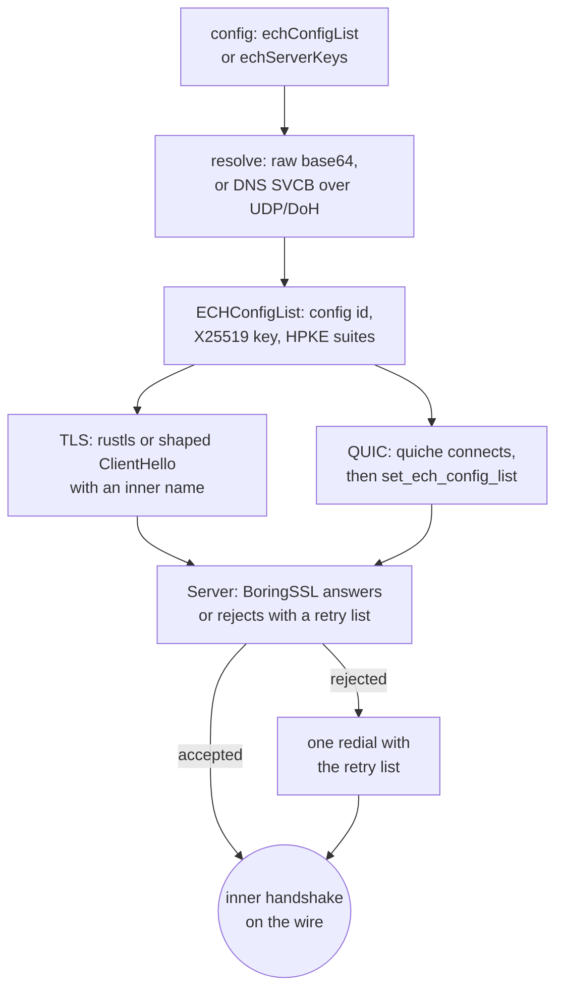

# ECH

`tlsSettings.echConfigList` carries an ECH config list as raw base64 or as `name+udp://…` / `name+https://…/dns-query`, and one list feeds both client lanes: the stock rustls dial in `crates/ferrox-core/src/tls/rustls_backend.rs` and the shaped dial in `crates/ferrox-core/src/tls/shaped/client.rs`. `tlsSettings.echServerKeys` is the base64 `u16 key || u16 config` TLV a TLS listener answers through BoringSSL. A QUIC listener hands the same keys to quiche's BoringSSL context, and a QUIC dial offers the same list before its first packet, so this method carries both roles on both transports. `echSockopt` (also read as `echSocketSettings`) marks the socket that carries the ECH DNS query.

The HPKE lane accepts X25519 with HKDF-SHA256 and AES-128-GCM, AES-256-GCM, or ChaCha20-Poly1305, so every suite an xray or sing-box key names is one this tree can answer. A bad config list fails the dial closed; a bad server key set refuses the inbound. A server that rejects an offer names its retry list, and the stock dial repeats the TCP and TLS handshake once with that list. The shaped lane reports the same list to the same one-retry caller. This is a setup path, not a per-record one.

## Data path



## Measured

<!-- counts:begin -->
| key | value | checked by |
| --- | --- | --- |
| aes256-gcm-seal-retired-instructions | 1517 | scripts/count-ops.sh |
| aes256-gcm-open-retired-instructions | 1587 | scripts/count-ops.sh |
| ech-offers-accepted-by-the-stock-lane | 1 | ferrox-app-proxy::tests::vless_over_ech_tls_carries_an_echo |
| rejected-ech-offers-retried-once | 1 | ferrox-app-proxy::tests::a_rejected_ech_offer_retries_once_with_the_servers_list |
| ech-offers-built-by-the-shaped-lane | 1 | ferrox-core-tls::shaped::hello::tests::a_real_ech_offer_hides_the_inner_name_under_the_public_one |
| quic-ech-offers-accepted | 1 | ferrox-app-quic::tests::an_ech_serving_lane_accepts_an_offer |
| quic-dials-that-offer-the-configured-list | 1 | ferrox-app-quic::tests::a_client_dial_offers_the_configured_ech_list |
| quic-lanes-that-fall-back-without-an-offer | 1 | ferrox-app-quic::tests::an_ech_serving_lane_answers_a_client_without_an_offer |
| heap-buffers-for-an-ech-cover | 1 | ferrox-core-tls::shaped::hello::tests::an_ech_cover_is_written_into_one_buffer |
<!-- counts:end -->

The stock test is the relay path: a VLESS flow over a TLS listener whose ECH key is the fixture's. The retry test first offers a valid config the listener does not hold, takes the retry list it returns, then keeps the second session. The QUIC tests read `ech_accepted()` on both ends, and the fallback test proves a client without a list still reaches the lane. The shaped hello test gates the real offer's outer and inner names, not a GREASE cover.

## Ops

```bash
./scripts/count-ops.sh report \
  tls::hpke::tests::aes_256_gcm_matches_the_nist_empty_message_vector \
  'ferrox_core::tls::hpke::Context::seal' \
  'ferrox_core::tls::hpke::Context::open'
```

The seal costs 1,517 retired instructions and the open 1,587. The NIST vector test is the deterministic probe: its fixed key, zero nonce and fixed plaintext mean the frame's count does not move with the offer's random key shares, and two `ops.yml` runs on the same tree returned the same pair. This host is macOS/aarch64, where valgrind has no build, so the exact-count gate in `./scripts/check.sh` is CI-only for the rows.

## Time

No matrix cell isolates ECH: the bench cells time a relay after the handshake, and an ECH dial does one extra TCP/TLS handshake only when the server rejects the offer. No duration is quoted here. The byte order is the gate: accepted offers keep xray's inner handshake, while a rejected offer follows this tree's one-retry path rather than xray's `SendAsRetry=false`.

## What we removed

- **A config rebuild for the retry.** The rejected offer clones the parsed `TlsConfig`, replaces its `ech_config_list` `Arc`, and reuses every other field; no text is parsed again and no server name is resolved again.
- **A second accept loop for QUIC.** The listener's BoringSSL context is built once per identity and shared with quiche; the dial sets the list on the connection it already made.

What was **not** removed: the retry costs one extra connection when a server rejects, and BoringSSL requires at least one retry config where Go/xray's `SendAsRetry=false` sends none, so a rejection's retry-list bytes differ from the reference even though an accepted offer does not.

## Pins

| what | where |
| --- | --- |
| ECH config list, DNS query, cache and `echServerKeys` TLV | `upstream/xray-core/transport/internet/tls/ech.go` |
| retry-on-rejection client | `upstream/sing-box/common/tls/client.go` |
| quiche's ECH setter | `upstream/quiche/quiche/src/lib.rs` |
| BoringSSL retry-config rule | `~/.cargo/registry/src/*/boring-sys-5.3.0/deps/boringssl/ssl/encrypted_client_hello.cc` |
| rustls rejection payload | `~/.cargo/registry/src/*/rustls-0.23.46/src/error.rs` |

## CI scope

What a change here owes, read by `scripts/ci-scope.py`; see [`docs/ci-scope.md`](../ci-scope.md).

<!-- scope:begin -->
- paths: crates/ferrox-app/src/ech_dns.rs, crates/ferrox-core/src/tls/ech.rs, crates/ferrox-core/src/tls/hpke.rs
- go: ./transport/internet/tls/...
<!-- scope:end -->
