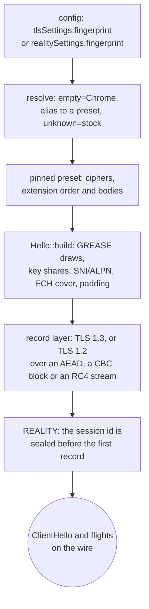

# uTLS fingerprints

`streamSettings.tlsSettings.fingerprint` and `realitySettings.fingerprint` name a browser whose ClientHello goes on the wire, and xray resolves that name through three tables in `transport/internet/tls/tls.go`: an empty name is `HelloChrome_Auto`, a name it does not know is `nil` and dials the stock hello, and every other name lands on a uTLS preset. `crates/ferrox-core/src/tls/shaped/` carries 31 of those presets as data, builds the hello from that table, and runs the TLS 1.3 or TLS 1.2 handshake under its own record layer — TLS 1.2 through either key transport (ECDHE, or a pre-master encrypted to the leaf) and either record shape (AEAD, or MAC-then-encrypt, CBC at the suite's own block width or RC4's stream with no IV and no padding), with the ECDHE point taken from the hello's `key_share` when it has one and drawn at the curve the `ServerKeyExchange` names, of the curves the hello advertised, when it does not; each lane answers a `CertificateRequest` with the empty chain the reference sends when its `TlsConfig` holds no client certificate; both client lanes — plain `security: tls` and REALITY — dial through it. uTLS shapes a client hello only, so this method has one role: the outbound dialer.

The reference is not copied. A preset is a `Profile` of cipher ids and `Ext` bodies, the builder walks that table once, and every hex in the oracle's golden is checked against the uTLS revision xray-core pins (`v1.8.3-0.20260301010127-aa6edf4b11af`, `upstream/xray-core/go.mod:18`). The xray name table is the reference for *which* names exist; the uTLS preset is the reference for their bytes.

## Data path



## Measured

<!-- counts:begin -->
| key | value | checked by |
| --- | --- | --- |
| ops-retired-instructions | UNBLESSED | scripts/count-ops.sh |
| oracle-cases-replayed-byte-identical | 50 | ferrox-core-tls::shaped::hello::tests::oracle_replay_matches_utls |
| distinct-presets-behind-those-names | 31 | ferrox-core-tls::shaped::hello::tests::oracle_replay_matches_utls |
| shaped-dials-that-complete-a-tls13-handshake | 1 | ferrox-core-tls::rustls_backend::tests::a_shaped_chrome_handshake_reaches_a_stock_server |
| shaped-dials-that-answer-a-tls13-client-auth-request | 1 | ferrox-core-tls::rustls_backend::tests::a_shaped_chrome_handshake_answers_a_client_certificate_request |
| shaped-dials-that-complete-a-tls12-handshake | 3 | ferrox-core-tls::rustls_backend::tests::a_shaped_dial_finishes_every_tls12_record_shape |
| relayed-records-that-allocate-once-warm | 0 | ferrox-core-tls::rustls_backend::tests::a_shaped_record_relays_without_allocating_once_the_handshake_is_done |
| shaped-records-resumed-after-a-poll-split | 1 | ferrox-core-tls::shaped::client::tests::a_record_split_by_a_timeout_is_resumed_not_lost |
| carrier-records-that-allocate-once-warm | 0 | ferrox-core-tls::rustls_backend::tests::a_carrier_record_lands_in_the_callers_window_without_a_stage |
| carrier-records-staged-into-a-fitting-window | 0 | ferrox-core-tls::rustls_backend::tests::a_carrier_record_lands_in_the_callers_window_without_a_stage |
| tls12-gcm-records-that-shift-their-plaintext | 0 | ferrox-core-tls::shaped::record::tests::a_tls12_gcm_record_opens_behind_its_explicit_nonce |
| tls12-cbc-records-that-shift-their-plaintext | 0 | ferrox-core-tls::shaped::record::tests::a_tls12_cbc_record_pads_to_the_rfc_length_and_open_back |
| tls12-3des-records-that-shift-their-plaintext | 0 | ferrox-core-tls::shaped::record::tests::a_tls12_3des_record_pads_to_its_own_block_and_open_back |
| heap-buffers-for-a-sealed-rc4-record | 0 | ferrox-core-tls::shaped::record::tests::a_tls12_rc4_record_carries_its_mac_and_no_iv |
| tls12-sessions-replayed-byte-identical | 16 | ferrox-core-tls::shaped::oracle::tls12_sessions_match_go |
| rsa-key-transport-vectors-replayed-byte-identical | 20 | ferrox-core-tls::shaped::oracle::rsa_key_transport_matches_go |
| table-spelling-resolutions-that-allocate | 0 | ferrox-core-tls::shaped::tests::a_table_spelling_resolves_without_a_heap_buffer |
| heap-buffers-for-a-chrome-hello | 2 | ferrox-core-tls::shaped::hello::tests::a_shaped_hello_writes_into_one_buffer |
| heap-buffers-for-an-ech-cover | 1 | ferrox-core-tls::shaped::hello::tests::an_ech_cover_is_written_into_one_buffer |
| heap-buffers-for-an-x25519-share | 2 | ferrox-core-tls::shaped::keys::tests::an_x25519_share_is_drawn_without_a_heap_buffer |
| heap-buffers-for-a-shuffled-hello-order | 0 | ferrox-core-tls::shaped::hello::tests::the_shuffle_draws_its_picks_without_a_heap_buffer |
| alpn-picks-that-allocate | 0 | ferrox-core-tls::shaped::hello::tests::an_alpn_pick_is_checked_without_a_copy |
| forced-alpn-lists-that-allocate | 0 | ferrox-core-tls::shaped::hello::tests::an_alpn_pick_is_checked_without_a_copy |
| heap-buffers-for-an-rsa-exponentiation | 8 | ferrox-core-tls::shaped::oracle::rsa_key_transport_matches_go |
| heap-buffers-for-a-post-handshake-flight | 0 | ferrox-core-tls::shaped::client::tests::a_post_handshake_flight_is_read_where_it_lies |
| certificate-entries-copied-out-of-the-record | 0 | ferrox-core-tls::shaped::client::tests::a_certificate_chain_is_read_where_the_record_lies |
| pulled-record-reads-outside-the-inbuf | 0 | ferrox-core-tls::shaped::client::tests::a_record_read_fills_the_inbuf_it_decrypts_from |
| inbuf-reallocations-per-record-cycle | 0 | ferrox-core-tls::shaped::client::tests::a_record_read_fills_the_inbuf_it_decrypts_from |
| heap-buffers-for-a-warm-relay-write | 0 | ferrox-core-tls::shaped::client::tests::a_warm_write_seals_into_the_buffer_it_already_owns |
| pulled-record-plaintext-copies-out-of-a-fitting-window | 0 | ferrox-core-tls::shaped::client::tests::a_tls13_record_is_read_where_it_lands |
| pulled-record-reads-per-window | 1 | ferrox-core-tls::shaped::client::tests::a_pulled_record_lands_in_one_vectored_read |
| heap-buffers-for-an-hpke-context | 0 | ferrox-core-tls::hpke::tests::a_context_costs_no_allocations |
| heap-buffers-for-an-ech-config | 1 | ferrox-core-tls::ech::tests::an_encoded_config_is_one_buffer |
<!-- counts:end -->

The 50 cases are the 31 presets plus the 19 names that alias onto them, so the alias table is gated by the same bytes it resolves to rather than asserted. `scripts/utls-oracle` zeroes the hello-phase entropy (random, session id, both 32-byte reads and the 10 GREASE bytes), erases the key-share, ECH-payload and key material after the fact, and prints the remaining body; both seeds are fixed, so the golden is stable. The oracle dials with `utls.Config.OmitEmptyPsk`, the only way a psk preset holding no session reaches the wire, and every shuffled case prints the body ahead of its extensions as a fourth field, so a shuffled preset gates its cipher list and not only its extension multiset.

`scripts/tls12-oracle` captures sixteen Go-to-Go TLS 1.2 sessions — one per suite Go's record layer keys past the AEAD names xray already reached: the six ECDHE-CBC ids, the five static-RSA ones, the two 3DES-EDE-CBC rows and the three RC4-SHA rows — and freezes both directions' bytes plus the master secret from the key log. `shaped::oracle::tls12_sessions_match_go` expands the key block from that secret, opens and authenticates every encrypted record, checks both `Finished` messages, then re-seals them so a CBC record's header — its explicit IV, MAC and padding count included — is Go's byte for byte despite a fresh random IV. The two 3DES sessions are what pins the block width: their two application records — the same payloads the AES rows carry — finish at 40 and 48 bytes past the header, where an AES row's finish at 48 and 64, and the block width is the only thing that moves. The three RC4 sessions are the stronger gate: a record there is the payload with its MAC behind it and nothing else, the keystream never restarts, and so the re-seal compares Go's whole ciphertext rather than only the header. The same golden's 20 `RSA` and `MODEXP` lines gate the key transport itself: the DER walk of a leaf's public key, `EncryptPKCS1v15`'s `0x00 || 0x02 || PS || 0x00 || M` for four moduli and exponents, and the modular exponentiation behind it for 1024- to 4096-bit keys.

## Ops

```bash
./scripts/count-ops.sh report \
  shaped::hello::tests::oracle_replay_matches_utls 'tls::shaped::hello'
```

`UNBLESSED`. The parse and the build run once per dial, not per byte relayed: this is a connection-setup cost, and no row here quotes it as a figure until `ops.yml` measures it. The exact-count gate in `./scripts/check.sh` cannot run on this macOS/aarch64 host because valgrind has no arm64 macOS build; that gate is CI's (`ops.yml`, artefact `method-ops`), and this slice names it rather than pretending it ran.

## Time

CI's `benchmark-matrix` vision reality cell carries a fingerprint and times the shaped client. Run `40033337593` on linux-x86_64, three repeats, measured `vless-vision-reality-raw-down-8` at 1040 MiB/s behind the ferrox server and 1163 MiB/s behind xray-core's, a **5.53x** client-leg ratio and a **1.03x** server-leg ratio; both cells passed the workload gate. The TLS vision cell carries no fingerprint and measures the stock rustls client, so it is not this method's rate. The counts block gates the operations removed — a warm relayed record takes no heap, a carrier record stages no plaintext, and a TLS 1.2 GCM record moves none — but a copy count is not a duration. Durations come only from CI runners.

## What we removed

- **The hello's entropy round trips and its wiping buffers.** A build used to reach the system pool three times before it wrote a byte, and to draw each key-share seed into a heap buffer it then wiped and copied.
  One 74-byte read now carries the random, the session id and the five GREASE pairs, the X25519 seed is drawn where it is turned into a secret, and Chrome's shuffle picks come off a stack pool that refills itself instead of a `4n`-byte heap buffer.
  The bytes are random either way, so the oracle's goldens and the dial tests read the same.
- **The ALPN offer's copy.** Answering a server's pick used to parse the offer into a `Vec<Vec<u8>>` first, one heap buffer per protocol, a WebSocket carrier cloned its whole forced list into the hello, and the accepted pick was cloned again into the session.
  The check now walks the configured list or the preset's table where it lies, the forced list is one of two statics, and the pick moves out of the `ServerHello`; `an_alpn_pick_is_checked_without_a_copy` gates both offer sources and the override, and no counter sees the move.
- **The extension object graph.** uTLS models a hello as a list of extension interfaces, each marshalling itself and each holding its own state. Here a preset is plain data — `Profile`, `Ext`, `Body` — and `Hello::encode_with` walks it in one pass into a single message buffer. There is no trait object per extension and no dynamic dispatch in the build.
- **rustls's handshake on a shaped dial.** `crate::tls::connect` routes a config whose fingerprint resolves to a preset to `shaped::Session`, which owns the record layer, the transcript and the key schedule. rustls is still used, but only its certificate verifier: the shaped dial never constructs a `rustls::ClientConnection`.
- **A second copy of the cipher table.** The shaped record layer accepts every TLS 1.2 suite Go's `crypto/tls` keys for a shaped dial — the AEAD names, the ECDHE-CBC six, the static-RSA five, the two 3DES rows and the three RC4 ones — through `Suite::from_id`, so a negotiated suite is looked up once instead of being matched again per record, and the `{key, mac, iv}` lengths, the PRF hash, the record MAC, the block width and the record's framing (AEAD, CBC or stream) each come from that one table rather than from a second switch per site.
- **The CBC record's staging pass.** A MAC-then-encrypt body used to be copied into a staging buffer, decrypted there and copied out again. `open12_into` now decrypts straight from the wire into the caller's window: the explicit IV and the ciphertext block behind each result are read where they lie, so the record costs no body copy and the plaintext is never shifted over the IV. What that path does *not* remove is the copy the pulled path makes when the caller's window is too small for the chunk, nor the padding walk, which reads the record's public length rather than its secret one.
- **The CBC decrypt's serial walk.** Eight blocks go through the AES backend per call, because CBC decryption chains through the XOR behind each block, not through the permutation: `decrypt8` runs eight independent `aesdec` chains on AES-NI and ARMv8, and the backend's own tail pass covers a length that is not a multiple of the batch, one block at a time. A 200-byte body is two calls instead of fourteen single-block ones. What was *not* removed is the encryption chain: a CBC *write* must feed each block's ciphertext into the next, so the walk stays one `encrypt_block` per block. What was removed in front of it is the branch — the key's width used to be matched inside that loop, so the 14-block write `a_tls12_cbc_record_past_one_batch_opens_the_same_both_ways` seals was 14 matches and is now one, and the loop body keeps no decrypt arm it never reached. The batch is a call-count claim no test in this tree can see — `scripts/count-ops.sh` and the `ops.yml` artefact are its only checkers and both are CI's, so `ops-retired-instructions` stays `UNBLESSED` until one of them is read; the bytes are gated by `a_tls12_cbc_record_past_one_batch_opens_the_same_both_ways`, whose 14-block record is the one that crosses a batch edge, and against Go by `tls12_sessions_match_go`.
- **A second CBC record walk.** Adding an eight-byte-block cipher could have meant copying `seal`, `open` and the padding read again. The reference does keep one record walk for every MAC-then-encrypt suite, but it picks the cipher through a per-suite `cipher func(key, iv []byte, isRead bool) any` and then type-switches the result on `cbcMode`, `aead` or `cipher.Stream` inside every `halfConn.encrypt` (`conn.go:483-560`), so the block size is a method call on an interface per record. Here the framing, the HMAC over `seq ‖ header ‖ plain`, the padding walk and both open paths are written once over a `Chain` trait whose `WIDTH` is a per-cipher constant, and a 3DES direction is one enum arm and one key schedule beside AES's; the AES arm keeps the width literal it already had, so its walk does not depend on the second implementor. What was *not* removed is 3DES's own per-block step: `TdesEde3` permutes one block per call (`ParBlocksSize = U1`), so the eight-block batch stays AES-only and a 3DES record walks one block at a time — and taking the schedule from `des` puts a second `cipher` major (0.5, for `des` 0.9) beside the 0.4 that `aes` already uses, which is the price of refusing less instead of writing the arithmetic in this tree. No local gate sees either cost, and no matrix cell times this path, so the two 3DES sessions in the golden are the witness that the shared walk is Go's, and the width claim is theirs alone.
- **A second RC4.** The three stream rows need a keystream, and this tree already has one: `crate::shadowsocks::Rc4` is `rc4-md5`'s schedule — a plain KSA, no warmup drop, and sixteen PRGA steps folded into a stack block per sixteen payload bytes. The first shape of this arm wrote its own byte-at-a-time loop beside it, which is a second way of doing one thing and the slower of the two; the direction now holds that type and adds only what a TLS record needs on top of a stream, an HMAC key and a sequence number. No `rc4` crate either way: RustCrypto's would put a *third* `cipher` major beside the 0.4 `aes` uses and the 0.5 `des` uses for a dozen lines. The reuse is gated rather than assumed — the three golden sessions re-seal to Go's ciphertext byte for byte, and a stream record has no random IV to hide a shifted position behind, so that equality is the witness that this keystream is the reference's. What was *not* removed is the fold the two MAC-then-encrypt walks share: `tag_is` is the constant-time MAC compare both `Cbc` and `Rc4` call — one helper with two callers rather than the second copy this arm first carried. Nor the body copy `open_into` makes before the keystream runs: the shared `crypt` works in place, and fusing read-and-XOR would mean a second method on another method's type, which is wider than these rows. What cannot be removed is the step: each byte's key comes from a swap the next byte depends on, so a stream record has no batch the way CBC's decrypt does, and its 258-byte state lives in the direction for the whole session.
- **The hello's two walks.** Each of a Chrome hello's 16 extension bodies used to be a `Vec<u8>` of its own, staged for the message to copy; the groups and versions lists carried a `Vec<u16>` in front of them and the ECH cover was cloned per hello. Every body now has one writer, generic over a `Sink` that is either the message or a `Width`: the first walk measures each body into its width, `fixed_len()` plus those widths reserves the message to its exact total, and the second walk runs the same writers into it. A Chrome hello costs 2 heap buffers and 2476 allocated bytes where the staged shape cost 18 and 3875, and the 16 buffers that go are the body buffers, the two staging lists and that clone. The shape this replaces was refused earlier for a good reason — a second table of widths beside the table itself is a second way of laying out the same thing — and what ships avoids that by measuring with the byte rule rather than beside it: a width *is* what the writer reports into a counting sink, so the two walks cannot disagree, and `oracle_replay_matches_utls` still pins all 50 replays while `a_shaped_hello_writes_into_one_buffer` gates the count, the exact fit of the reserve and that the counted bytes are the oracle's. What is *new* is the second walk: each body's arithmetic runs twice, once thrown away, which is the price of reserving a message before its bytes exist — `scripts/count-ops.sh` sees no frame of `shaped::hello` and the `ops.yml` artefact has not been read for it, so the instruction cost stays `UNBLESSED` rather than being quoted. What was *not* removed is the copy the second walk makes of a preset's own static bytes — a raw body, an ALPN list, the ECH cover — into the message, because the hello owns its buffer and that copy is the hello's width. A dial's two extra shapes, the cookie a retry echoes and the ALPN a carrier forces, are entries no golden byte names, and `a_shuffled_hello_with_a_cookie_and_a_forced_alpn_stays_exactly_sized` builds a shuffled hello carrying both and checks each extension's length field against the bytes beside it.
- **The ECH cover's staged payload.** uTLS's GREASE ECH cover is a 42-byte header — content type, suite and KEM id, config id, encapsulation length, the 32 X25519 bytes, payload length — ahead of a payload drawn from the preset's candidate list. It used to grow a `Vec` from empty and build that payload in a zero-filled `vec![0u8; n]` for the header to copy: at Chrome's four candidate lengths (payloads 144, 176, 208, 240) that is five heap buffers and 458, 522, 586 or 650 allocated bytes for a cover of 186 to 282, one of those allocations an `alloc_zeroed`. It is now one buffer reserved to 42 plus the payload, and the random bytes are drawn straight into the tail that buffer already owns, so the cover costs its own length and pays no zero fill. One 37-byte read now also carries the suite pick, the config id, the payload-length pick and the 32-byte encapsulation together, where the picks and the encapsulation were two reads of the pool. `an_ech_cover_is_written_into_one_buffer` gates the count, that nothing in the window was zero-allocated, and that the length is the capacity — which is the assertion that caught this reserve being two bytes short. What was *not* removed is the copy the hello's second walk makes of this cover into the message, nor the `Hello::ech` field that holds it: the cover is drawn once per dial and echoed by the retry. The header's suite and KEM used to be written as two halves of the same four bytes with nothing between them; one write is the same four bytes, and the golden is the witness. The bytes are gated where they always were — `oracle_replay_matches_utls` replays the cover's fixed canonical shape for all 50 names, and the shuffled hello above carries a randomly drawn one through the whole extension walk.
- **The ECH schedule's heap.** `Context::new` built every RFC 9180 input as a `Vec` — the ten-byte suite id, the three labeled extracts, the 65-byte `context`, and each labeled expand's input and its output — nine heap buffers per sealer or opener.
  The suite ids are arrays, the labels go to `HkdfExtract::input_ikm` piece by piece, `expand_multi_info` expands the concatenation without building it, the context is a stack array, and the key and base nonce land in fixed slots, so the schedule costs no allocation at all.
  `a_context_costs_no_allocations` counts zero over an AES-128-GCM context; the same witness compiled against the previous implementation counts 9 allocations and 375 bytes, two of them zero-filled, which is the before half of the number. `rfc9180_a1_base_matches` and `rfc9180_a2_base_matches` still hold key, nonce and ciphertext to the vectors, which is the byte gate.
  A config used to build a `contents` buffer, growing it as it pushed, and copy it into the framed one — 4 allocations and 185 bytes for a generated two-suite config. Its length is known before the first byte, so it is reserved once and written in place, and `an_encoded_config_is_one_buffer` holds the count to one; that witness measures 4 against the previous implementation. `Hello::enable_ech` encoded that config once to size its info buffer and again to fill it, and now encodes once; no witness counts that one, because both encodings are the same bytes and the allocation it drops sits on a dial no golden reaches.
  What was *not* removed is the encoded config's own `Vec`: it is handed to the info and compared against the retry, so it outlives the stack, and the HMAC still sees the label bytes themselves rather than a cheaper MAC, because the bytes are RFC 9180's word for word and only the buffers in front of them moved.
- **An RSA dependency.** The static-RSA arm needs a public-key exponentiation, and this tree takes no `rsa` crate for it: `shaped::rsa.rs` walks the leaf's `RSAPublicKey` DER, builds the PKCS#1 v1.5 block, and does the modular exponentiation with hand-written Montgomery arithmetic over `u64` limbs — a multiply is one schoolbook pass into a `2k+1`-limb window and one REDC pass out of it, and 20 golden vectors from Go gate every step. What was *not* removed is the walk's eight buffers: the modulus's limbs, `Mont`'s `R²`, the accumulator, three result limbs and the caller's output are each allocated once and held for every multiply, and `rsa_key_transport_matches_go` counts them for all 16 `MODEXP` vectors — eight whether the exponent is `3` or `65537` and the modulus 128 or 512 bytes, which is the shape a per-multiply accumulator would break. `R² mod n` is built by doubling from one and is reached at the modulus's own top limb: a power of two below `2^(64·(k−1))` is below `n`, so the first `64·(k − 1)` shifts can neither carry out nor need a subtraction, and skipping them drops half the walk for a 4096-bit key. A handshake does the walk once and no relay ever reaches it.
- **The chain's own copies.** A `Certificate` used to parse into a `Vec<Vec<u8>>`, one heap buffer copied out of the record for every DER, and `verify_chain` then cloned the leaf out of that a second time — a two-certificate chain left the verifier with three buffers and two copies of the leaf. Both parses now hand back the record's own ranges, so the verifier reads the chain where it arrived and the webpki wrapper is built over borrowed bytes. What remains is exactly one copy: the leaf the session holds for its `CertificateVerify` signature and its public key, because that outlives the record it came in. `a_certificate_chain_is_read_where_the_record_lies` gates the removal by pointer identity — each entry's base against the record's own byte address, in both versions. What was *not* removed is the `ServerKeyExchange` point's `to_vec`: that arm keeps the peer share past the record it arrives in, through two more handshake reads, so its 32 to 66 bytes stay owned.
- **The post-handshake copy.** A flight of finished handshake messages used to be drained into a `Vec<u8>` per message before its type byte was read — a NewSessionTicket, the commonest of them, copied whole to be thrown away unread. The walk now reads the type and `KeyUpdate`'s one request byte where they lie, consumes the message with a `drain`, and seals the reply straight into the session's own `reply` buffer instead of a temporary it copies out of. `a_post_handshake_flight_is_read_where_it_lies` counts zero allocations over a 44-byte ticket, which a copy — any copy, including a `to_vec` of the staged flight — turns into one. What was *not* removed is the staging itself: a chunk whose record is larger than the caller's window still lands in `plain` before it is read.
- **The per-record heap.** A pulled record a window under `RECORD_READ` takes lands in the session's `inbuf` and is decrypted where it lies, and a poll that expires mid-record keeps what it read so the next call resumes the record rather than parsing the body as a fresh header; a carrier record whose window holds the whole chunk is decrypted at the front of that window, and the session's buffers keep their capacity, so a relayed record allocates nothing once warm; a write is sealed into one reused buffer, and a single-part write skips the staged segment list. The staging buffer `plain` holds only what a window too small for the chunk cannot take, so a normal carrier relay never writes it.
- **The pulled window's copy.** A pulled TLS 1.3 record into a window of at least `RECORD_READ` now skips `inbuf`: one `readv` puts the header in a stack slot and the body at the front of the caller's window, and the body is decrypted where it lands, so the `inbuf`-to-window copy a pulled record used to pay is gone. A `readv` that brings only the header — a stream with no vectored read, or a record split at its header — finishes the body in the window with one more read instead of staging it. `a_tls13_record_is_read_where_it_lands` gates the removal — the plaintext is at the front of the window, the bytes behind it are the record's decrypted tail rather than the untouched window a staged copy leaves, and `plain` stays empty — `a_pulled_record_lands_in_one_vectored_read` holds a whole record to one read, and `a_narrow_window_drains_the_record_from_the_staging_buffer` gates the fallback two reads at a time, so the record is neither lost nor duplicated when the window splits it. What was *not* removed is `plain` itself, `inbuf`, the staging a window under `RECORD_READ` and every TLS 1.2 record still need, or the in-window move that closes the gap behind each record after the first in a burst: the roomy path trades one `read` for one `readv`, and only a header-only `readv` pays a second read. The wire is unchanged.
- **A 16 KiB zero pass and a copy per pulled record.** A socket read landed in a stack `[0u8; RECORD_READ]` — 16 KiB of zeros before every `read`, however few bytes the record held — and what arrived was then copied into `inbuf` for `process_inbuf` to decrypt in place. The read now fills `inbuf`'s own spare capacity, so a record crosses user space once and nothing zero-fills a window the read is about to overwrite. `a_record_read_fills_the_inbuf_it_decrypts_from` holds the buffer the stream was handed to the vector's own base, by pointer, for two records, and holds the capacity steady across the cycle; the stack shape fails the pointer assertion, where a bytes-only test passes with the chunk and the copy still there. What did not move: one `read` per record attempt on the staging path, its returned count's handling, the timeout mapping, `process_inbuf`'s in-place decrypt, the `inbuf`-to-window copy a window under `RECORD_READ` still pays, and the wire. One consequence is named rather than hidden: `inbuf` now holds a record window (16 KiB) of capacity after its first read, where the old vector grew to the largest record it had seen — a bulk record filled it anyway, and a session that only ever sees small records carries the difference until it closes. No counter in this tree observes a stack fill, so the zero pass is prose gated by the pointer, not a number.
- **The carrier's second copy.** A roomy window used to receive plaintext only after the record had been decrypted in `inbuf` and copied out of it. `open` now copies each body once, straight to the front of the caller's window, and decrypts it there; the loopback carrier test still gates the zero-staging and zero-allocation rows, and no counter observes the copy itself.
- **The record header's slot.** `read_record` used to lay the five header bytes ahead of the body in the same buffer, then decrypt from offset five. The header is passed to the decryptor by value and never needed after, so the body fills the buffer from offset zero: one fewer five-byte copy per record and five fewer bytes of high-water.
- **The TLS 1.2 GCM shift.** A GCM record's explicit nonce leads the body, and the plaintext used to be moved eight bytes down over it. `open12` returns the plaintext's offset instead, so the nonce stays where it arrived and the plaintext is never moved; the record test asserts the plaintext opens at offset eight with the nonce bytes intact.
- **A dial that built its own client.** The KCP arm of `security: tls` — one `relay_kcp_under_tls` helper, which both VLESS and Trojan dial through — called `RustlsProvider::connect` directly instead of `crate::tls::connect`, so it read the config's roots and name but dropped its `fingerprint` and wrote rustls's hello. It now takes the same route as every other carrier, and `a_fingerprint_shapes_the_hello_a_kcp_session_dials` reads the GREASE code point off the KCP stream — pre-wiring that first suite was `0x1302`, not `0x?a?a`.
- **The normalization copy.** A fingerprint name already written the way the preset table spells it is borrowed and looked up in place; only input that has to change (case, a `-`/`.` separator, a `hello_` prefix) is normalized into a new string. The test gates zero allocations for the seven table spellings.
- **The output buffer a shaped session opened per relay write.** `write_all_slices` — the gathered write a vision frame and a foxy DATA frame go through — sealed into a `Vec::new()` that grew to the record and was dropped, so every write paid an allocator round trip for a buffer of the size the last one had. The session now seals into its own `out`, the buffer `Write::write` already kept, and both callers share one `seal_out`, so the reuse is one line rather than two copies of it. `a_warm_write_seals_into_the_buffer_it_already_owns` measures the second 8200-byte gathered write at zero allocations, holds `out`'s capacity steady across it, and compares the pointer the stream was handed with `out`'s own base — the per-call `Vec` allocates once and hands over a base that is never `out`'s, so the row fails there. What was *not* removed: a write wider than one 16 KiB record still opens the chunk list `seal_parts` slices it with, and `out` keeps one maximal write's sealed bytes of capacity until the session closes. The wire is unchanged — `seal_out` calls the same `seal_parts`, and the vision and foxy relay suites still gate the bytes.

## The parts that are not byte-identical, named

- **The four PSK presets send their hello with the psk extension gone.** `hellochrome_100_psk`, `hellochrome_112_psk_shuf`, `hellochrome_114_padding_psk_shuf` and `hellochrome_115_pq_psk` are in xray's `OtherFingerprints` table (`transport/internet/tls/tls.go:286`) with no bundle and no knob behind them, so xray's own dial fails on them: the preset carries an empty `UtlsPreSharedKeyExtension`, `ApplyPreset` builds it, and the *handshake* refuses it — `tls: empty psk detected; remove the psk extension for this connection or set OmitEmptyPsk to true to conceal it in utls`. Here the four resolve to the browser's shape with that empty extension omitted, which is what the reference emits with the knob it names, so the wire carries a preset's hello rather than the stock one: `hellochrome_100_psk` replays byte for byte and the three shuffled ones by multiset, invariant slots and the body ahead of the extensions — where `hellochrome_114_padding_psk_shuf` replays exactly what `hellochrome_106_shuffle` does, so the name aliases that profile rather than restating it, and the oracle keeps both rows, which is what catches a pin where the two diverge. What is *not* shipped is a psk mode — the omitted extension stays omitted, since there is no session to bind. xray-core-rust's table names all four too (`crates/xray-tls/src/fingerprint.rs:244-248`), so a config written for either reference dials a preset's hello here.
- **Names xray refuses.** xray's JSON parser refuses `unsafe` and `hellogolang` (`invalid "fingerprint"`) and any unknown name (`unknown "fingerprint"`); this tree dials the stock hello for all of them and adds zeronet's `none`/`unshaped` spellings for the same hello. It also reads sing-box's five `chrome_psk`/`chrome_pq` names as the plain Chrome hello sing-box sends, and takes any preset name with `-`/`.` folded to `_`, uTLS's `hello` prefix written with a separator or left off entirely. Each of those resolves to a preset the oracle already replays or to the stock hello, so the wider vocabulary adds no bytes; `shaped::tests::alternate_spellings_resolve_to_the_oracle_gated_profile` holds the pointers equal and the oracle gates the presets. That stock hello is rustls's, not Go's `crypto/tls` — `HelloGolang` marshals through Go's handshake, which nothing in this tree builds, and row 18's `unsafe` already means the same stock rustls shape.
- **`random`, `randomized`, `hellorandomized*`.** The weights are reproduced (`shaped::draw`), but uTLS seeds a SHAKE256 stream through Go's `math/rand` per connection and this tree draws once per process through its own SHAKE256 reader, so the bytes cannot be compared and are not. The draw-once-per-process shape matches xray seeding its preset once.
- **Chrome's shuffle.** Nine presets (`chrome`, `hellochrome_106_shuffle`, `hellochrome_112_psk_shuf`, `hellochrome_114_padding_psk_shuf`, `hellochrome_115_pq`, `hellochrome_115_pq_psk`, `hellochrome_120`, `hellochrome_120_pq`, `hellochrome_131`) reorder their middle extensions from fresh entropy in uTLS and here. The oracle therefore gates the sorted extension multiset, the positions of the GREASE, padding and PSK entries and the body ahead of the extensions — all three of which the shuffle never moves — instead of a fixed order, so a shuffled preset still gates its cipher list.
- **Each TLS 1.2 record shape a shaped dial can finish, finished.** `a_shaped_dial_finishes_every_tls12_record_shape` dials three presets through `Tls12Server`, the tree's scripted TLS 1.2 listener, which now keys the suite its constructor names instead of the one GCM row rustls would serve: Chrome at `0xc02b`, `helloios_13` at `0xc009` and `360` at `0xc007` — an AEAD, a CBC block and an RC4 stream. `360` carries no `key_share`, so its point is drawn at the curve the `ServerKeyExchange` names, of the curves that hello advertised, and every dial then relays a frame both ways — which is what shows the keystream running in both directions rather than only inside the record test. What a self-paired dial cannot witness is a byte: the listener is ours, so a key block both sides derive the same wrong way still finishes. The golden's three RC4 sessions stay the byte gate, and `a_tls12_rc4_record_carries_its_mac_and_no_iv` still gates the shape no session reaches — payload plus MAC, no IV, no padding, plaintext at offset zero. The `360` hello carries no extended-master-secret extension either, which makes that dial this tree's only non-EMS TLS 1.2 session: `tls12_sessions_match_go` asserts every captured hello offers `0x0017`, so all sixteen golden sessions are EMS ones and the plain-master arm is gated by the dial alone.
- **No shaped dial finishes a static-RSA handshake.** That arm needs a listener that unpads a PKCS#1 v1.5 pre-master; rustls serves no RSA key-transport suite and `ring` exposes no RSA decrypt, and a hand-written private-key walk in a test would put a second, untested one beside the public-key arithmetic in `shaped::rsa.rs`. So the transport is gated by the golden's 20 `RSA` and `MODEXP` vectors and by the five static-RSA sessions' key block and records, and by no completed dial.
- **A `ServerKeyExchange` naming P-521 is refused.** `keys::generate` agrees on the three curves `ring` carries — X25519, P-256, P-384 — plus the two hybrids, and nothing in the dependency tree does P-521 or the brainpool rows the same presets advertise, so the dial fails where the reference would continue. Go reaches P-521 only through `selectCurve`, which takes the first entry of `X25519, P-256, P-384, P-521` the peer offered, and every preset that names P-521 names P-256 and P-384 too.
- **Ids Go's table does not contain.** `0x0004` (RC4-MD5), `0x003d`, `0xc024`, `0xc028`, the DHE and static-ECDH names and the SEED rows are advertised by the `360`, `firefox_55/63` and iOS/Safari presets but are implemented by nothing in the pinned reference's client table — `0x003d`, `0xc024` and `0xc028` sit in uTLS's `EnableWeakCiphers` list, which xray never calls (checked against `upstream/xray-core`), and the rest are in no Go table at all (`crypto/tls/cipher_suites.go:681-705`). Refusing them matches the reference; its own shaped client fails the same handshake.
- **ECH, PSK and client certificates.** With no `echConfigList` the profile keeps its GREASE cover; a configured list replaces it with a real ECH offer whose outer name is the config's public name and whose inner hello carries the dialed name (row 39); the shaped lane refuses a hello that does not confirm it. There is no session resumption and no PSK mode — even the four `*_psk` presets ship their hello with the empty `pre_shared_key` omitted, so no binder is ever written. Both lanes answer a `CertificateRequest` with an empty `Certificate`, which is all a `TlsConfig` with no client certificate can send. The TLS 1.2 walk hashes it behind the flight's `ServerHelloDone`, the order the reference's transcript uses, and the `helloios_13` dial gates that. The TLS 1.3 walk reads the request where the server interleaves it — ahead of the server's own `Certificate`, so it enters the transcript there — then echoes the request's `certificate_request_context` in its answer and hashes that answer between the server's `Finished` and its own, while both application secrets stay derived from the transcript through the server's `Finished` — the answer moves the verify_data, never the keys: `a_shaped_chrome_handshake_answers_a_client_certificate_request` gates all of it against a listener that asks and accepts an anonymous client. A request that arrives *after* the handshake, the re-auth a TLS 1.3 server may ask for mid-stream, still stops the read where Go answers it: rustls's server has no way to send one, so gating it needs a scripted TLS 1.3 listener of our own, which is a slice wider than this arm.
- **Conformance is a completion gate, not a byte gate.** `upstream/xray-rust` injects `ferrox-app` as the dialing client through the `XRAY_VLESS_FULL_BINARY` seam, and its `local_xray_interop_tests` suite names the fingerprints: `rust_socks_client_reaches_echo_server_through_local_xray_vless_reality_vision_selected_fingerprints`, `rust_socks_clients_open_parallel_echo_flows_through_local_xray_vless_reality_vision_selected_fingerprints` and `xray_core_socks_clients_open_parallel_echo_flows_through_local_xray_vless_reality_vision_selected_fingerprints` each dial REALITY Vision once per name in `chrome`, `hellochrome_133`, `hellofirefox_148`, `hellosafari_26_3`, `helloios_13`, `hello360_11_0`, `hellochrome_120_pq` and `hellofirefox_99` — eight names per row, all eight of which this tree resolves to a preset. `conformance.yml` runs that suite unmodified; on this slice's own run all three rows are `ok` and the job records `PASS: xray-rust suite green against ferrox-app at 5834b86 (injected via XRAY_VLESS_FULL_BINARY)`. What that proves is that a shaped hello completes the reference's handshake, which a stock hello also does, so it cannot witness a byte: `oracle_replay_matches_utls` stays the byte gate. uTLS's own tests are in-package Go with no binary seam, and xray-core's scenario suite still holds its TLS/REALITY siblings at the pb `streamSettings` refusal (row 24's note), so no `conformance.yml` leg compares hello bytes against the reference.

## Pins

| what | where |
| --- | --- |
| empty-name default, unknown-name `nil`, the three name tables | `upstream/xray-core/transport/internet/tls/tls.go` |
| names refused at config parse | `upstream/xray-core/infra/conf/transport_security.go` |
| sing-box's five Chrome spellings | `upstream/sing-box/common/tls/utls_client.go` (`uTLSClientHelloID`) |
| zeronet's `none`/`unshaped` stock spellings | `upstream/zeronet/crates/zero-security/src/fingerprint.rs` |
| the fourth name table, and the seam that dials eight names through this client | `upstream/xray-core-rust/crates/xray-tls/src/fingerprint.rs`, `upstream/xray-rust/crates/xray-core-rs/tests/local_xray_interop_tests.rs` (`selected_reality_interop_fingerprints`) |
| preset bytes, GREASE draws, shuffle, ECH cover, the `OmitEmptyPsk` knob that lets a psk preset reach the wire | uTLS `v1.8.3-0.20260301010127-aa6edf4b11af` (the revision in `upstream/xray-core/go.mod`) |
| the presets as data | `crates/ferrox-core/src/tls/shaped/profiles.rs` |
| the replay oracle | `scripts/utls-oracle` |
| the sixteen TLS 1.2 sessions and the 20 RSA key-transport vectors | `scripts/tls12-oracle` |
| Go's TLS 1.2 suite table, its `{key, mac, iv}` lengths and its weak rows | uTLS `cipher_suites.go:150-172`, `u_common.go:741-765`, `crypto/tls/cipher_suites.go:681-705` |
| the record layer's three cases — AEAD, `cbcMode`, `cipher.Stream` | Go `crypto/tls/conn.go:483-560`, its stream case at `509-518` |
| the TLS 1.2 curve a server may name, and the order it names it in | uTLS `key_agreement.go` (`selectCurve`, `curvePreferences`) |

## CI scope

What a change here owes, read by `scripts/ci-scope.py`; see [`docs/ci-scope.md`](../ci-scope.md).

<!-- scope:begin -->
- paths: crates/ferrox-core/src/tls/shaped/*, crates/ferrox-core/src/tls/hpke.rs, crates/ferrox-core/src/tls/ech.rs, scripts/utls-oracle/*, scripts/tls12-oracle/*
- go: ./transport/internet/tls/...
<!-- scope:end -->
