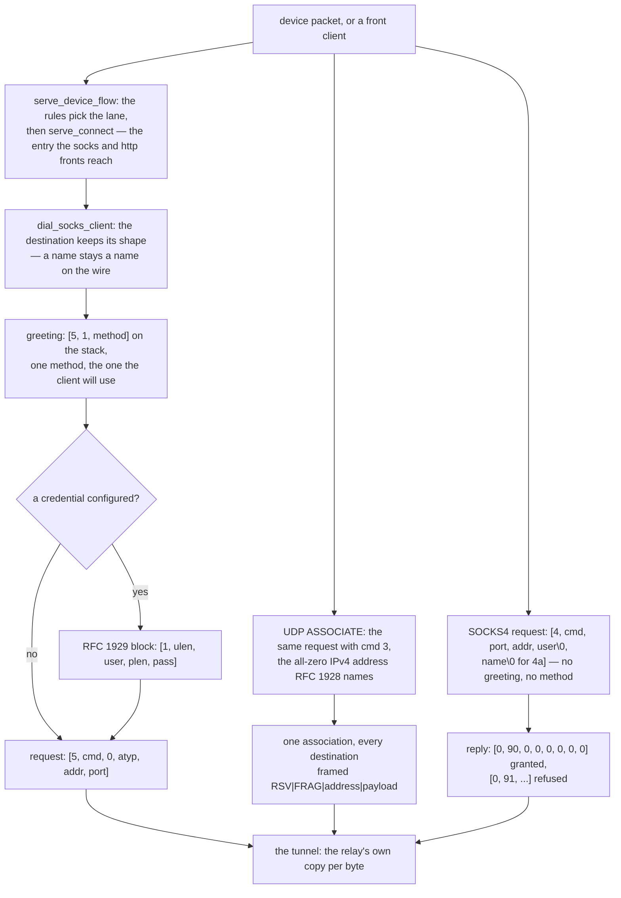

# SOCKS5, both roles

Row 45: the `socks` protocol is served by the tree's front and, since this slice, **dialled** by it. The client half writes the three stages a SOCKS5 client writes — the greeting, the RFC 1929 credential exchange when a credential is configured, and the request — and it is a lane in the tree's own front layer, not a second dialer: the native device inbound (`tun`) hands its flows to `serve_device_flow`, which asks the routing rules for the lane and then calls `serve_connect`, the same entry the `socks` and `http` fronts reach, and the lane decides that the bytes on the wire are SOCKS5.

The front reads its account list from `settings.accounts`, or from xray's `users` alias when `accounts` is absent (`infra/conf/socks.go:30-42`); the `mixed` front's HTTP side reads the same list.

The datagram half is the same protocol in the other direction: one `UDP ASSOCIATE` association to the upstream server, and every datagram rides it framed the way RFC 1928 frames them.

## Byte-identity

The bytes this client writes are the bytes the pinned references write, and the claim is checked by a differential, not by reading the code:

- `xray-core/proxy/socks/protocol.go`'s `ClientHandshake` writes the greeting `[5, 1, method]`, the RFC 1929 block `[1, ulen, user, plen, pass]` when a credential is configured, and the request `[5, cmd, 0, atyp, addr, port]`. For a UDP request it writes `{1, 0, 0, 0, 0, 0, 0}` — the all-zero IPv4 address RFC 1928 names no destination with. `EncodeUDPPacket` writes `[0, 0, 0]` and then the address and the payload.
- `heiher/hev-socks5-core`'s `hev_socks5_client_write_auth_methods` writes **one** method — the one the client will use — and `hev_socks5_client_write_request` writes the version, the command, the reserved byte and the address in that order.

`scripts/socks5-oracle` drives the pinned `xray-core`'s own `ClientHandshake` and `EncodeUDPPacket` over an in-memory pipe and prints every octet they write. The Rust side replays the same `script.txt` through this tree's writers and the two runs are compared octet for octet: five handshakes (no-auth and credentialed, over an IPv4 literal, a domain name and an IPv6 literal) and three datagram frames (the same three address shapes). The oracle is a Go program over the pinned module, so it is a reference and not a copy: no line of it enters this tree, and the golden it records is a fixture the Rust test replays.

The one place the tree does **not** copy the reference is the method list. The pinned writers offer exactly the one method they will use — `[5, 1, 0]` without a credential and `[5, 1, 2]` with one — and so does this client. `zeronet`'s `connect_socks5` offers two (`[5, 2, 0, 2]`), which reaches one more server: this tree's own front answers `[5, 2]` when it is configured with accounts and `[5, 0]` when it is not, so a client that offers both is answered with whichever the front wants, and a client that offers only the method the front does not want is refused. One method is what the references write.

## Data path



## Measured

<!-- counts:begin -->
| key | value | checked by |
| --- | --- | --- |
| ops-retired-instructions | UNBLESSED | scripts/count-ops.sh |
| oracle-lines-matching-the-pinned-go | 8 | ferrox-core-socks::tests::the_client_writes_the_bytes_the_pinned_go_writes |
| methods-offered-in-the-greeting | 1 | ferrox-core-socks::tests::the_greeting_is_the_bytes_the_pinned_writer_writes |
| request-bytes-per-tcp-dial | 10 | ferrox-core-socks::tests::the_request_is_the_bytes_the_pinned_writer_writes |
| credential-bytes-per-authenticated-dial | 5 | ferrox-core-socks::tests::the_user_pass_block_is_rfc_1929 |
| datagram-frame-bytes-overhead | 10 | ferrox-core-socks::tests::the_datagram_frame_is_rfc_1928 |
| servers-answering-another-method-refused | 1 | ferrox-app-socks::tests::a_credentialed_session_refuses_a_server_that_answers_no_auth |
| client-bound-name-heap-allocations | 0 | ferrox-app-socks::tests::a_bound_name_is_read_into_the_callers_stack |
| client-request-heap-allocations | 0 | ferrox-app-socks::tests::a_request_is_written_from_the_callers_stack |
| device-flows-leaving-through-the-client-lane | 1 | ferrox-app-tun::tests::a_device_flow_leaves_through_the_socks_client_lane |
| tcp-tunnels-through-the-front | 1 | ferrox-app-proxy::tests::a_socks_client_dials_the_front_and_carries_an_echo |
| datagrams-through-the-front | 1 | ferrox-app-proxy::tests::a_socks_client_carries_a_datagram_through_the_front |
| datagram-payload-copies-per-forwarded-datagram | 0 | ferrox-app-proxy::tests::a_forwarded_datagram_is_the_frame_the_client_framed |
| datagram-frame-allocations-per-frame | 0 | ferrox-app-proxy::tests::a_forwarded_datagram_is_the_frame_the_client_framed |
| front-name-zero-filled-bytes | 0 | ferrox-app-proxy::tests::a_socks_front_reads_no_buffer_it_zeroed |
| datagram-rebuild-copies-per-reframed-datagram | 1 | ferrox-app-proxy::tests::a_datagram_naming_a_host_is_reframed_around_its_payload |
| datagram-frames-the-client-framed | 1 | ferrox-app-proxy::tests::a_forwarded_datagram_is_the_frame_the_client_framed |
| datagram-ipv6-literal-destinations-answered | 1 | ferrox-app-proxy::tests::a_destination_naming_an_ipv6_literal_is_the_address_it_named |
| credentialed-tunnels-through-the-front | 1 | ferrox-app-proxy::tests::a_socks_client_offers_the_credential_the_front_asks_for |
| credentials-the-front-refuses | 1 | ferrox-app-proxy::tests::a_front_refuses_a_credential_it_does_not_know |
| config-lanes-named | 1 | ferrox-app-proxy::tests::a_socks_outbound_names_its_server_and_credential |
| pb-scenario-sides-decoded | 2 | ferrox-app-xray_pb::tests::a_socks_scenario_decodes_both_sides |
| socks4-handshake-allocations | 0 | ferrox-app-proxy::tests::a_socks4_handshake_costs_no_heap_buffer |
| socks4a-handshake-allocations | 1 | ferrox-app-proxy::tests::a_socks4a_handshake_costs_one_heap_buffer |
| socks4-reply-bytes | 8 | ferrox-core-socks::tests::the_socks4_reply_is_the_bytes_the_pinned_server_writes |
| socks4-client-request-buffers | 1 | ferrox-app-socks::tests::a_socks4_session_writes_the_request_and_reads_the_reply |
| socks4a-client-request-buffers | 1 | ferrox-app-socks::tests::a_socks4a_session_names_its_destination |
| socks4-requests-a-credential-front-refuses | 1 | ferrox-app-proxy::tests::a_front_that_asks_for_a_credential_refuses_a_socks4_request |
| socks4-xray-scenario-tests-passing | 1 | scripts/run-upstream-suite.sh |
<!-- counts:end -->

The first row after the ops row is the identity claim itself: eight recorded runs — five handshakes and three datagram frames — compared octet for octet against the pinned Go's own writer. The greeting row is the one-method rule the pinned writers follow, pinned as bytes (`[5, 1, 0]` and `[5, 1, 2]`) rather than as a count of what the code happens to send. The request and credential rows are the byte counts a reader can check by hand: a `CONNECT` for an IPv4 literal is ten octets (`[5, 1, 0]` plus the type byte, four address bytes and two port bytes), and the RFC 1929 block for a one-byte name and a one-byte password is five (`[1, 1, u, 1, p]`). The datagram row is the frame's overhead — the two reserved bytes, the fragment byte, the address type byte, the address and the port — which is ten octets before the payload.

The five datagram rows are the frame itself. A datagram the client framed with a literal address is the frame this tree builds, so it goes on as it arrived and its payload is not copied: the writer is handed the client's own base pointer, the frame costs no allocation at all, and the caller's buffer neither moves nor grows (`a_forwarded_datagram_is_the_frame_the_client_framed`). The frame the tree would have built is byte for byte the client's own, so the fast path cannot change a byte on the wire. A datagram that named a host is the one frame that is rebuilt — the tree resolved the name into an address, and the frame it builds says so — and that rebuild copies the payload once (`a_datagram_naming_a_host_is_reframed_around_its_payload`). The last row is a destination that is an IPv6 literal in the name field: it is the address and the port the datagram named (`a_destination_naming_an_ipv6_literal_is_the_address_it_named`).

The refusal row is the client's half of the method negotiation: a server that answers a method the client did not offer is refused, the way the pinned Go client refuses it (`"auth method not supported."`). A credentialed session therefore never tunnels through a server that answered `[5, 0]`, and a credential that is half written refuses the session outright rather than downgrading it to no authentication.

The four end-to-end rows are the shape: the device's TCP flow leaves through the client lane and the SOCKS5 server receives a `CONNECT` for the destination the device's packet named; the same lane carries an echo through the tree's own front; the datagram lane carries a datagram through it; and the credentialed lane carries an echo through a front that asks for the credential. The refusal row is the front's half: a credential it does not know is refused with the status byte, not with a closed socket.

## SOCKS4

The older version of the same protocol, in both roles. A SOCKS4 request is one block: the version, the command, the port, the address, the user id and its NUL — and, for SOCKS4a, the name and its NUL. There is no greeting and no method to negotiate, so the request is the first thing on the wire.

The front answers with the pinned server's own eight bytes: `[0, 90, 0, 0, 0, 0, 0, 0]` when it grants and `[0, 91, 0, 0, 0, 0, 0, 0]` when it refuses — the version byte zero, the code, and the port and the address the pinned Go server writes as `net.AnyIP` and port 0.

A front that asks for a credential refuses a SOCKS4 request: the protocol carries a user id and no password, so there is nothing to check a credential against. The pinned Go server refuses it the same way, with the same reply.

The client speaks SOCKS4 when the config names `version: "4"`: a name rides the SOCKS4a form, with the `0.0.0.1` marker in the address field, so the server resolves it and this tree's resolver never sees it; an IPv6 address has no SOCKS4 form and is refused.

### Leaner than the pinned server

The pinned Go server's SOCKS4 path (`xray-core/proxy/socks/protocol.go`'s `handshake4`) reads the user id with `ReadUntilNull`, which takes **one byte per call** and hands back a `String` — an allocation for a name no front here reads — then reads the domain the same way for SOCKS4a and parses it into an address, then allocates the request header it returns, then writes the reply through a pooled buffer. Two heap buffers for a SOCKS4 request and three for a SOCKS4a one, and the user id's bytes copied into a string that is then thrown away.

This tree allocates **none** of those: the user id is stepped over in a stack buffer, the reply is a static array, and the destination for a SOCKS4 request is an address. A SOCKS4a request costs **one** buffer, the name itself, because the name *is* the destination and has to outlive the read; the pinned path copies it twice (once for the name it read, once for the address it parsed).

The name is also read in fewer calls. The pinned reader takes a byte per call, so a name of n bytes costs it n+1 reads; here the first byte is read on its own — an empty name is one byte, and a proxy client sends one — and the rest is found with a **peek** and taken with one read, so the bytes after the name stay on the socket for the tunnel. A name of n bytes therefore costs at most three calls, and the empty name costs one in both.

The client is leaner than this tree's own SOCKS5 client, which writes three blocks (the greeting, the credential, the request): the SOCKS4 request is **one** buffer, and the reply is one read of eight bytes.

### What is not proved here

- The syscall count is arithmetic, not a count: a socket's read count cannot be gated by a loopback test, so the three-call figure is the shape of the code and the pinned reader's `n+1` is what its own loop does. No local check counts either.
- The durations are CI-only: the matrix carries no socks cell, so no local run measures this path.
- No pinned tree in this matrix ships a SOCKS4 **client** whose bytes can be read here: `xray-core`'s client is SOCKS5 only, `zeronet` speaks SOCKS5 in both roles, and sing-box's SOCKS4 client lives in a library this tree does not vendor. The client's claim is therefore against this tree's own SOCKS5 client (one buffer against three), and the server's claim is against the pinned Go server above.
- `TestSocksConformanceMod` is the xray-core scenario that exercises SOCKS4 (`socks4.Dial` against this front), and it is in the pin's gate; the other socks scenarios still name their own rows' gaps.

The frame a datagram is sent in is still one buffer: the header and the payload are contiguous, so the datagram that is rebuilt around its payload copies it once. A vectored send would not copy it, but the tree's datagram sockets are `std`'s and that call is not portable to the Windows arm this tree ships, so the copy stays where the frame has to be rebuilt. The address a datagram named is still resolved per datagram: the tree has no resolver of its own (README row 82), so the system resolver answers, and it answers from its own cache, which is what keeps the answer as fresh as the system's TTL. The reference resolves once per destination and keeps a DNS client of its own, so it pays the lookup less often and holds its answer longer; trading that freshness for the lookup is the resolver row's decision, not this one's. The header the fast path compares is the header the tree would have written, so the comparison costs what a copy of the header would have cost and a datagram whose payload is shorter than the header pays a comparison it would have paid a copy of.

Syscalls: a TCP dial writes three times (the greeting, the credential block when there is one, the request) and reads four (the method reply, the credential reply, the reply's head, the bound address), then the relay's own reads and writes carry the payload. A loopback test cannot gate a syscall total, so no row claims one; the shape is prose.

Copies: the handshake's bytes are built once — the greeting on the stack, the credential block and the request in one buffer each — and the payload is the relay's own copy, the same one every other lane pays. Time: not measured, see below.

## Ops

```bash
./scripts/count-ops.sh report \
  socks::tests::the_client_writes_the_bytes_the_pinned_go_writes 'ferrox_core::socks::request'
```

`UNBLESSED`, as above — macOS/aarch64 ships no `valgrind`, so this count is CI-only there and has not been read; it is not a number and is not quoted as one.

## Time

**Not measured yet.** Durations come from CI runners (`bench.yml`, `parity.yml`); no CI artefact has been read. `scripts/lib-matrix.sh` carries no socks cell — there is no `socks-*` scenario id — so `bench.yml` and `compare.yml` gate nothing here, and a local dial would measure a VPN tunnel rather than this code.

## What we removed

- **A zero pass over the name and the credential a client sends.** The front opened each of them with `vec![0u8; len]` and the read that follows filled every byte, so a flow paid a zero pass over the name, the user and the password for nothing. Each buffer is the read's own room now, and the counting allocator's `zeroed` counter is the witness: `a_socks_front_reads_no_buffer_it_zeroed` fails if the front zeroes one again. The bytes on the wire do not move: the same bytes are read into the same buffer, and the name still becomes the same `String`.
- **A second dialer in the device front.** The tun2socks shape this tree could have grown is a bespoke outbound call from the packet handler. It does not: `accept_flow` opens a loopback pair and calls `serve_device_flow`, which asks the rules for the lane and then calls the same `serve_connect` every other front reaches, and the lane that serves it is the tree's own protocol set. The device's destination keeps its shape down to the request bytes — a name the caller asked for is a name in the `CONNECT`, so the server resolves it and this tree's resolver never sees it. The idea `zeptun` sells (translate the device onto the SOCKS machinery, do not re-implement it) is taken without its translator thread; `is_device` refuses `utun`/`wintun`/`tun2socks` as *protocol* names while serving `tun` with all three device spellings, so the config surface keeps one way in.
- **A reply name rebuilt on the heap.** The bound address a server writes with a domain type was read into a `Vec` and converted into an owned `String` before anyone looked at it — even for a TCP tunnel, which uses nothing the reply bound. The bytes are read into a 257-byte stack buffer now: the TCP tunnel drops them without a heap buffer, and the UDP association hands the same bytes to the resolver, borrowing a valid UTF-8 name and keeping the old lossy `String` only for bytes that are not UTF-8. `a_bound_name_is_read_into_the_callers_stack` is the witness: the read allocates nothing.
- **The greeting's and the request's heap buffers.** The pinned Go client allocates a `buf.Buffer` per stage — one for the greeting, one for the credential block, one for the request — and hands each to the socket. The greeting here is three bytes on the stack (`[u8; 3]`); the request is written into a 262-byte stack array at the widest RFC name, with the address written into it by `encode_into`; only a name longer than 255 bytes keeps the allocating writer. The credential block is one buffer. The pinned oracle's bytes are the witness that the walk is the same one, and `a_request_is_written_from_the_callers_stack` counts zero allocations for a literal request.
- **A second SOCKS5 codec.** The tree already parsed SOCKS5 addresses for its front (`parse_socks_addr_rest`, `push_socks_addr`). The client side reuses that field order rather than introducing a second reader, and the datagram frame it writes is the same `[0, 0, 0]` + address + payload the front already reads.
- **The payload copy every datagram paid.** The datagram lane read a frame, took the address out of it and wrote the payload into a frame of its own — the same bytes, copied again, for every datagram on the lane. The frame the client framed *is* the frame the tree builds whenever the address is a literal, so the tree compares the two headers now and sends the client's own frame when they are the same: the payload is not copied at all, and the bytes on the wire are the same either way, because the header that is compared is the header that would have been written. The witness is pointer identity and a byte comparison in one test (`a_forwarded_datagram_is_the_frame_the_client_framed`): the writer is handed the client's own base pointer, the frame costs no allocation, the caller's buffer neither moves nor grows, and the frame the tree would have built is byte for byte the client's. A datagram that named a host is the one frame that is rebuilt, because the tree resolved the name into an address and the frame it builds says so (`a_datagram_naming_a_host_is_reframed_around_its_payload`).
- **A frame buffer per datagram.** Two lanes built the frame they send in a buffer of their own, allocated for that datagram: the door's uplink and the freedom lane's answer. The frame is the lane's now — one buffer for the lane's life — and the framing itself allocates nothing at all, so a datagram on either lane costs no heap buffer.
- **The authority the datagram named, spelled out.** A datagram that named a host had its authority written into a string — the name copied, the port appended — before it went to the resolver. The name and the port go to the resolver as they are now, so the datagram's own bytes are not copied to be resolved, and a name that is an IPv6 literal is the address and the port it named (`a_destination_naming_an_ipv6_literal_is_the_address_it_named`).
- **Ten copies of one frame.** The RFC 1928 frame was written out where it was needed — the reserved bytes, the fragment byte, the address and the payload — in the door, in the freedom lane, in the SOCKS client's two legs and in each protocol lane's answer. There is one writer now (`socks_udp_frame`), and it is the frame the oracle's golden already held: the bytes on the wire are the same ones, written in one place.

## What was not removed

Named rather than claimed, with the worst input worked out first:

- **The client offers exactly one method.** `[5, 1, 0]` without a credential and `[5, 1, 2]` with one, because that is what the pinned writers write. A client that offers both reaches one more server — one that wants no authentication *and* accepts a credential — at the cost of a byte this tree's own front would refuse, and the reference's rule is the one this tree keeps.
- **A credential that cannot be spelled refuses the lane.** A name or a password over 255 bytes, or a half-written credential, refuses the session rather than falling back to no authentication: a silent downgrade would hand the server a tunnel the operator asked to be authenticated. The pinned Go client would send a zero-length name instead; the refusal is this tree's own, and it is the safe direction.
- **The bound address is read and dropped.** The server's reply names the address it bound; the client reads its octets so the stream sits where the tunnel begins, and does not use it. A reply whose address type is a name is refused, the way `hev_socks5_client_read_response` refuses it (it accepts the IPv4 and IPv6 types only).
- **The datagram lane is one association for every destination,** not one per destination, and the association's control leg is held open for its life — dropping it ends the association, which is what the reference does too. The frame the lane writes carries an address, never a name: the tree's own front resolves a name in the datagram lane before it reaches here, and that resolution is the front's behaviour, not this lane's.
- **The BIND command is refused.** SOCKS4's second command asks the proxy to open a *listening* port; nothing here listens for one, so the request is refused with the protocol's own rejection code, the way the pinned server refuses it.
- **The front does not sniff an HTTP request.** The pinned socks server reads one byte and, when it is not 5 or 4, hands the connection to its HTTP server (`ProcessWithFirstbyte`). This tree's `socks` front does not; the `mixed` protocol is where both live. `TestSocksWithHttpRequest` fails against this tree for that reason and passes against the reference.
- **The front has no datagram switch.** The pinned server config carries `udp_enabled` and refuses a `UDP ASSOCIATE` when it is false; the bridge reads that flag and drops it, and this front always carries datagrams. The `socks` inbound's own JSON surface has no `udp` setting to carry it either.
- **The credential block and the request are heap buffers.** The greeting is on the stack; the other two are one `Vec` each, allocated per dial. The reference allocates one buffer per stage as well, so this is not a regression, but it is an allocation the handshake pays and the page does not claim away.
- **The front's method list is drained on the stack,** 255 bytes, never inspected beyond the one method the front wants — the tree's existing shape, now with a second method it can want.

## Conformance

`conformance.yml`'s scenario-map job runs every test in the pinned `xray-core`'s `testing/scenarios` package against `ferrox-app`, and the pin's gate names the ones that must be green. `TestSocksBridgeTCP` is one of them now: it is xray's own scenario — a `socks.ServerConfig` inbound that asks for a password on one side, a `socks.ClientConfig` outbound that offers one on the other, and a `dokodemo.Config` front that rewrites every flow to an echo server — and it runs against this tree unmodified through the `scripts/xray-scenarios.sh` seam. The bridge carries `xray.proxy.socks.ServerConfig` (the auth type, the account map, the address and the datagram flag read and dropped) and `xray.proxy.socks.ClientConfig` (one endpoint, with the credential when the config names one); a user level is refused by name, because it feeds a policy app this tree has no lane for.

The rest of the socks family is the work list, and each failure is another row's gap rather than this one's: `TestSocksWithHttpRequest` needs the front's HTTP sniff, `TestSocksBridageUDP` needs the `dokodemo-door` inbound to carry UDP (the bridge refuses a UDP-only dokodemo by name), and `TestSocksBridageUDPWithRouting` needs the router app. `TestSocksConformanceMod` — the scenario that dials this front with `socks4.Dial` — passes, and it is in the pin's gate beside `TestSocksBridgeTCP`. The map's own count at this pin is 21 of the 72 green, the socks family 2 of its 5; the run is `scripts/run-xray-scenario-map.sh` against the pinned checkout, and it is informational — a failing test never fails the job.

## Pins

| what | where |
| --- | --- |
| the client handshake, the credential block and the datagram frame | `upstream/xray-core/proxy/socks/protocol.go` |
| the server side: the account map, the method refusal, the HTTP sniff | `upstream/xray-core/proxy/socks/server.go` |
| the Go core's one-method greeting and its request writer | `upstream/pattng` — the `hev-socks5-tunnel` submodule that carries `heiher/hev-socks5-core` is not fetched at this pin |
| the outbound's own handshake | `upstream/sing-box/protocol/socks/outbound.go` |
| the two-method greeting this tree does not copy | `upstream/zeronet/crates/zero-protocol/src/socks.rs` |
| the recorder that produced `expected.txt` | `scripts/socks5-oracle/main.go` |

## CI scope

What a change here owes, read by `scripts/ci-scope.py`; see [`docs/ci-scope.md`](../ci-scope.md).

<!-- scope:begin -->
- paths: crates/ferrox-core/src/socks.rs, crates/ferrox-app/src/socks.rs
- symbols: socks
- oracle: socks
- go: ./proxy/socks/...
<!-- scope:end -->
