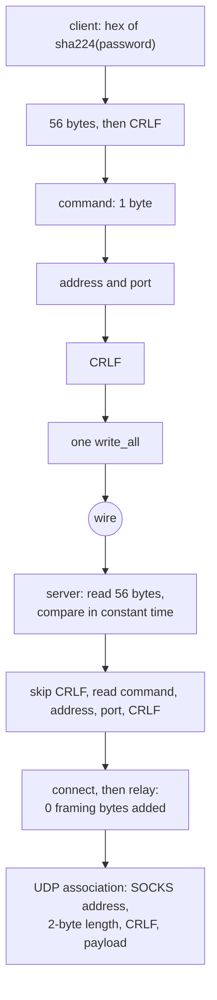

# Trojan over TCP

Trojan is a header and then nothing, which makes it the cheapest method in the matrix to relay and the easiest to get subtly wrong.

The header is `sha224_hex(password) | CRLF | command(1) | address | port | CRLF`. The 56 ASCII bytes are compared without an early exit on the server; after that the stream is the stream and the relay adds no framing bytes at all.

A dial that was handed a name writes it as ATYP 3 with its own length, the form this method's reader already accepts, so the edge answers the lookup rather than the client's resolver.

A listener that declares `security: tls` terminates the session its config names and reads the header off it, on each carrier the dial uses — the six TCP carriers, and KCP, where the session wraps the connection itself, and an `xdrive` row, where `security` names the store's own lane handshake rather than a session above it; `a_trojan_inbound_that_declares_tls_answers_every_carrier` dials all six and holds the echo, and `a_trojan_kcp_inbound_that_declares_tls_answers_the_session` / `a_trojan_kcp_dial_under_tls_wraps_the_header_in_the_session` hold the KCP pair from both ends.

A UDP association rides every carrier the outbound dials — raw, ws, httpUpgrade, gRPC, xhttp (stream-one), http header and KCP — plain or under a terminated session, on both the client and the listener. The listener parses the association off whatever carrier the dial wrote; the client splits the session into the reader and writer its pump needs and wakes a parked reader by closing the carrier it came from. `a_trojan_udp_association_crosses_every_carrier` runs all fourteen pairs and holds two datagrams through each, 250 ms apart so a pump that polls instead of parking is caught.

Two things are deliberately not implemented and are named rather than rounded off: mux is VLESS-only on both ends, so a trojan row that asks for it is not carried; and an inbound that declares `security: reality` is refused by name rather than served as plaintext — a silent downgrade of a session the config asked for is the failure mode, and `a_trojan_reality_inbound_is_refused_not_downgraded` is the gate. The `trojan://` share link is parsed by `ferrox_core::trojan::TrojanLink`, which `check`/`run` accept beside `vless://`, and its header probe goes through the same `encode_header` the dial uses. These are capability statements, not performance ones.

## Data path



## Measured

<!-- counts:begin -->
| key | value | checked by |
| --- | --- | --- |
| ops-retired-instructions | UNBLESSED | scripts/count-ops.sh |
| password-bytes-on-the-wire | 56 | ferrox-app-proxy::tests::trojan_key_is_sha224_hex |
| framing-bytes-added-after-the-header | 0 | ferrox-app-proxy::tests::trojan_relay_round_trips_and_refuses_strangers |
| udp-framing-bytes-per-datagram | 2 | ferrox-app-proxy::tests::trojan_udp_frames_carry |
| udp-carriers-holding-an-association | 7 | ferrox-app-proxy::tests::a_trojan_udp_association_crosses_every_carrier |
| header-reads-numeric-address | 2 | ferrox-app-proxy::tests::the_trojan_header_costs_two_reads_not_seven |
| header-reads-domain-address | 3 | ferrox-app-proxy::tests::the_trojan_header_costs_two_reads_not_seven |
| header-bytes-copied-out-of-the-buffer | 0 | ferrox-app-proxy::tests::the_trojan_header_costs_two_reads_not_seven |
| key-bytes-compared-early-exit | 0 | ferrox-app-proxy::tests::the_key_compare_reads_every_byte |
<!-- counts:end -->

## Ops

```bash
./scripts/count-ops.sh report \
  proxy::tests::the_trojan_header_costs_two_reads_not_seven 'proxy::decode_trojan_request'
```

`UNBLESSED`, and it cannot be blessed: the frame `ops.yml` measures runs through `the_trojan_header_costs_two_reads_not_seven`, whose domain branch calls the system resolver (`getaddrinfo`) for `localhost`, so the retired-instruction count is not reproducible. Two `ops.yml` runs of a byte-identical binary reported `80397` then `80812` while `der_to_pem` held at `2680` both times — the spread is the resolver, not the release layout. The removed `String` and `host:port` re-scan are real and deterministic in our code (no combined `String` is built any more), but a number a run contradicts the next is not a gate; it stays `UNBLESSED` and the drop below `main`'s `81735` is read as prose, never quoted as a figure.

## Time

Read from one CI run of one `benchmark-matrix.yml` cell, `trojan-tls-raw-down-8` (download, 8 connections, 16 384 × 65 536 B, standard tier, 3 repeats, `xray-core` as the reference) — the cell a plaintext listener used to fail with no byte moved. Each row is that runner's median over its three repeats, and no ratio is taken across two runners.

| runner | throughput vs `xray-core` | ferrox MiB/s | `xray-core` MiB/s | cpu per GiB |
| --- | --- | --- | --- | --- |
| ubuntu-24.04 x86_64 | 2.12× | 2814.1 | 1325.2 | 1136.2 vs 2235.0 ms |
| ubuntu-24.04-arm aarch64 | 1.45× | 2250.7 | 1552.3 | 1498.8 vs 1846.2 ms |
| macos-15 aarch64 | 1.69× | 1762.6 | 1043.8 | 1053.8 vs 1715.0 ms |
| windows-latest x86_64 | 2.81× | 1757.3 | 624.8 | 1851.6 vs 5146.5 ms |

`zeronet` medians 2000.0, 1712.7, 1600.0 and 1524.1 MiB/s on those four runners, so the row is not a reference that alone ran badly. Peak RSS on ubuntu x86_64 reads 13.5 MiB against `xray-core`'s 58.9 MiB.

## What we removed

- **Seven header reads down to two, and eight down to three for a domain.** The header is `56 + 2 + 1 + addr + port + 2` bytes. The old `decode_trojan_request` read it a field at a time: `read_exact` for the 56 key bytes, then CRLF, then the command, then `read_socks_addr`, which is another `read_exact` for `atyp` and one each for the address, the port and the closing CRLF. `decode_trojan_request` now fills one stack buffer through a cursor and parses it in place, so a numeric address costs two reads and a domain three — the domain cannot do better in two because its length byte has to arrive before the name's extent is known. `the_trojan_header_costs_two_reads_not_seven` drives all three address forms over a fixed byte source and counts the reads exactly.
- **A key compare that returned on the first wrong byte.** `got != *key` short-circuits, so the time it took said how much of the key was right. `key_agrees` folds the whole 56 bytes into one accumulator instead, and refuses a short read outright. `the_key_compare_reads_every_byte` is the gate.
- **An MD5 or SHA-1 chain per connection.** The password arrives as its SHA-224 hex, so there is nothing to derive: 56 bytes on the wire, 56 bytes compared. Contrast Shadowsocks, where the MD5 chain and HKDF are real work and are named in [that page](shadowsocks.md).
- **The `host:port` `String` a domain header serialised for the resolver.** `resolve_endpoint` did `format!("{host}:{port}").to_socket_addrs()`: it built one owned `String` and the `str` form then re-scanned it for the last `:` to split host and port back apart. The `(&str, u16)` tuple hands the resolver both as separate arguments — no serialisation, no `String`, no port re-scan — and a bracketless IPv6 host is no longer mangled by that split. The bytes on the wire are identical either way, so `the_trojan_header_costs_two_reads_not_seven` holds the domain path byte-identical but cannot see the removed allocation, and no count sees it either — the `decode_trojan_request` frame is dominated by the resolver's own nondeterministic work (see **Ops**). The removal is therefore witnessed structurally: the tuple form contains no `format!` and builds no combined `String`, so that allocation is gone by construction, not by measurement.

- **The `host:port` `String` a numeric dial address was serialised into, per flow.** The same shape this page condemns above for the resolver lived one layer out, in the dial: `serve_connect` cloned the configured address and formatted `{address}:{port}` before handing it to `to_socket_addrs`, and `dial_trojan_udp_uplink` spelled it again per UDP destination — so every cleartext trojan flow paid a `String` clone, a serialisation, and a host/port re-scan in front of the resolution. `resolve_outbound` parses a numeric address straight from the borrowed parts (IPv4, or IPv6 bare or bracketed) and sends a name to the resolver as the `(&str, u16)` tuple; the answer and the wire bytes are what the old spelling returned, and the removal is witnessed structurally — no `clone`, no `format!` left on that path — and gated for behavior by the loopback trojan dials, which all resolve through it. Like the tuple above, it carries no row: the resolver branch is dominated by `getaddrinfo`'s nondeterministic work, and a numeric branch that never reaches the syscall cannot be counted from a test that only sees the connected socket.

- **The client dial header's one heap `Vec` per numeric address.** The request side, `trojan_header`, built a `Vec::with_capacity(63 + addr_len)` — already exact, no realloc — for every dial. For a numeric address the header is bounded by the protocol (68 bytes IPv4, 80 IPv6), so it is now spelled into a fixed stack buffer behind the same `Deref`-to-`&[u8]` the dial sites already take, and that allocation is gone by construction. A name is not bounded (its length byte allows a host up to 255 bytes, past any stack buffer), so the name branch keeps the precise heap `Vec` and the bytes it emits are unchanged; `trojan_header_builds_identical_bytes_for_every_destination` checks IPv4, IPv6 and a name against the field-by-field reference. The removal carries no row — `trojan ops-retired-instructions` is `UNBLESSED` and cannot be blessed (see **Ops** above), and a once-per-connection control-path allocation never reaches the measured frame — so it is a structural claim, not a number. Spelling into the buffer adds one 80-byte zero-init pass before the fields are written; that pass is traded against the removed allocation and is not timed.

What is **not** removed: the 2-byte length prefix on UDP. It is wire format, not an optimisation, and `trojan_udp_frames_carry` / `trojan_udp_frames_reject_damage` are the gates on it. What is left on a domain header is the resolver's own work — a real DNS name still reaches `getaddrinfo`, and that lookup belongs to the system resolver, not to a copy this page controls; a numeric host in the name field now parses straight to an address with no allocation at all.

## Pins

| what | where |
| --- | --- |
| field-at-a-time header parse, `io.ReadFull` per field | `upstream/xray-core/proxy/trojan/protocol.go` |
| header read into one `buf.Buffer`, parsed in place | `upstream/xray-core/proxy/trojan/server.go` |
| header layout, headroom write | `upstream/sing-box` → `sagernet/trojan/protocol.go` |
| slice parser, zero allocations | `upstream/zeronet/crates/zero-protocol/src/trojan.rs` |

Xray's two ends disagree with each other, which is the honest summary: the server (`server.go`) reads the first request into one `buf.Buffer` and compares `first.Byte(56)` in place, while the client (`protocol.go`, `ParseHeader`) does five `io.ReadFull` calls plus `ReadAddressPort` against the bare socket.

## CI scope

What a change here owes, read by `scripts/ci-scope.py`; see [`docs/ci-scope.md`](../ci-scope.md).

<!-- scope:begin -->
- paths: -
- symbols: trojan
- scenarios: trojan-raw, trojan-tls
- oracle: trojan
- go: ./proxy/trojan/...
<!-- scope:end -->
