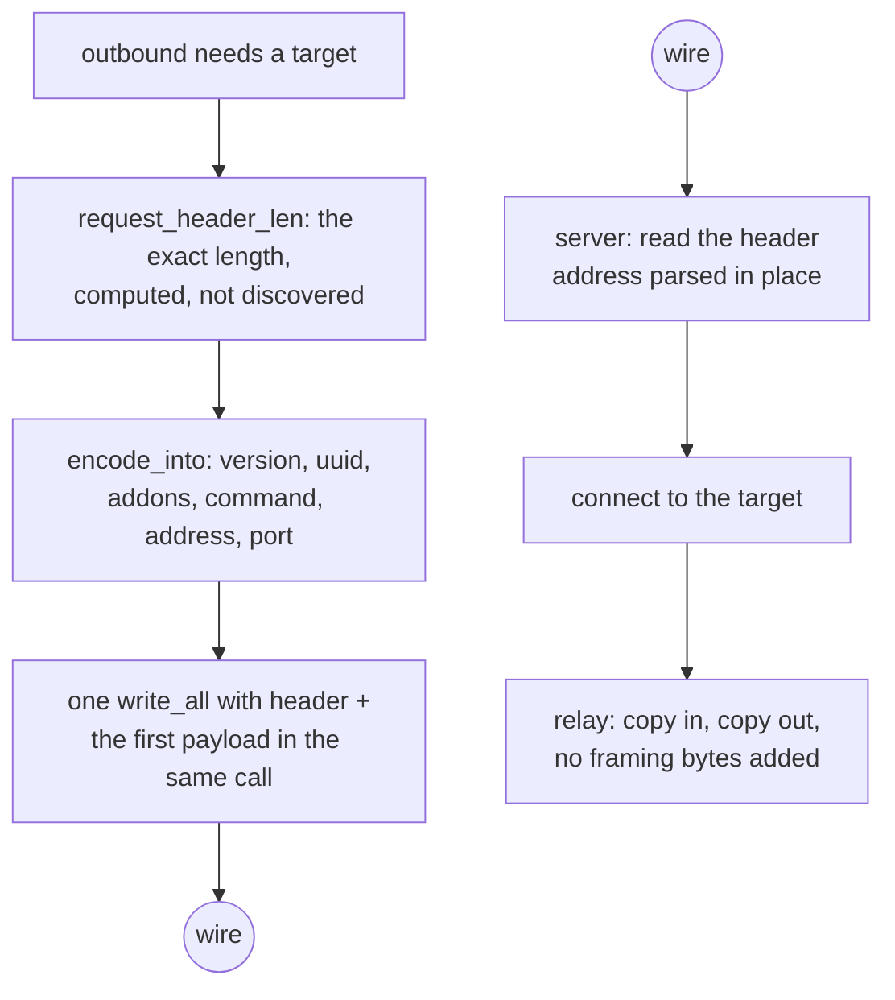

# VLESS over TCP

VLESS has no framing. One request header, then the stream is the stream, and the whole method's cost is in reading that header without copying it and encoding it without allocating.

The header is `version(1) | uuid(16) | addonsLen(1) | addons | command(1) | address | port`. `addons` is a protobuf whose only field this tree honours is `Flow`, the XTLS Vision selector; a header that carries a flow gets 2 add-on bytes and nothing else. For `xtls-rprx-vision` the command byte and the address are still written — Vision is a framing *around* VLESS, not a replacement for its target field.

A dial keeps the destination the shape the client gave it: a name leaves as ATYP 2 plus its bytes and the edge answers the lookup, so nothing on this machine asks its own resolver for a host the tunnel was meant to carry. Only `Freedom`, the Foxy direct split and a UDP front that already resolved the datagram's destination look a name up here.

`request_header_len` is a pure function of the destination, so the caller knows the exact length before reading anything. `encode_into` writes into a buffer the caller owns. That combination is why `ferrox-bench` gate 2 can assert zero allocations, zero allocated bytes and zero zero-fills for the encode at an IPv4, an IPv6 and a domain destination.

## Data path



## Measured

<!-- counts:begin -->
| key | value | checked by |
| --- | --- | --- |
| ops-retired-instructions | UNBLESSED | scripts/count-ops.sh |
| request-header-allocations | 0 | ferrox-bench-gate-2 |
| request-header-bytes-zero-filled | 0 | ferrox-bench-gate-2 |
| address-families-encoded | 4 | ferrox-core-vless::tests::header_address_families_encode_stably |
| vision-addons-bytes | 2 | ferrox-core-vless::tests::non_vision_header_carries_empty_addons |
| reality-outbound-rows-dialled | 6 | ferrox-app-proxy::tests::vless_outbound_with_reality_dials_raw_and_every_carrier |
| vision-header-targets-matching-core | 2 | ferrox-app-proxy::tests::vision_header_matches_the_core_encoder |
| dial-header-reallocations | 0 | ferrox-app-proxy::tests::dial_headers_are_sized_to_the_bytes_they_hold |
| request-header-reads | 4 | ferrox-app-proxy::tests::the_vless_request_header_costs_four_reads_not_six |
| request-parse-allocations | 0 | ferrox-core-vless::tests::the_request_parse_allocates_nothing_and_borrows_the_name |
| request-parse-name-copies | 0 | ferrox-core-vless::tests::the_request_parse_allocates_nothing_and_borrows_the_name |
| request-flow-decisions | 1 | ferrox-core-vless::tests::the_flow_is_named_without_building_a_string |
| handshake-pump-buffer-reallocations | 0 | ferrox-app-proxy::tests::the_pump_forwards_its_buffer_by_pointer_and_holds_capacity_steady |
<!-- counts:end -->

The relay buffer's zero-fills are prose, not a row. A row needs a checker that sees the thing it names, and the only counter that sees a fill is `alloc_zeroed`: the counting `GlobalAlloc` that could watch one `RelayBuf`'s whole life (`new()` and one promotion) has to be installed by the test binary that runs the gate, and this crate's test binary is where the tree's one blessed instruction count lives. CI measured the collision — `der_to_pem` went `2653 → 2743` because every allocation it makes grew a thread-local test — and a harness cost is not a change to the product, so the allocator stays in `ferrox-core`'s own test binary, where nothing is blessed, and the shape it proves is `alloc_count::tests::an_uninitialised_tail_is_allocated_but_not_filled`: capacity plus `set_len` and `vec![0u8; n]` are the same allocation and the same bytes, and the fill is the only difference. The promotion's 240 KiB was never visible to any counter here anyway — growing with `resize(.., 0)` writes the tail with `write_bytes`, which is not `alloc_zeroed` — and the only counter that would see it is an instruction count, which is the `UNBLESSED` row above.

The handshake pump now spends that same `RelayBuf`, so a dial stops paying a 16 KiB `vec![0u8; …]` memset for bytes the first `read` overwrites. That fill is prose by the rule just above; the row that is checked is the pump's buffer *handoff* — the carrier receives the buffer's own bytes, and a relay window of sub-buffer push/drain cycles (one read shy of the promotion edge, so the cap's own test below stays the only one that grows it) neither move the allocation nor grow its `size()`, so steady traffic reallocates none of it.

## Ops

```bash
./scripts/count-ops.sh report \
  vless::tests::header_address_families_encode_stably 'ferrox_core::vless::VlessLink::encode_into'
```

`UNBLESSED`, as above.

## Time

Durations come from CI only: `.github/workflows/parity.yml` and `.github/workflows/benchmark-matrix.yml` run the `vless-raw` scenario across the pinned engines. Ratios are `ferrox` against `xray-core`, full tier, ubuntu `x86_64`, five repeats, all seven cells gate-green with zero engine failures; no ratio is taken across two cells. `.github/workflows/compare.yml` times the header encode against the bench's own reference build of the same bytes, and its report is uploaded as an artefact so the figures below name a runner and a download.

| cell | throughput | cpu per GiB | peak RSS |
| --- | --- | --- | --- |
| `vless-raw-up-1` | 2.374× [2.288, 2.455] | 3.085× [3.017, 3.134] | 5.651× [5.604, 5.700] |
| `vless-raw-down-8` | 2.115× [2.092, 2.150] | — | — |
| `vless-raw-duplex-8` | 1.892× median | — | — |

An upload *throughput* row is only evidence about the engines once the benchmark sink stops comparing bytes one at a time; with the old sink every engine landed `within-noise` at ~14% of the cell's own one-hop ceiling — the sink, not the cipher, was the floor. The CPU and RSS ratios were always engine comparisons and are unaffected by that change. On `ubuntu-24.04-arm` the throughput row reads 2.834× median [2.413, 3.497] with `ferrox` cpu at ~204 ms/GiB against `xray-core`'s 635. On `macos-15` the workload is not priceable: every engine fails with `No buffer space available (os error 55)`, a runner-buffer fault rather than a comparison.

## What we removed

- **Three heap allocations per request.** The server's request header used to build a `String` for the flow the add-ons named, a `Vec` for a domain target and a second `String` for that domain's bytes — three mallocs and three copies before the request could be answered. The parse now lives beside the encoder in `ferrox-core::vless` and allocates nothing: the flow is a decision (`None`, `Vision`, `Other`) read out of the add-on protobuf without building a string, and a domain is *borrowed* from the buffer the header was read into, so the name that comes back is the name that arrived. `the_request_parse_allocates_nothing_and_borrows_the_name` is the gate: the counting allocator in this crate's own test binary holds the parse at zero allocations, zero allocated bytes and zero zero-fills, and the name's base pointer lies inside the caller's buffer while the buffer's own pointer does not move. The bytes on the wire are the same four reads in the same order — `the_vless_request_header_costs_four_reads_not_six` still counts four, and the loopback decodes that dial every reader still read the same header.

- **A map walk per header.** The header encoder asked the query map for the flow every time it wrote one — a `BTreeMap` descent with string compares, per header, to learn a fact the link was parsed with. The link now decides its flow once, when it is parsed, and the encoder reads the decision. The measurement is gate 4's framing row, which times the tree's encode against the bench's own reference build of the same bytes in one interleaved run, so each run's ratio to its own reference is the figure and the nanoseconds are not: `compare.yml` on `main` reads 2.80x, 2.51x and 2.86x at an IPv4 target, an IPv6 one and a domain, and the same workflow on this branch reads 4.59x, 3.19x and 5.56x. The two runs sat on different runners — the reference build itself read 46.0 ns in one and 102.9 ns in the other — so only the ratios are comparable, not the times. The bytes are unchanged: the same header, the same add-ons, the same target, and the row asserts that byte equality before it times anything. The single-loop `encode_into` line `compare.yml` also prints cannot resolve a change of this size: it read 16.1 ns on `main` and 20.6 ns on this branch, on a runner where everything was 2.2x slower, so it moved with the machine and not with the code.

- **A field-at-a-time header read.** This is the largest difference between the implementations and it is not close. Xray's `proxy/vless/encoding/encoding.go:120` calls `addrParser.ReadAddressPort`, which issues a separate `io.ReadFull` for the port, another for the address type byte, then another per family, then one for a domain's length and one for its body — up to seven reads served out of one `BufferedReader`, so one syscall but seven slice splits and seven `Read` calls. sing-box's `sagernet/sing-vmess/vless/protocol.go:29-79` does the same thing against the **bare `net.Conn`**, so it is 6–8 real syscalls for a 19–34 byte header, plus a `make([]byte, strLen)` and a `string(strBytes)` second allocation for a domain. The Rust rewrite of xray-core reads it the same way (`upstream/xray-core-rust/crates/xray-proxy-vless/src/encoding/mod.rs:155`): the port in one `read_exact`, the family byte in another, the body in a third, a domain's bytes in a `vec![0u8; len]` it then turns into a `String`, and the add-ons in a third `vec![0u8; len]` before a protobuf decode — the Go shape, ported, allocations and all. Zray parses a slice in place with zero allocations. The core encoder and the in-memory parser here (`parses_the_brief_link`, `header_address_families_encode_stably`) were always the in-place half — but the **server** read, `decode_request` handed a raw `TcpStream` in `serve_vless_raw`, was the field-at-a-time shape this bullet condemns: `read_exact` for the 18-byte head, then the add-ons, then the command, then the port, then the family byte, then the body — five syscalls for an IP target, six for a domain. The reads are now folded on the grain of the wire: the add-ons ride in with the command byte (both always header, and a mux request's frame data starts after the command, so this read is safe for every command), and the port, family, and the body's first byte are the same four bytes for every family — an IPv4 or IPv6 octet, or a domain's length. So the server request costs four reads for every address family and two for mux. `the_vless_request_header_costs_four_reads_not_six` drives it from an in-memory stream that answers the whole buffer, where the count is exact (a loopback socket's read count moves with the scheduler and cannot gate it); the byte-identity is held by the loopback decode tests that dial every reader. No byte was added to the wire and none is over-read: every read is bounded to header bytes, so the first payload byte still reaches the relay untouched.
- **A header written through a temporary.** sing-box's `WriteBuffer` path is already good — it extends the header into the pooled buffer's headroom and writes header and payload in one call — and this tree matches that shape rather than the `buf.NewSize` + copy shape beside it.
- **An 8 KiB buffer per connection that is thrown away.** Xray's `proxy/vless/inbound/inbound.go:286` does `buf.FromBytes(make([]byte, buf.Size))`, and because `FromBytes` marks the buffer `ownership: unmanaged` its `Release` is a no-op, so that 8 KiB never reaches `bytespool`. The relay buffer here starts at 16 KiB and is promoted to 64 KiB when a read fills it or the leg has moved a whole window in short reads — a `recv` returns what is queued rather than what was asked, so a busy Windows leg would otherwise relay a bulk transfer 16 KiB at a time — and the promotion stops at 64 KiB, because the promoted windows are exactly what the `rss_mib` cells pay per leg and sixteen of them at 256 KiB cost the duplex cell 4 MiB zeronet never carried (issue #382's table); 64 KiB still reads coarser than any comparator's own copy, so the throughput the wide window bought stays and only 3 MiB of resident bytes leave. On Linux the plain `copy` path is `splice(2)` with no user-space copy at all. The carrier legs read through `filled` too, so a ws, xhttp, httpupgrade or grpc flow frames the window a busy leg has been given rather than slicing the 16 KiB prefix it started with; `a_carrier_leg_reads_the_window_it_promoted` drives a leg over a socket and holds both the window it was handed and a frame larger than the small one. A frame over a TLS carrier is offered to the session in record-sized windows, because a session seals 16 KiB at a time and refuses a payload its buffer cannot hold, and `a_carrier_frame_is_offered_in_record_windows` holds that cut: the bytes and their order are unchanged, the record count is the one the same frame took as 16 KiB frames. `the_window_promotes_to_the_cap_and_holds_it_over_push_and_drain` is the cap's gate: capacity held and the buffer's own pointer steady across push/drain cycles after the promotion.
- **A payload grace in front of every raw upload.** The pump that carries the client's bytes while the edge still owes its `[0, 0]` waited out `payloadGrace` before its first read, on the theory that a refusal would arrive inside the window. A server that withholds its answer until it sees payload — xray flushes a buffered response on the first downstream write — therefore saw no payload for the whole grace, and the first write of every raw upload paid it. The raw rung now pumps from the first byte; the grace still guards the carriers that can replay a refused dial, but the raw pump reports whether it spent any of the app's bytes and a raw rung that did stops instead of climbing, because the next rung could only carry the rest of the stream. `vless_raw_client_pumps_the_upload_before_the_payload_grace_expires` is the gate: it arms a 500 ms grace, gives the edge a 200 ms read window, and fails when the echo arrives only after the grace. What did not move: the bytes on the wire, the response read, and the relay's own splice path once the pump ends; the poll quantum and the stop check are unchanged, and the pump now checks for its stop on every read rather than only on a timeout, so a busy upload hands back to the relay at the answer instead of at EOF.

- **A `POLLIN` the pipe ring could not serve.** The pump armed it while the pipe held fewer bytes than its capacity, which is a question in bytes, and the ring refuses by *slots*: a wake that is honest about the socket still has nowhere to put what it sees, and re-arming it is a spin on a flow nobody can move. The `vless-raw-up-1` cell priced that spin as a resolved regression: main's nightly cost 2 501 ms of system time per GiB where xray-core cost 1 076 on that same runner (0.431× its cost, interval [0.423×, 0.441×], the cell exiting red), and the fixed build costs 185 where xray-core costs 721 (3.818× better, interval [3.606×, 4.020×]). The two cells ran on different machines, so only each one's ratio to its own comparator is comparable — not 2 501 against 185. `vless-raw-down-1` moved the same way it already did (2.271× xray-core's cost to 2.459×), so the back-off gave nothing up there. Measured against the pump that re-armed the wake, a destination reading 512 bytes every 2 ms cost 78 183 ingest splices that moved nothing out of 79 013 wakes in a 400 ms window; the same window on this pump measures 2. Item 15 of `docs/method-superset.md` carries the counts, and `poll_relay::no_pollin_is_armed_on_a_ring_that_holds_bytes_it_cannot_take` holds the arm's truth table while `relay_tests::a_trickling_destination_does_not_spin_the_pump` counts the wake. What was not removed: the first refusal of each stall is still an ingest attempt, so the pump pays one splice that moves nothing per stall cycle, and a byte the ring could take now waits for the drain wake that clears the stall rather than the source wake that found it. That delay is priced, not assumed: the same cell's throughput measured inside noise afterwards (mid 0.988×), with the system time at a thirteenth.
- **The relay buffer's own `memset`.** Both of its fills were setup cost paid before the first byte arrived: `vec![0u8; 16 KiB]` reaches for `alloc_zeroed`, and `resize(256 KiB, 0)` on promotion writes another 240 KiB — 32 KiB per connection up front, since each direction has its own buffer, and 240 KiB per direction that promotes (a full read, or a whole window moved in short ones). None of it is read: the buffer's whole length goes to `read`, and `filled` hands back only the prefix that read reported, so the socket writes every byte before a caller can reach it. Both paths are `with_capacity` plus `set_len` now, the shape `read_into_tail` and the head reader already use. What that trades is stated plainly: the invariant is no longer enforced by the type, it is the fact that `as_mut` is only ever given to a `read`. A caller that compared or printed the whole buffer would be reading bytes nobody wrote, which is why `RelayBuf` lost its `Debug`, and why the three size gates (`a_read_that_fills_the_window_promotes_it_at_once`, `a_relay_buffer_promotes_once_a_whole_window_has_moved`, `a_promoted_buffer_returns_the_bytes_that_were_read`) fill the buffer before reading through it.

- **A reallocating dial header.** The app-side `vless_header` and `vless_vision_header` reserved a fixed 30 and 30+18 bytes, but an IPv6 destination writes 38 and 56 — the family byte plus 16 octets instead of 4 — so every v6 dial, including this row's TLS path, overran the reservation and paid a heap reallocation, a copy, and a free on a 38-byte header. They now reserve the exact length (the fixed prefix plus `1 + 4` or `1 + 16` chosen from the destination family), so `capacity == len` and the buffer never grows. `dial_headers_are_sized_to_the_bytes_they_hold` holds the capacity at the length for both families and both header shapes; nothing got worse — the IPv4 shape also loses its 4 bytes of slack, and the bytes on the wire are the same the core encoder writes.

- **A doomed IPv4 parse on every domain encode.** `Addr::of` scanned for `:`, found none for a domain, and handed the whole host to `std`'s IPv4 parser regardless of shape — so `example.com`, the destination `compare.yml` loops `encode_into` over, paid a parse that can only fail, since an IPv4 literal is `.` and decimal digits and nothing else. The classifier now folds the decision into that single pass: a `:` still breaks to the IPv6 branch as `contains` did, and the IPv4 parse is reached only when every byte is in `[0-9.]` — exactly the set `std` can accept, so the skipped call was always a miss. IPv4 and IPv6 hosts are untouched; only the doomed call is gone. `addr::tests::the_fused_classifier_is_the_original_two_call_logic_on_every_host` sweeps well-formed and malformed literals, scope ids and domains against the old two-call logic and holds them byte-identical; `header_address_families_encode_stably` still fixes the encoded bytes for all three families.

- **The UDP relay loops' zero fill.** Nineteen SOCKS-inbound loops in this file and two in `shadowsocks2022.rs` (`serve_socks_udp_{freedom,foxy,foxy_ip, vless,vless_xudp,vmess,trojan,shadowsocks2022}`, `serve_vless_udp`, `pump_vmess_udp`, `serve_trojan_udp`, the three `spawn_*_udp_reader` loops, `serve_udp_on`, `serve_udp_relay`) each calloc'd a 64 KiB `UDP_BUF` per flow before the first datagram arrived. They now take `udp_buffer()`, which asks for the bytes through `RelayBuf::with_len` without filling them; the fill is the only difference, the shape `an_uninitialised_tail_is_allocated_but_not_filled` measures. Nothing past a datagram escapes: every use is a `recv` target followed by `&buf[..n]`, or an `&mut buf` handed to `read_udp_datagram` / `read_trojan_datagram` / `pump_trojan_replies`, each of which `read_exact`s or `recv_from`s only the length it reports. Syscalls, read granularity and the datagram bytes are unchanged, which is what the exact-ops job holds steady; what retires is the 64 KiB fill per flow, witnessed by the CI RSS matrix. The handshake and small fixed buffers beside these loops stay zeroed, and the KCP lanes' two receive buffers are untouched — that page still carries its own argument for them.

- **An address `String` cloned and re-serialised per flow to be taken apart again.** `serve_connect` reached the socket layer through `vless.address.clone()` and `format!("{address}:{port}")`, and the tuple form of `to_socket_addrs` then re-split what it was handed — two allocations (one a `String` built from parts the caller already held) and one host/port re-scan per flow, in front of every protocol outbound, this row's cleartext dial included. `resolve_outbound` parses a numeric address straight from the borrowed parts — an IPv4, a bare or bracketed IPv6 — and a name goes to the resolver as the `(&str, u16)` tuple, the shape `resolve_endpoint` already used for a carrier's host; the resolver's answer is the same first addr the `host:port` spelling returned, and the bytes on the wire do not change. The four UDP/mux dial sites that spelled the same endpoint (`dial_vless_udp_uplink`, `open_vless_mux`, `dial_trojan_udp_uplink`, `kcp_dial_session`) share the helper. Nothing got worse; the removal is witnessed structurally — no `clone` and no `format!` are left on that path — and gated for behavior by the loopback dial tests, every one of which resolves its `127.0.0.1` edge through this helper (`a_silent_carrier_is_dialled_once_rather_than_once_per_rung` for the walk, the raw/tls/mux dials for the arms); the resolver branch's first-answer shape is the same tuple the trojan page already gates through `decode_trojan_request`'s domain path, and no count of ours can see past `getaddrinfo`'s own nondeterminism.

- **A heap buffer for a VLESS answer that never needs one.** `read_vless_response` handed the response's addons rest to `vec![0u8; consumed - 2]` — and the decoder bounds the addons field against the two-byte prefix it is handed, so only a zero length ever answers, that branch never fired, and the declaration was a latent heap trip sitting in the handshake of every dial. It is a `[0u8; 255]` on the stack now, the legal maximum for a one-byte addons length; the accepted set is what the gate names — `a_flow_echo_refusal_and_a_bare_answer_never_spend_the_payload` reads a bare `[0, 0]` as an answer, refuses a nonzero addons having consumed only its two prefix bytes, leaves the payload behind unconsumed, and calls a wrong version no answer at all. No row carries the allocation: the counting allocator that could see it lives in `ferrox-core`'s test binary, not this crate's (see the zero-fill prose above).

## Rows that are dialled

`security=reality` outbounds dial raw TCP and every carried carrier (`vless_outbound_with_reality_dials_raw_and_every_carrier`): the dial seals the session id into a stock hello, verifies the bound leaf, and relays with or without Vision. A carried REALITY row rides the same `ws`, `httpupgrade`, `grpc`, `xhttp` and `http-header` framings a plain-`TLS` row does, over the one seal the raw dial pays; only the UDP-carrier set stays a server row, so those shapes are still skipped rather than dialled. The dial writes the same header bytes the core encoder writes (`vision_header_matches_the_core_encoder`).

## Pins

| what | where |
| --- | --- |
| header layout, addons, address parsing | `upstream/xray-core/proxy/vless/encoding/` |
| header layout, field-at-a-time socket reads | `upstream/sing-box` → `sagernet/sing-vmess/vless/protocol.go` |
| the same field-at-a-time shape in Rust | `upstream/xray-core-rust/crates/xray-proxy-vless/src/encoding/` |
| slice parser, zero allocations | `upstream/zeronet/crates/zero-protocol/src/vless.rs` |

## CI scope

What a change here owes, read by `scripts/ci-scope.py`; see [`docs/ci-scope.md`](../ci-scope.md).

<!-- scope:begin -->
- paths: crates/ferrox-core/src/vless.rs
- symbols: vless
- scenarios: vless-raw, vless-tls-raw
- oracle: vless
- go: ./proxy/vless/...
<!-- scope:end -->
